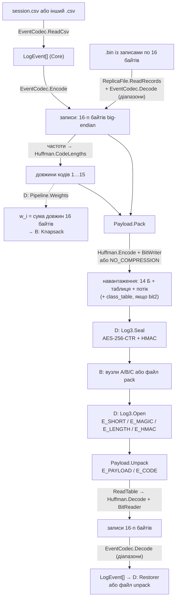

# Зона A — Compression & Format (`sergeymal1`)

Посібник для захисту. Тут розібрано кожен файл твоєї зони: що він робить, чому написаний саме так, які коди помилок дає і де це перевіряють тести. Наприкінці — питання, які найімовірніше поставлять, і живі «мікрозміни» з точними рядками. Загальна карта системи — у [README.md](README.md) цієї теки.

Номери рядків звірено з кодом станом на 19.11.2026. Якщо код зміниться, посилання можуть з'їхати на кілька рядків.

---

## 1. Коротко про зону

Твоя зона відповідає за все, що відбувається з подіями журналу **до шифрування і після розшифрування**. Подія з CSV перетворюється на рівно 16 байтів big-endian. Записи одного batch стискаються канонічним Гаффманом або, якщо стиснення не виграє, кладуться як є (режим NO_COMPRESSION). Із цього збирається відкрите навантаження репліки, яке зона D шифрує в LOG3. На зворотному шляху навантаження розбирається строго: будь-яке порушення формату дає код `E_PAYLOAD` або `E_CODE`, а не аварію і не хибні записи. Ще дві частини зони працюють з файлами: `pack`/`unpack` для обміну репліками з рецензентами і `check` для звірки з еталонними пакетами викладача.

| Файл | Призначення одним рядком |
|---|---|
| [src/SecureLog.Compression/EventCodec.cs](../../src/SecureLog.Compression/EventCodec.cs) | подія ↔ 16 байтів (розділ 1 специфікації), перевірка діапазонів полів, читання і запис CSV |
| [src/SecureLog.Compression/BitIO.cs](../../src/SecureLog.Compression/BitIO.cs) | побітовий запис і читання MSB-first, нульове доповнення, межа потоку |
| [src/SecureLog.Compression/Huffman.cs](../../src/SecureLog.Compression/Huffman.cs) | довжини кодів (дерево чергою з пріоритетами, обмеження 15), канонічні коди, перевірка Крафта, кодер, декодер |
| [src/SecureLog.Compression/Payload.cs](../../src/SecureLog.Compression/Payload.cs) | навантаження репліки (розділ 3): пакування з вибором NO_COMPRESSION і строгий розбір |
| [src/SecureLog.App/ReplicaFile.cs](../../src/SecureLog.App/ReplicaFile.cs) | команди `pack`/`unpack`: файл з однієї або кількох реплік поспіль |
| [src/SecureLog.App/Reference.cs](../../src/SecureLog.App/Reference.cs) | команда `check`: звірка з `reference/` (6 `ref_*`, 7 `bad_*`) |

Специфікація, яку реалізує зона, — виданий викладачем `FORMAT_SPEC_P3.md`, розділи 0, 1, 3, 3.1, 3.2, 3.3 і частина розділу 5 (коди `E_PAYLOAD`, `E_CODE`). У репозиторії її немає, вона лежить окремо.

---

## 2. Що входить у твою частину

Твої коміти (автор `sergeymal1`), згруповані за етапами.

**Етап 1. Базовий формат (31.10–03.11).**

- `5227183` (31.10) — прибрано шаблонний `Class1.cs`, у `SecureLog.Compression.csproj` додано посилання на `SecureLog.Core`. Відтоді зона A залежить лише від ядра (`LogEvent`, `ReplicaException`) і не знає про інші зони.
- `48e537a` (02.11) — `BitIO.cs`: райтер і рідер бітів, рідер перевіряє вихід за межу потоку.
- `4237586` (02.11) — `Huffman.cs`: канонічні коди з обмеженням довжини 15.
- `2c6b226` (02.11) — `EventCodec.cs`: розбір CSV і двійковий запис 16 байтів.
- `fb3fd44` (03.11) — `Payload.cs`: пакування з фолбеком NO_COMPRESSION і таблицею класів.

**Етап 2. Тести (08.11–10.11).**

- `e415186` (08.11) — перша версія приймальних тестів C1 і власні замінні вектори в `reference/` (тоді еталонів викладача ще не було). 14.11 замінні вектори видалено, їх місце зайняли видані `ref_*`/`bad_*` ([decisions.md](../decisions.md), п. 1).
- `6e17335` (10.11) — юніт-тести `Huffman_*` і `Payload_*`.

**Етап 3. Інтеграція з матеріалами викладача (14.11).** 14.11 команда отримала еталонні пакети. Що з цього вийшло:

- `3d8ddca` — зайвий повний байт після потоку, обірваний потік і ненульове доповнення тепер дають `E_PAYLOAD`, а не `E_CODE`. **Чому:** еталонний `bad_07_extra_bitstream` очікує саме `E_PAYLOAD` (`reference/expected_failures.json`). Раніше специфікацію прочитали інакше. Логіка нового прочитання: це порушення інваріантів довжини навантаження, а не самої таблиці кодів ([decisions.md](../decisions.md), п. 1 і таблиця в п. 3).
- `8282c2e` — команда `check` (`Reference.cs` + підключення в `Program.cs`): записи, таблиця, коди, потік і очікувані коди помилок.
- `2a68d15` — `check` додатково збирає пакет нашим кодером і вимагає збігу **байт у байт**. Так доведено, що наш Гаффман будує ті самі довжини, що й генератор викладача, а не лише вміє читати його пакети.
- `c4c6ef3` — строгі діапазони полів запису за розділом 1 (`source_id` 1…4095, `category` ≤ 15, `severity` ≤ 7, `critical` ∈ {0, 1}, `record_flags` ≤ 3), порушення — `E_PAYLOAD`. У CSV `critical` тепер лише `0` або `1`. **Чому:** для перехресного оцінювання рецензент може записати в поле неможливе значення, і строгий розбір має це відхилити. Раніше перевірявся лише `critical`, а `ReadCsv` мовчки перетворював, наприклад, `7` на `false` ([decisions.md](../decisions.md), останній рядок таблиці в п. 3).

**Етап 4. Файли реплік для обміну (14.11).**

- `1781038` — `ReplicaFile.cs`: файл з однієї або кількох реплік поспіль. Команди `pack`/`unpack` у `Program.cs` підключено в зоні D (коміт `095cd8f`).
- `569e387` — тести round-trip і пошкоджень файлів реплік (`RoundTripTests.cs`).
- `87e6779` — **fix:** порожній вхід із `--raw` тепер дає NO_COMPRESSION. **Чому:** для порожнього входу умова вибору виглядала як `0 + 0 > 0 · (1 − 1)`, тобто `0 > 0` = false, і `pack --raw` писав режим Гаффмана з порожньою таблицею. Саме цей випадок перевіряє тест `RestoresRecordsByteForByte(0)` з попереднього коміту: з `raw = true` він вимагає `Compressed == false` ([RoundTripTests.cs:51](../../tests/SecureLog.Tests.Unit/RoundTripTests.cs#L51)), тож до виправлення він падав би. Виправлення — умова `minGain >= 1 ||` на початку ([Payload.cs:33](../../src/SecureLog.Compression/Payload.cs#L33)).

Тест обрізання файлу на межі реплік пізніше виправлено в зоні C (коміт `bfad0ab`). Що саме там перевіряється, розібрано в розділі 6.

---

## 3. Де твоя зона в системі

### 3.1. Шлях даних



Головне правило порядку: **спершу стиснути, потім зашифрувати**. Шифротекст AES-CTR виглядає як випадкові байти, і Гаффман лише додав би до нього таблицю (див. розділ 8, питання 5).

### 3.2. Хто викликає твій код

| Хто (зона) | Де | Що викликає | Навіщо |
|---|---|---|---|
| `Replica.Build` (D) | [Replica.cs:13-15](../../src/SecureLog.App/Replica.cs#L13) | `EventCodec.Encode` → `Payload.Pack(…, minGain, classTable)` → `Log3.Seal` | репліка одного batch у конвеєрі; `minGain` приходить з параметрів ГА ([Pipeline.cs:108](../../src/SecureLog.App/Pipeline.cs#L108)) |
| `Replica.Open` (D) | [Replica.cs:18-19](../../src/SecureLog.App/Replica.cs#L18) | `Log3.Open` → `Payload.Unpack` → `EventCodec.Decode` | читання однієї репліки; так читають `Restorer`, `check` для `bad_*`, вебконсоль ([Web/Program.cs:119](../../src/SecureLog.Web/Program.cs#L119)) і тести |
| `Restorer.Restore` (D) | [Replica.cs:25-41](../../src/SecureLog.App/Replica.cs#L25) | через `Replica.Open`; ловить лише `ReplicaException` | твій `E_*` означає «копію відхилено», відновлення йде далі з інших вузлів |
| `Pipeline.Weights` (D) | [Pipeline.cs:148-160](../../src/SecureLog.App/Pipeline.cs#L148) | `EventCodec.Encode`, `Huffman.CodeLengths` | **міст до зони B:** вага `w_i` для рюкзака і розмір таблиці `2·nsym`, який резервується в batch ([Pipeline.cs:79](../../src/SecureLog.App/Pipeline.cs#L79)) |
| `Workspace.Csv` (D) | [Workspace.cs:20](../../src/SecureLog.App/Workspace.cs#L20) | `EventCodec.ReadCsv` | `session.csv`, `train.csv`, `valid.csv` для `run`, `train`, тестів |
| `Report.Write`, таблиця 4 (D) | [Report.cs:68-75](../../src/SecureLog.App/Report.cs#L68) | `EventCodec.Encode`, `Payload.Pack(bytes)` і `Payload.Pack(bytes, -10)` | «стиснути → зашифрувати» проти «зашифрувати → стиснути» |
| `Attack.Demo` (D) | [Attack.cs:18-19](../../src/SecureLog.App/Attack.cs#L18) | `EventCodec.Encode` | відкритий текст для слабкого шифру і частоти навчального набору |
| CLI `Program` (D) | [Program.cs:97-114](../../src/SecureLog.App/Program.cs#L97), [142-150](../../src/SecureLog.App/Program.cs#L142) | `ReplicaFile.ReadRecords/Pack/Unpack/WriteRecords`, `Reference.Check` | команди `pack`, `unpack`, `check`; друк `ВІДХИЛЕНО E_…` і коди виходу |

### 3.3. Чий код викликаєш ти

| Твій код | Що використовує | Звідки |
|---|---|---|
| усі файли зони | `ReplicaException(code, message)` з властивостями `Code` і `Detail`; константи `ErrorCode.Payload` = `"E_PAYLOAD"`, `ErrorCode.Code` = `"E_CODE"` | [Core/ReplicaException.cs](../../src/SecureLog.Core/ReplicaException.cs) |
| `EventCodec` | `LogEvent(uint Time, ushort Source, ushort Code, int Metric, byte Category, byte Severity, bool Critical, byte Flags)` — `readonly record struct` | [Core/LogEvent.cs:7-8](../../src/SecureLog.Core/LogEvent.cs#L7) |
| `ReplicaFile.Pack` | `Crypto.SaltSize`, `Crypto.DeriveKeys`, `Log3.Seal` | зона D |
| `ReplicaFile.Unpack` | `KeyRing`, `Log3.Open`, `Log3.HeaderSize`, `Log3.Overhead`, `Log3.LengthOffset` | зона D |
| `Reference` | `KeyRing`, `Log3.Open`, `Log3.Seal(…, fixedNonce)`, `Replica.Open` | зона D |

Що важливо знати про ці типи:

- `LogEvent` — структура-запис із порівнянням за значенням. Тому `Restorer` зливає копії з різних вузлів звичайним `HashSet<LogEvent>`: однакові 8 полів — це однакові 16 байтів. Поле `Critical` має тип `bool`, тому байт 14, рівний 2…255, не можна зберегти без втрат. Саме тому `EventCodec.Decode` такий байт відхиляє.
- `ReplicaException` — окремий тип, щоб відновлювач ловив лише погані дані, а не помилки самої програми. `Message` = `"E_PAYLOAD: пояснення"`, `Detail` — лише пояснення. `ReplicaFile` використовує `Detail`, щоб дописати номер репліки, не дублюючи код. **Головний обов'язок твоєї зони перед D:** на будь-яких байтах кидати лише `ReplicaException`, ніколи `IndexOutOfRangeException` чи інше. Це перевіряє тест `BrokenPayloadWithValidHmacNeverCrashes`.
- `Log3.Overhead` = 43 + 32 = 75 байтів, `Replica.Overhead` = 75 + `Payload.FixedSize` (14) = 89 ([Replica.cs:11](../../src/SecureLog.App/Replica.cs#L11)). Порожня репліка `ref_02_empty.bin` має якраз 89 байтів.

---

## 4. Розбір коду по файлах

### 4.1. `EventCodec.cs` — запис журналу (розділ 1)

Константи: `RecordSize = 16` ([EventCodec.cs:13](../../src/SecureLog.Compression/EventCodec.cs#L13)), `CsvHeader` — порядок стовпців для запису CSV ([EventCodec.cs:14](../../src/SecureLog.Compression/EventCodec.cs#L14)).

**Розкладка запису** (FORMAT_SPEC, розділ 1; усі числа big-endian, розділ 0):

| Зсув | Розмір | Поле | Тип і діапазон |
|---:|---:|---|---|
| 0 | 4 | `timestamp_ms` | uint32, без обмежень |
| 4 | 2 | `source_id` | uint16, 1…4095 |
| 6 | 2 | `event_code` | uint16, без обмежень |
| 8 | 4 | `metric_value` | int32 (доповняльний код), без обмежень |
| 12 | 1 | `category` | 0…15 |
| 13 | 1 | `severity` | 0…7 |
| 14 | 1 | `critical` | 0 або 1 |
| 15 | 1 | `record_flags` | 0…3 |

#### `Encode(IReadOnlyList<LogEvent>)` — [EventCodec.cs:16-33](../../src/SecureLog.Compression/EventCodec.cs#L16)

Виділяє `n·16` байтів і для кожної події пише поля в зріз `s` з 16 байтів:

```csharp
BinaryPrimitives.WriteUInt32BigEndian(s, e.Time);
BinaryPrimitives.WriteUInt16BigEndian(s[4..], e.Source);
...
s[14] = (byte)(e.Critical ? 1 : 0);
```

`BinaryPrimitives.*BigEndian` пише старший байт першим незалежно від процесора (x86 сам по собі little-endian). Діапазони `Encode` не перевіряє: він довіряє `LogEvent`. Перевірка стоїть на вході (`ReadRecords`) і на виході (`Decode`).

**Приклад — перший запис `data/session.csv`:** `1373,106,122,3429,15,1,1,3`.

| Поле | Значення | Байти (hex) |
|---|---|---|
| `timestamp_ms` | 1373 = 0x55D | `00 00 05 5D` |
| `source_id` | 106 = 0x6A | `00 6A` |
| `event_code` | 122 = 0x7A | `00 7A` |
| `metric_value` | 3429 = 0xD65 | `00 00 0D 65` |
| `category` | 15 | `0F` |
| `severity` | 1 | `01` |
| `critical` | 1 | `01` |
| `record_flags` | 3 | `03` |

Разом `0000055D 006A 007A 00000D65 0F 01 01 03`. Те саме показує `xxd data/session.bin | head -1`:

```text
00000000: 0000 055d 006a 007a 0000 0d65 0f01 0103  ...].j.z...e....
```

Від'ємний показник пишеться в доповняльному коді: найменший у сесії `metric_value = −2637` дає `FF FF F5 B3` (2³² − 2637 = 0xFFFFF5B3). Тест `C12` перевіряє, що `Encode` усієї сесії збігається з виданим `session.bin` байт у байт ([C1Tests.cs:210](../../tests/SecureLog.Tests.C1/C1Tests.cs#L210)).

#### `Decode(ReadOnlySpan<byte>)` — [EventCodec.cs:36-58](../../src/SecureLog.Compression/EventCodec.cs#L36)

1. Довжина не кратна 16 → `E_PAYLOAD` ([рядок 38](../../src/SecureLog.Compression/EventCodec.cs#L38)). З репліки сюди така довжина не дійде, бо раніше її відсіче інваріант `symbol_count = 16 × record_count`. Тож це захисна перевірка для прямих викликів.
2. Для кожного запису ланцюжок тернарних операторів шукає перше порушене поле ([рядки 43-48](../../src/SecureLog.Compression/EventCodec.cs#L43)):

   ```csharp
   string? bad = BinaryPrimitives.ReadUInt16BigEndian(s[4..]) is 0 or > 4095 ? "source_id поза 1…4095"
       : s[12] > 15 ? "category поза 0…15"
       : s[13] > 7 ? "severity поза 0…7"
       : s[14] > 1 ? "critical не 0 і не 1"
       : s[15] > 3 ? "record_flags поза 0…3"
       : null;
   ```

   Порядок перевірки: `source_id`, `category`, `severity`, `critical`, `record_flags`. Якщо порушено одразу кілька полів, у повідомленні буде перше. Номер запису `i` рахується з нуля.
3. Порушення → `E_PAYLOAD` «запис i: …» ([рядок 49](../../src/SecureLog.Compression/EventCodec.cs#L49)).
4. Інакше збирається `LogEvent`, `critical` = `s[14] == 1`.

Хто викликає `Decode`: `Replica.Open` (D), `ReplicaFile.Unpack` (лише для перевірки, результат відкидається, [ReplicaFile.cs:100](../../src/SecureLog.App/ReplicaFile.cs#L100)), `ReplicaFile.ReadRecords` (перевірка входу `pack`), `ReplicaFile.WriteRecords` (вихід у CSV), `Reference.Compare`.

Приклад з README: 16 байтів `A` (0x41) дають `source_id = 0x4141 = 16705 > 4095`. `pack` відповідає: `помилка: вхід не відповідає FORMAT_SPEC_P3, розділ 1: запис 0: source_id поза 1…4095` і завершується з кодом 2.

#### `ReadCsv(string path)` — [EventCodec.cs:61-86](../../src/SecureLog.Compression/EventCodec.cs#L61)

- Порожній файл → порожні масиви ([рядок 66](../../src/SecureLog.Compression/EventCodec.cs#L66)).
- Заголовок розбирається в словник «назва → індекс стовпця» ([рядок 68](../../src/SecureLog.Compression/EventCodec.cs#L68)). Тому порядок стовпців не важливий, а зайві стовпці, зокрема `label`, не заважають.
- Порожні рядки пропускаються ([рядок 72](../../src/SecureLog.Compression/EventCodec.cs#L72)). Числа розбираються з `CultureInfo.InvariantCulture`.
- `critical` — лише `"0"` або `"1"`, інакше `FormatException` ([рядок 81](../../src/SecureLog.Compression/EventCodec.cs#L81)). До коміту `c4c6ef3` тут стояло `== "1"`, і будь-яке інше значення мовчки ставало `false`.
- `label` повертається окремим масивом, якщо стовпця немає — `−1` ([рядок 83](../../src/SecureLog.Compression/EventCodec.cs#L83)).

Діапазони тут перевіряють лише самі типи: `byte.Parse("300")` дає `OverflowException`, а `ushort` не прийме `70000`. Решту (`source_id = 0`, `category = 20`) ловить `EventCodec.Decode`, який викликає `ReplicaFile.ReadRecords`. Відсутній стовпець дає `KeyNotFoundException`, короткий рядок — `IndexOutOfRangeException`. `ReplicaFile` перетворює ці винятки на `InvalidDataException` ([ReplicaFile.cs:32-35](../../src/SecureLog.App/ReplicaFile.cs#L32)).

#### `WriteCsv(…)` — [EventCodec.cs:88-99](../../src/SecureLog.Compression/EventCodec.cs#L88)

Заголовок, за потреби `,label`, далі рядки. `string.Create(inv, $"…")` форматує з інваріантною культурою, тож роздільник і знак мінуса не залежать від мови Windows. Викликається з `unpack`, якщо вихідний файл має розширення `.csv`.

---

### 4.2. `BitIO.cs` — біти MSB-first (розділи 0 і 3.2)

#### `BitWriter` — [BitIO.cs:6-30](../../src/SecureLog.Compression/BitIO.cs#L6)

Стан: список готових байтів `_bytes`, акумулятор `_acc` і лічильник бітів у ньому `_count` ([рядки 8-9](../../src/SecureLog.Compression/BitIO.cs#L8)).

`Write(uint code, int length)` ([рядки 11-22](../../src/SecureLog.Compression/BitIO.cs#L11)) бере біти коду від старшого до молодшого (`i` від `length − 1` до 0), зсуває кожен в акумулятор, а після восьми бітів скидає байт:

```csharp
_acc = (_acc << 1) | (int)((code >> i) & 1);
if (++_count == 8) { _bytes.Add((byte)_acc); _acc = _count = 0; }
```

`ToArray()` ([рядки 24-29](../../src/SecureLog.Compression/BitIO.cs#L24)): якщо в акумуляторі лишилися біти, вони зсуваються вліво на `8 − _count`, тобто доповнюються **нулями справа** (розділ 3.2: «padding останнього байта нульовий»). Метод копіює список і стан не змінює.

Приклад (перевірено запуском): `Write(0b101, 3)`, `Write(0b1, 1)`, `Write(0b11, 2)` дають біти `101111`, доповнені до `10111100` = `0xBC`.

#### `BitReader` — [BitIO.cs:33-48](../../src/SecureLog.Compression/BitIO.cs#L33)

`ref struct` над `ReadOnlySpan<byte>`: дані не копіюються, і структура не може потрапити в купу. `Position` рахує прочитані біти.

`ReadBit()` ([рядки 40-47](../../src/SecureLog.Compression/BitIO.cs#L40)):

- `Position >= _data.Length * 8` → `E_PAYLOAD` «бітовий потік закінчився раніше, ніж очікувалось» ([рядок 43](../../src/SecureLog.Compression/BitIO.cs#L43)). Тут саме `E_PAYLOAD`: `bitstream_len` замалий для `symbol_count` символів, тобто порушено інваріант довжини навантаження. До 14.11 тут було `E_CODE`.
- Біт: байт `Position >> 3` (ділення на 8), біт `7 − (Position & 7)` у ньому, тобто від старшого.

---

### 4.3. `Huffman.cs` — канонічний Гаффман (розділ 3.2)

`MaxLength = 15` ([Huffman.cs:11](../../src/SecureLog.Compression/Huffman.cs#L11)) — найбільша довжина коду за специфікацією. Від цієї константи залежать обмеження в `CodeLengths`, розміри масивів у `CanonicalCodes`, одиниці суми Крафта у `Validate`, межа циклу в `Decode` і перевірка таблиці в `Payload.ReadTable`.

Ідея канонічного Гаффмана: у навантаження йдуть **лише довжини кодів**, а самі коди кодер і декодер незалежно виводять із довжин тим самим алгоритмом.

#### `CodeLengths(int[] freq)` — [Huffman.cs:14-26](../../src/SecureLog.Compression/Huffman.cs#L14)

На вході 256 частот байтів, на виході 256 довжин (0 — символу немає).

1. `freq` клонується, щоб не зіпсувати масив того, хто викликає ([рядок 16](../../src/SecureLog.Compression/Huffman.cs#L16)).
2. `TreeDepths(freq)` будує звичайне дерево Гаффмана.
3. Якщо найбільша глибина ≤ 15 — результат готовий ([рядок 20](../../src/SecureLog.Compression/Huffman.cs#L20)).
4. Інакше кожна ненульова частота ділиться навпіл з округленням угору, `(f + 1) / 2` ([рядки 23-24](../../src/SecureLog.Compression/Huffman.cs#L23)), і дерево будується знову.

Чому з округленням угору: ненульова частота лишається ≥ 1, тож жоден символ не зникає з алфавіту. Специфікація забороняє зливати символи. Чому цикл скінченний: частоти зменшуються, доки всі не стануть 1. Для рівних частот дерево збалансоване, і 256 символів дають глибину 8 ≤ 15.

Коментар `shortcut:` ([рядки 21-22](../../src/SecureLog.Compression/Huffman.cs#L21)) чесно визнає компроміс: дерево лишається повним (Крафт = 1), але **не оптимальним** серед кодів з обмеженою довжиною. Оптимальний метод — package-merge. Код довжини 16 потребує щонайменше 2584 байтів у блоці, а batch конвеєра обмежений 1024 байтами, тож у конвеєрі такого не буває ([decisions.md](../decisions.md), п. 4).

**Приклад** (тест `Huffman_LimitsCodeLengthTo15AndKeepsTreeComplete`, перевірено запуском): частоти Фібоначчі 1, 1, 2, 3, 5, …, 75025 для 25 символів дають «драбину» глибиною 24. Після **одного** ділення частоти стають 1, 1, 1, 2, 3, …, 37513, глибина падає до 13, і довжини виходять такі: 13, 13, 12, 12, 12, 11, 11, 10, 10, 9, 9, 8, 8, 7, 7, 6, 6, 5, 5, 4, 4, 3, 3, 2, 2.

#### `TreeDepths(int[] freq)` (private) — [Huffman.cs:29-61](../../src/SecureLog.Compression/Huffman.cs#L29)

```csharp
var queue = new PriorityQueue<int, (long Freq, int Id)>();
```

`PriorityQueue` у .NET — мін-купа. Пріоритет — кортеж `(частота, номер вузла)`: кортежі порівнюються спершу за частотою, а за рівної частоти за номером. Отже, за рівних частот першим виходить **старший вузол**, тобто з меншим номером.

1. Листки отримують номери 0, 1, 2, … у порядку зростання символу ([рядки 35-41](../../src/SecureLog.Compression/Huffman.cs#L35)). `symbol[v]` — символ листка `v`, `parent[v]` — батько, спершу −1.
2. **Вироджений алфавіт** ([рядки 42-46](../../src/SecureLog.Compression/Huffman.cs#L42)): якщо символ один, дерево з одного листка дало б довжину 0, тобто нуль бітів на символ. Специфікація вимагає довжину 1 і код `0`.
3. Злиття ([рядки 47-55](../../src/SecureLog.Compression/Huffman.cs#L47)): дістати два найменші `a`, `b`, створити вузол з номером `parent.Count`, записати `parent[a] = parent[b] = id` і покласти його в чергу з сумою частот.
4. Глибини ([рядки 57-58](../../src/SecureLog.Compression/Huffman.cs#L57)): кожен батько створюється пізніше за дітей, тож має більший номер. Корінь — останній вузол з глибиною 0. Ідучи від `parent.Count − 2` вниз, глибину батька вже пораховано: `depth[v] = depth[parent[v]] + 1`.
5. Довжина символу — глибина його листка ([рядок 59](../../src/SecureLog.Compression/Huffman.cs#L59)).

Порожній вхід (усі частоти 0) нічого не кладе в чергу, і всі довжини лишаються 0. Складність — O(k log k) для k ≤ 256 різних символів, плюс O(N) на підрахунок частот.

**Чому правило рівних частот важливе.** Різні правила дають різні, але однаково оптимальні дерева. Таблиця й потік тоді відрізнятимуться, хоча декодувати все одно можна: довжини ж передаються. Зі збереженим правилом `(Freq, Id)` наш кодер збирає всі 6 `ref_*` байт у байт. Перевірено: якщо перевернути правило на `(Freq, −Id)`, усі юніт-тести проходять, але `check` дає «наш кодер дав інше навантаження» для `ref_01` і `ref_06`, і падає `C12` (розділ 9, зміна 8).

#### `CanonicalCodes(byte[] lengths)` — [Huffman.cs:64-82](../../src/SecureLog.Compression/Huffman.cs#L64)

Стандартний алгоритм DEFLATE (RFC 1951, §3.2.2):

```csharp
for (int bits = 1; bits <= MaxLength; bits++)
{
    code = (code + blCount[bits - 1]) << 1;
    nextCode[bits] = code;
}
...
if (lengths[s] > 0) codes[s] = nextCode[lengths[s]]++;
```

1. `blCount[l]` — скільки символів мають довжину `l` ([рядки 66-68](../../src/SecureLog.Compression/Huffman.cs#L66)). `blCount[0]` завжди 0, бо нульові довжини пропускаються.
2. `nextCode[l]` — перший код довжини `l`: попередній перший код плюс кількість кодів попередньої довжини, зсунуто на біт вліво ([рядки 70-76](../../src/SecureLog.Compression/Huffman.cs#L70)).
3. Символи обходяться **за зростанням**, і кожен отримує черговий код своєї довжини ([рядки 78-81](../../src/SecureLog.Compression/Huffman.cs#L78)).

Властивості результату: коди однієї довжини йдуть підряд і впорядковані за символом, а коротші коди числово менші за префікси довших. На цьому тримається декодер.

**Приклад 1** (тест `C04`, перевірено запуском): довжини a=1, b=2, c=3, d=3.

| `bits` | `blCount[bits−1]` | `nextCode[bits]` | Кому призначено |
|---|---|---|---|
| 1 | 0 | (0 + 0) << 1 = 0 | a = `0` |
| 2 | 1 | (0 + 1) << 1 = 2 | b = `10` |
| 3 | 1 | (2 + 1) << 1 = 6 | c = `110`, d = `111` |

**Приклад 2** (`ref_01_single_record`): довжини: символ 0 — 1; символи 1, 2, 3, 9, 101, 120, 196, 232 — 4. Тоді `nextCode[1] = 0`, `nextCode[2] = 2`, `nextCode[3] = 4`, `nextCode[4] = 8` = `1000`. Коди: 0 → `0`, 1 → `1000`, 2 → `1001`, 3 → `1010`, 9 → `1011`, 101 → `1100`, 120 → `1101`, 196 → `1110`, 232 → `1111`. Це в точності `таблиця_кодів` з `ref_01_single_record.json`, і `check` звіряє це для кожного `ref_*` ([Reference.cs:95-97](../../src/SecureLog.App/Reference.cs#L95)).

#### `Validate(byte[] lengths)` — [Huffman.cs:85-98](../../src/SecureLog.Compression/Huffman.cs#L85)

Нерівність Крафта: префіксний код з довжинами lᵢ існує тоді й лише тоді, коли Σ 2^(−lᵢ) ≤ 1. Дерево **повне** (немає «порожніх» гілок), коли сума дорівнює рівно 1. Специфікація вимагає рівності для двох і більше символів.

Щоб не мати похибок дробів, сума рахується цілими числами **в одиницях 2⁻¹⁵**: довжина `l` додає `2^(15 − l)`, а одиниця дорівнює `2^15 = 32768`:

```csharp
kraft += 1L << (MaxLength - length);
...
long required = used == 1 ? 1L << (MaxLength - 1) : 1L << MaxLength;
```

- Довжина > 15 → `E_CODE` ([рядок 92](../../src/SecureLog.Compression/Huffman.cs#L92)). Це захисна перевірка, бо `ReadTable` уже відсікає такі довжини.
- Один символ: потрібно рівно `2^14` (тобто ½), а це можливо лише з довжиною 1.
- Два і більше: потрібно рівно `2^15`.
- Порожня таблиця (`used = 0`) не перевіряється: порожня репліка законна.
- Невідповідність → `E_CODE` «довжини кодів не задають повне префіксне дерево» ([рядок 97](../../src/SecureLog.Compression/Huffman.cs#L97)).

| Набір довжин | Сума в одиницях 2⁻¹⁵ | Результат |
|---|---|---|
| 1, 2, 3, 3 | 16384 + 8192 + 4096 + 4096 = 32768 | OK |
| `ref_01`: 1 + вісім по 4 | 16384 + 8 · 2048 = 32768 | OK |
| `bad_06_kraft`: два символи (0x00, 0x01) по 2 | 8192 + 8192 = 16384 (½) | `E_CODE` |
| один символ з довжиною 2 | 8192 ≠ 16384 | `E_CODE` |
| у «abracadabra» довжину `a` збільшено на 1 | < 32768 | `E_CODE` (неповне дерево) |
| додано `z` з довжиною 1 | > 32768 | `E_CODE` (такого коду не існує) |

Розшифроване навантаження `bad_06_kraft.bin` (перевірено запуском): `0001 00 00 0002 | 00 02 01 02 | 00000010 | 00000004 | 55555555`. Це 1 запис, таблиця {0x00: 2, 0x01: 2} і потік `01010101…`. Потік декодувався б, але таблиця описує лише половину дерева.

#### `Encode(data, lengths)` — [Huffman.cs:100-106](../../src/SecureLog.Compression/Huffman.cs#L100)

Будує канонічні коди і пише код кожного байта через `BitWriter`. Символ із довжиною 0 записався б як нуль бітів, тобто мовчки зник би. Це безпечно лише тому, що `Payload.Pack` завжди будує довжини з тих самих даних ([Payload.cs:26-30](../../src/SecureLog.Compression/Payload.cs#L26)).

**Приклад потоку (`ref_01`).** Запис `1000, 101, 120, 2500, 2, 1, 1, 0` → байти `00 00 03 E8 00 65 00 78 00 00 09 C4 02 01 01 00`. Коди підряд:

```text
00→0  00→0  03→1010  E8→1111  00→0  65→1100  00→0  78→1101
00→0  00→0  09→1011  C4→1110  02→1001  01→1000  01→1000  00→0
```

Разом 7·1 + 9·4 = 43 біти. По 8: `00101011 11011000 11010010 11111010 01100010 000|00000` → `2B D8 D2 FA 62 00`. Останні 5 бітів — нульове доповнення. Це точно `bitstream_hex` з `ref_01_single_record.json`.

#### `Decode(lengths, bitstream, count)` — [Huffman.cs:109-142](../../src/SecureLog.Compression/Huffman.cs#L109)

Декодер працює без дерева, лише з трьома масивами:

1. `Validate(lengths)` — неможлива таблиця відсікається до читання потоку ([рядок 111](../../src/SecureLog.Compression/Huffman.cs#L111)).
2. `sorted` — символи в **канонічному порядку**: за довжиною, потім за символом ([рядок 112](../../src/SecureLog.Compression/Huffman.cs#L112)). `perLength[l]` — скільки кодів довжини `l` ([рядки 113-114](../../src/SecureLog.Compression/Huffman.cs#L113)).
3. Для кожного з `count` символів ([рядки 118-135](../../src/SecureLog.Compression/Huffman.cs#L118)):
   - `code` — прочитані біти, `first` — перший канонічний код поточної довжини, `index` — позиція цього першого коду в `sorted`;
   - дочитати біт: `code |= reader.ReadBit()`;
   - якщо `code − first < perLength[length]`, то `code` — один із кодів довжини `length`, і символ = `sorted[index + code − first]`;
   - інакше перейти до довжини `length + 1`: `index += perLength[length]`, `first = (first + perLength[length]) << 1`, `code <<= 1`. Це та сама рекурентність, що й `nextCode` у `CanonicalCodes`.
   - Якщо за 15 бітів код не знайдено → `E_CODE` «код відсутній у таблиці» ([рядок 134](../../src/SecureLog.Compression/Huffman.cs#L134)).
4. Після `count` символів ([рядки 138-140](../../src/SecureLog.Compression/Huffman.cs#L138)):
   - `(Position + 7) / 8` (спожиті байти з округленням угору) має дорівнювати довжині потоку. Інакше `E_PAYLOAD` «зайві байти після закодованих даних» — це випадок `bad_07`.
   - Біти до кінця поточного байта мають бути нулями, інакше `E_PAYLOAD` «ненульове доповнення».

**Покроковий приклад** (`ref_01`, читаємо код `1011`; перевірено запуском). `sorted = [0, 1, 2, 3, 9, 101, 120, 196, 232]`, `perLength[1] = 1`, `perLength[4] = 8`, решта 0.

| Довжина | Біт | `code` | `first` | `index` | `perLength` | `code − first` | Рішення |
|---|---|---|---|---|---|---|---|
| 1 | 1 | 1 | 0 | 0 | 1 | 1 | 1 ≥ 1 → далі; `index` = 1, `first` = (0 + 1) << 1 = 2, `code` = 2 |
| 2 | 0 | 2 | 2 | 1 | 0 | 0 | 0 ≥ 0 → далі; `first` = 4, `code` = 4 |
| 3 | 1 | 5 | 4 | 1 | 0 | 1 | далі; `first` = 8, `code` = 10 |
| 4 | 1 | 11 | 8 | 1 | 8 | 3 | 3 < 8 → `sorted[1 + 3]` = **9** |

Код `0` розпізнається одразу на довжині 1: `0 − 0 < 1` → `sorted[0]` = 0.

**Коли можливий «код відсутній у таблиці».** Якщо Крафт = 1, кожна послідовність бітів рано чи пізно потрапляє в якийсь код, тож після `Validate` ця помилка можлива лише у двох випадках. Перший — вироджений алфавіт: єдиний код `0`, а в потоці трапилась `1`. Другий — порожня таблиця при `count > 0`. Перевірено запуском: таблиця {0x01: 1}, потік `80 00`, `count` = 16 → `E_CODE`. Той самий потік лише з байтом `80` дає `E_PAYLOAD`, бо біти скінчилися раніше, ніж минуло 15 кроків.

Інші перевірені випадки для таблиці {0x01: 1}: потік `00`, `count` = 8 → вісім байтів `01`; потік `00 00`, `count` = 8 → `E_PAYLOAD` «зайві байти».

Складність декодування — O(кількість бітів), щонайбільше 15 кроків на символ.

---

### 4.4. `Payload.cs` — навантаження репліки (розділи 3, 3.1, 3.3)

Константи ([Payload.cs:12-14](../../src/SecureLog.Compression/Payload.cs#L12)):

```csharp
public const int FixedSize = 14;
public const byte ClassTable = 0x04, NoCompression = 0x08;
private const byte Extensions = 0x03, Reserved = 0xF0;   // PREDICTION і MULTI_COPY_META не підтримуються
```

`FixedSize = 14` = 2 (`record_count`) + 1 (`flags`) + 1 (`reserved`) + 2 (`table_nsym`) + 4 (`symbol_count`) + 4 (`bitstream_len`).

**Розкладка** (n = `table_nsym`, B = `bitstream_len`):

| Зсув | Розмір | Поле |
|---:|---:|---|
| 0 | 2 | `record_count` (u16) |
| 2 | 1 | `flags`: bit0 PREDICTION, bit1 MULTI_COPY_META, bit2 CLASS_TABLE, bit3 NO_COMPRESSION, bits 4–7 = 0 |
| 3 | 1 | `reserved` = 0 |
| 4 | 2 | `table_nsym` (u16: 256 символів у байт не вміщуються) |
| 6 | 2n | `table`: пари (символ, довжина) за зростанням символу |
| 6 + 2n | 4 | `symbol_count` = 16 × `record_count` |
| 10 + 2n | 4 | `bitstream_len` |
| 14 + 2n | B | `bitstream` |
| 14 + 2n + B | `record_count` | `class_table`, лише якщо bit2 |

**Приклад — навантаження `ref_01` (38 байтів, перевірено запуском):**

```text
00 01 | 00 | 00 | 00 09 | 00 01 01 04 02 04 03 04 09 04 65 04 78 04 C4 04 E8 04 | 00 00 00 10 | 00 00 00 06 | 2B D8 D2 FA 62 00
rc=1   flags res  nsym=9  таблиця 18 Б: (0,1) (1,4) (2,4) (3,4) (9,4) (101,4) ...   sym=16        len=6         потік
```

14 + 18 + 6 = 38, і `довжина_шифротексту` в `ref_01_single_record.json` теж 38 (CTR не змінює довжину). Репліка: 43 + 38 + 32 = 113 байтів.

#### `Pack(records, minGain = 0, classTable = null)` — [Payload.cs:20-52](../../src/SecureLog.Compression/Payload.cs#L20)

1. Перевірки аргументів ([рядки 22-24](../../src/SecureLog.Compression/Payload.cs#L22)): довжина кратна 16, записів ≤ 65535, `classTable` — по байту на запис. Порушення → `ArgumentException`: це помилка того, хто викликає, а не погані дані, тому тут не `ReplicaException`.
2. Частоти → `Huffman.CodeLengths` → таблиця пар за зростанням символу ([рядок 29](../../src/SecureLog.Compression/Payload.cs#L29)) → `Huffman.Encode` ([рядки 26-30](../../src/SecureLog.Compression/Payload.cs#L26)).
3. Вибір режиму ([рядок 33](../../src/SecureLog.Compression/Payload.cs#L33)):

   ```csharp
   if (minGain >= 1 || table.Length + bitstream.Length > records.Length * (1 - minGain))
   ```

   Гаффман лишається, якщо таблиця разом із потоком займають не більше `(1 − minGain)` від сирих байтів. Порівнюються лише змінні частини, бо 14 обов'язкових байтів однакові в обох режимах. За рівності вибирається Гаффман.
   - `minGain = 0` (типово) — Гаффман, якщо він не довший за сирі байти;
   - `0 < minGain < 1` — Гаффман лише з виграшем щонайменше `minGain` (наприклад, 0.1 = 10 %); це ген ГА «поріг NO_COMPRESSION» (0…0.3), зараз `min_gain = 0` у `data/ga_params.json`;
   - `minGain ≥ 1` — завжди NO_COMPRESSION (`pack --raw`, тест C03). Умова `minGain >= 1 ||` з'явилася в коміті `87e6779` заради порожнього входу;
   - `minGain < 0` — Гаффман, навіть якщо він довший. `−10` використовують `check` (щоб повторити викладача, який пише Гаффмана завжди) і таблиця 4 звіту («Гаффман примусово»).
4. NO_COMPRESSION ([рядки 35-37](../../src/SecureLog.Compression/Payload.cs#L35)): прапорець 0x08, таблиця порожня (`table_nsym = 0`, як у `ref_05`), потік — сирі записи.
5. Запис полів ([рядки 40-50](../../src/SecureLog.Compression/Payload.cs#L40)). `reserved` (байт 3) не пишеться явно: новий масив уже заповнений нулями. `symbol_count` = `records.Length`, тобто рівно 16 × `record_count`.

| Вхід | Режим за `minGain = 0` | Навантаження |
|---|---|---|
| порожньо (0 записів) | Гаффман з порожньою таблицею, `flags = 0` (як `ref_02`) | 14 нульових байтів |
| порожньо, `minGain = 1` | NO_COMPRESSION | `00 00 08 00 00 00 00 00 00 00 00 00 00 00` |
| 1 запис `ref_01` | NO_COMPRESSION: 18 + 6 = 24 > 16 | 30 Б = 14 + 16 сирих |
| 1 запис `ref_01`, `minGain = −10` | Гаффман | 38 Б (як в еталоні) |
| 16 байтів `0x01` (`ref_03`) | Гаффман: 2 + 2 = 4 ≤ 16 | `0001 00 00 0001 0101 00000010 00000002 0000` (18 Б) |
| перші 48 записів сесії (= `ref_04`) | Гаффман: 246 + 398 = 644 ≤ 768 | 658 Б, 123 символи, найдовший код 10 біт |
| уся сесія, 1200 записів | Гаффман | 19200 → 11920 Б (256 символів, довжини 1…11) |

#### `Unpack(payload)` — [Payload.cs:55-89](../../src/SecureLog.Compression/Payload.cs#L55)

Строгий розбір, перевірки йдуть саме в такому порядку:

| № | Рядок | Перевірка | Код |
|---|---|---|---|
| 1 | [57](../../src/SecureLog.Compression/Payload.cs#L57) | довжина < 14 | `E_PAYLOAD` |
| 2 | [60](../../src/SecureLog.Compression/Payload.cs#L60) | `reserved ≠ 0` або встановлено біти 4–7 `flags` | `E_PAYLOAD` (`bad_05`) |
| 3 | [61](../../src/SecureLog.Compression/Payload.cs#L61) | біт 0 або 1 (`PREDICTION`, `MULTI_COPY_META`) — розширення не підтримуються | `E_PAYLOAD` (розділ 3.1: «невідоме розширення → E_PAYLOAD») |
| 4 | [64](../../src/SecureLog.Compression/Payload.cs#L64) | таблиця виходить за межі навантаження | `E_PAYLOAD` |
| 5 | [69](../../src/SecureLog.Compression/Payload.cs#L69) | `symbol_count ≠ 16 × record_count` | `E_PAYLOAD` |
| 6 | [72](../../src/SecureLog.Compression/Payload.cs#L72) | `14 + 2n + B (+ record_count, якщо bit2) ≠ довжина` — нічого зайвого й нічого не бракує | `E_PAYLOAD` |
| 7 | [78](../../src/SecureLog.Compression/Payload.cs#L78) | NO_COMPRESSION: `bitstream_len ≠ symbol_count` | `E_PAYLOAD` |
| 8 | [83](../../src/SecureLog.Compression/Payload.cs#L83) | Гаффман: `ReadTable` (порядок символів, довжини 1…15), далі `Huffman.Decode` (Крафт, коди, довжина потоку, доповнення) | `E_CODE` / `E_PAYLOAD` |
| 9 | [87](../../src/SecureLog.Compression/Payload.cs#L87) | значення в `class_table` > 2 (3…255 зарезервовано) | `E_PAYLOAD` |

Деталі, які варто пам'ятати:

- `symbol_count` і `bitstream_len` читаються в `long` ([рядки 67-68](../../src/SecureLog.Compression/Payload.cs#L67)): u32 може не вміститися в `int`, а сума на рядку 72 не повинна переповнитися. Приводити до `int` безпечно лише після перевірки 6.
- Перевірку 4 зроблено через `FixedSize + tableBytes`, і це якраз `pos + 8`. Тому читання `symbol_count` і `bitstream_len` ніколи не виходить за межі масиву.
- У режимі NO_COMPRESSION таблиця **не читається і не перевіряється** ([decisions.md](../decisions.md), п. 3: «під час читання таблиця в цьому режимі ігнорується»). Перевірено: навантаження NO_COMPRESSION з `table_nsym = 1` і довільною парою приймається.
- `class_table` — останні `record_count` байтів (`payload[^recordCount..]`, [рядок 86](../../src/SecureLog.Compression/Payload.cs#L86)).
- `Unpack` повертає сирі байти записів, а не `LogEvent`. Діапазони полів перевіряє наступний крок, `EventCodec.Decode`, у того, хто викликає (`Replica.Open`, `ReplicaFile.Unpack`).

#### `ReadTable(table)` (private) — [Payload.cs:92-103](../../src/SecureLog.Compression/Payload.cs#L92)

- символ не більший за попередній → `E_CODE` «символи таблиці не за зростанням» ([рядок 98](../../src/SecureLog.Compression/Payload.cs#L98)). Так само відсікаються дублікати;
- довжина 0 або > 15 → `E_CODE` ([рядок 99](../../src/SecureLog.Compression/Payload.cs#L99)).

`Bad(message)` ([рядок 105](../../src/SecureLog.Compression/Payload.cs#L105)) — скорочення для `new ReplicaException(ErrorCode.Payload, …)`.

**Межа між `E_PAYLOAD` і `E_CODE`.** `E_CODE` означає, що неможлива сама таблиця кодів (порядок, довжина, Крафт) або в потоці трапився код, якого в таблиці немає. `E_PAYLOAD` — порушено структуру чи інваріанти довжин навантаження: зарезервовані біти, розширення, `symbol_count`, загальна довжина, межа бітового потоку, доповнення, `class_table`, діапазони полів запису.

---

### 4.5. `ReplicaFile.cs` — `pack` / `unpack`

Це частина твоєї зони в `SecureLog.App`. Розбір аргументів командного рядка і друк результату — у `Program.cs` зони D: `PackFile` ([Program.cs:97-105](../../src/SecureLog.App/Program.cs#L97)) і `UnpackFile` ([Program.cs:107-114](../../src/SecureLog.App/Program.cs#L107)). `ReplicaException` там перетворюється на `ВІДХИЛЕНО <код>: …` і код виходу 1 ([Program.cs:19-24](../../src/SecureLog.App/Program.cs#L19)). `InvalidDataException`, `IOException`, `ArgumentException` і `FormatException` перетворюються на `помилка: …` і код виходу 2 ([Program.cs:25-29](../../src/SecureLog.App/Program.cs#L25)).

`MaxRecords = ushort.MaxValue` = 65535 ([ReplicaFile.cs:17](../../src/SecureLog.App/ReplicaFile.cs#L17)), бо `record_count` — u16. `Part(Records, Compressed, HasClassTable)` ([рядок 20](../../src/SecureLog.App/ReplicaFile.cs#L20)) — що прочитано з однієї репліки. `unpack` друкує з цього режими.

#### `ReadRecords(path)` — [ReplicaFile.cs:23-53](../../src/SecureLog.App/ReplicaFile.cs#L23)

1. `.csv` (без урахування регістру, `IsCsv`, [рядок 125](../../src/SecureLog.App/ReplicaFile.cs#L125)) → `ReadCsv` → `Encode`. Помилки розбору CSV перетворюються на `InvalidDataException("CSV не розібрано: …")` ([рядки 32-35](../../src/SecureLog.App/ReplicaFile.cs#L32)).
2. Інший файл → сирі байти.
3. Довжина не кратна 16 → `InvalidDataException` з поясненням ([рядки 42-43](../../src/SecureLog.App/ReplicaFile.cs#L42)).
4. `EventCodec.Decode` перевіряє діапазони. `ReplicaException` перетворюється на `InvalidDataException` з `e.Detail` ([рядки 44-51](../../src/SecureLog.App/ReplicaFile.cs#L44)).

Чому не `E_*`: це вхід `pack`, а не репліка. Коди `E_*` належать до приймання реплік (розділ 5), тому погані вхідні дані дають код виходу 2, а не 1.

#### `WriteRecords(path, records)` — [ReplicaFile.cs:56-60](../../src/SecureLog.App/ReplicaFile.cs#L56)

`.csv` → `WriteCsv(Decode(records))` без мітки. Інакше — сирі 16-байтові записи, щоб вихід можна було порівняти з входом через `cmp`.

#### `Pack(records, password, noCompression = false, maxRecords = MaxRecords)` — [ReplicaFile.cs:64-80](../../src/SecureLog.App/ReplicaFile.cs#L64)

1. Одна випадкова сіль на файл і **один** виклик PBKDF2 (100000 ітерацій — це повільно, [рядки 66-67](../../src/SecureLog.App/ReplicaFile.cs#L66)).
2. Записи ріжуться на шматки по `maxRecords`. Кожен шматок стає `Payload.Pack(шматок, noCompression ? 1 : 0)` → `Log3.Seal(keys, salt, 0, seq++, payload)`: `replica_group_id = 0`, `batch_seq` = номер репліки, nonce у кожної свій ([рядки 72-78](../../src/SecureLog.App/ReplicaFile.cs#L72)).
3. `do … while`, а не `while`: порожній вхід теж дає одну порожню репліку (89 байтів), як `ref_02_empty`.

Параметр `maxRecords` < 65535 потрібен лише тестам, щоб отримати кілька реплік з малої кількості записів.

#### `Unpack(file, KeyRing)` — [ReplicaFile.cs:88-112](../../src/SecureLog.App/ReplicaFile.cs#L88)

Цикл по репліках: `Boundary` визначає довжину поточної, далі `Log3.Open` (D, порядок приймання з розділу 5) → `Payload.Unpack` → `EventCodec.Decode` (лише перевірка) → записи дописуються в результат ([рядки 95-102](../../src/SecureLog.App/ReplicaFile.cs#L95)). Будь-який `ReplicaException` перекидається з тим самим кодом, але з поясненням «репліка N (байти a…b): …» ([рядки 104-108](../../src/SecureLog.App/ReplicaFile.cs#L104)). Вихід не повертається частково: або всі записи, або виняток. Перевантаження з паролем ([рядок 82](../../src/SecureLog.App/ReplicaFile.cs#L82)) створює `KeyRing`, який кешує ключі за сіллю, тож PBKDF2 знову виконується один раз на файл.

#### `Boundary(rest)` (private) — правило межі реплік, [ReplicaFile.cs:118-123](../../src/SecureLog.App/ReplicaFile.cs#L118)

```csharp
if (rest.Length < Log3.HeaderSize) return rest.Length;
long declared = Log3.Overhead + (long)BinaryPrimitives.ReadUInt32BigEndian(rest[Log3.LengthOffset..]);
return declared + 4 <= rest.Length && rest.Slice((int)declared, 4).SequenceEqual("LOG3"u8) ? (int)declared : rest.Length;
```

- Залишок коротший за заголовок → уся решта (далі `Log3.Open` дасть `E_SHORT`).
- `declared = 75 + ciphertext_len`. Межею він стає **лише тоді**, коли одразу за ним починається `LOG3`.
- Інакше вся решта файлу вважається однією реплікою, і `Log3.Open` перевіряє точну довжину. Зайві чи відсутні байти дають `E_LENGTH`, як для звичайного файлу з однією реплікою.

Навіщо умова з `LOG3`: якщо зіпсовано `ciphertext_len`, без неї файл розрізався б у випадковому місці, і помилка виникла б у «наступній репліці» з незрозумілим кодом. З умовою зіпсована довжина поводиться так само, як в одиночній репліці. `declared` має тип `long`, бо `ciphertext_len` = 0xFFFFFFFF не повинен переповнити `int`. Таке значення перевіряє тест `AnyCorruptionIsRejectedWithCode`.

**Приклад** (перевірено запуском): 30 записів сесії, `maxRecords = 10`. Виходять три репліки: байти 0…232, 233…474, 475…718, файл 719 байтів.

| Пошкодження | Результат |
|---|---|
| відрізано останній байт | `E_LENGTH: репліка 3 (байти 475…717)` |
| дописано байт `00` | `E_LENGTH: репліка 3 (байти 475…719)` |
| змінено біт посередині | `E_HMAC: репліка 2 (байти 233…474)` |
| обрізано рівно на 475 | повертаються перші 20 записів без помилки |

Останній рядок — задокументоване обмеження ([decisions.md](../decisions.md), «Файли реплік»): кількість реплік у файлі ніде не записано, тому обрізання точно на межі не виявляється. Повертається точний початок записів, хибних даних немає. Для файлу з однією реплікою такого випадку немає.

---

### 4.6. `Reference.cs` — команда `check` (розділ 6)

Підключення в CLI — `CheckReference` у `Program.cs` (D, [рядки 142-150](../../src/SecureLog.App/Program.cs#L142)). Він друкує `OK`/`ПОМИЛКА` для кожного файлу і `пройдено X з Y`, а за помилки ставить код виходу 1.

`Verdict(Name, Ok, Detail)` ([Reference.cs:16](../../src/SecureLog.App/Reference.cs#L16)) — результат для одного файлу.

#### `Check(dir, password)` — [Reference.cs:18-55](../../src/SecureLog.App/Reference.cs#L18)

1. Для кожного `ref_*.json` за алфавітом викликається `Compare(json, bin)`. `ReplicaException` перетворюється на вердикт «еталонний пакет відхилено: …» ([рядки 21-34](../../src/SecureLog.App/Reference.cs#L21)).
2. Якщо є `expected_failures.json`, то для кожного файлу з нього `Replica.Open(bin, KeyRing(password))`. Отриманий код порівнюється з `очікуваний_код` ([рядки 36-53](../../src/SecureLog.App/Reference.cs#L36)). Якщо пакет раптом прийнято, вердикт — «отримано прийнято».

`ref_*` відкриваються паролем з власного `.json` ([рядок 62](../../src/SecureLog.App/Reference.cs#L62)), `bad_*` — паролем із CLI (типово `algo2026` з конфігу).

#### `Compare(json, packet)` (private) — [Reference.cs:58-106](../../src/SecureLog.App/Reference.cs#L58)

Повертає `null`, якщо все збіглося, інакше опис першої розбіжності:

1. `Log3.Open` (D) → `Payload.Unpack` → `EventCodec.Decode` ([рядки 64-66](../../src/SecureLog.App/Reference.cs#L64)).
2. Записи збігаються з `записи` з `.json` ([рядки 67-71](../../src/SecureLog.App/Reference.cs#L67)).
3. `class_table` збігається, включно з `null` проти «є» ([рядки 72-74](../../src/SecureLog.App/Reference.cs#L72)).
4. `flags` і бітовий потік у hex ([рядки 77-82](../../src/SecureLog.App/Reference.cs#L77)).
5. Пари (символ, довжина) з навантаження = `таблиця_кодів` ([рядки 84-92](../../src/SecureLog.App/Reference.cs#L84)).
6. Канонічні коди, виведені **лише з довжин** (`CanonicalCodes`), дорівнюють рядкам `код` викладача ([рядки 95-97](../../src/SecureLog.App/Reference.cs#L95)).
7. **Наш передавач:** `Payload.Pack(записи, NO_COMPRESSION ? 1 : −10, class_table)` має дати те саме навантаження байт у байт ([рядки 100-101](../../src/SecureLog.App/Reference.cs#L100)). `−10` потрібне, бо викладач пише Гаффмана навіть тоді, коли він довший (`ref_01`: 24 байти проти 16).
8. `Log3.Seal` з тією самою сіллю і nonce з `.json` має відтворити весь пакет ([рядки 103-105](../../src/SecureLog.App/Reference.cs#L103)). Так заодно перевіряються AES-CTR і HMAC зони D.

Що містять еталони: `ref_01` — 1 запис, 9 символів; `ref_02` — порожньо; `ref_03` — 16 байтів `0x01`, одна пара (1, 1), потік `00 00`; `ref_04` — перші 48 записів сесії, 123 символи, довжини до 10; `ref_05` — перші 32 записи, `flags = 8`; `ref_06` — перші 32 записи, `flags = 4`, `class_table` з 32 байтів.

---

## 5. Коди помилок твоєї зони

Коди `E_SHORT`, `E_MAGIC`, `E_LENGTH` і `E_HMAC` дає зона D (`Log3.Open`) ще до твого коду. Ти маєш знати, що `bad_01`–`bad_04` відсіюються саме там, і зашифроване навантаження до `Payload.Unpack` взагалі не доходить.

| Умова | Код | Де в коді | Хто перевіряє |
|---|---|---|---|
| навантаження коротше за 14 байтів | `E_PAYLOAD` | [Payload.cs:57](../../src/SecureLog.Compression/Payload.cs#L57) | `Payload_RejectsBrokenInvariants` (`payload[..10]`), `BrokenPayloadWithValidHmacNeverCrashes` |
| `reserved ≠ 0` | `E_PAYLOAD` | [Payload.cs:60](../../src/SecureLog.Compression/Payload.cs#L60) | **`bad_05_reserved`**, `C11` (`reservedByte`) |
| біти 4–7 `flags` | `E_PAYLOAD` | [Payload.cs:60](../../src/SecureLog.Compression/Payload.cs#L60) | `C11` (`flags \|= 0x40`) |
| `PREDICTION` / `MULTI_COPY_META` | `E_PAYLOAD` | [Payload.cs:61](../../src/SecureLog.Compression/Payload.cs#L61) | `C11` (`flags \|= 0x01`) |
| таблиця за межами навантаження | `E_PAYLOAD` | [Payload.cs:64](../../src/SecureLog.Compression/Payload.cs#L64) | випадкові пошкодження в `BrokenPayload…` |
| `symbol_count ≠ 16 × record_count` | `E_PAYLOAD` | [Payload.cs:69](../../src/SecureLog.Compression/Payload.cs#L69) | `Payload_RejectsBrokenInvariants` (змінено `symbol_count`; змінено `record_count`) |
| сума довжин полів ≠ довжина навантаження | `E_PAYLOAD` | [Payload.cs:72](../../src/SecureLog.Compression/Payload.cs#L72) | `Payload_RejectsBrokenInvariants` (зайвий байт у кінці) |
| NO_COMPRESSION і `bitstream_len ≠ symbol_count` | `E_PAYLOAD` | [Payload.cs:78](../../src/SecureLog.Compression/Payload.cs#L78) | `BrokenPayload…` |
| `class_table` містить 3…255 | `E_PAYLOAD` | [Payload.cs:87](../../src/SecureLog.Compression/Payload.cs#L87) | `Payload_RejectsBrokenInvariants` (`classes[5] = 3`) |
| символи таблиці не за зростанням або повторюються | `E_CODE` | [Payload.cs:98](../../src/SecureLog.Compression/Payload.cs#L98) | `Payload_RejectsBrokenInvariants` (`With(8, payload[6])`) |
| довжина в таблиці 0 або > 15 | `E_CODE` | [Payload.cs:99](../../src/SecureLog.Compression/Payload.cs#L99) | `Payload_RejectsBrokenInvariants` (`With(7, 0)`) |
| сума Крафта ≠ 1 (або ≠ ½ для одного символу) | `E_CODE` | [Huffman.cs:97](../../src/SecureLog.Compression/Huffman.cs#L97) | **`bad_06_kraft`**, `Huffman_RejectsBadTablesAndBitstreams` (неповне, переповнене, один символ довжини 2) |
| довжина > 15 у `Validate` (захисна) | `E_CODE` | [Huffman.cs:92](../../src/SecureLog.Compression/Huffman.cs#L92) | прямого тесту немає: `ReadTable` відсікає раніше |
| за 15 бітів код не знайдено | `E_CODE` | [Huffman.cs:134](../../src/SecureLog.Compression/Huffman.cs#L134) | можливо лише для одного символу або порожньої таблиці (розділ 4.3) |
| бітовий потік закінчився раніше | `E_PAYLOAD` | [BitIO.cs:43](../../src/SecureLog.Compression/BitIO.cs#L43) | `Huffman_RejectsBadTablesAndBitstreams` (`bits[..^1]`) |
| зайвий повний байт після потоку | `E_PAYLOAD` | [Huffman.cs:138](../../src/SecureLog.Compression/Huffman.cs#L138) | **`bad_07_extra_bitstream`**, `Huffman_RejectsBadTablesAndBitstreams` (`[.. bits, 0]`) |
| ненульове доповнення останнього байта | `E_PAYLOAD` | [Huffman.cs:140](../../src/SecureLog.Compression/Huffman.cs#L140) | окремого тесту немає; зачіпається випадковими пошкодженнями в `BrokenPayload…` |
| довжина записів не кратна 16 | `E_PAYLOAD` | [EventCodec.cs:38](../../src/SecureLog.Compression/EventCodec.cs#L38) | захисна: з репліки неможлива через перевірку 5 |
| поле запису поза діапазоном розділу 1 | `E_PAYLOAD` | [EventCodec.cs:49](../../src/SecureLog.Compression/EventCodec.cs#L49) | для `pack` — `InputOutsideFormatIsRejectedWithMessage` (як `InvalidDataException`) |
| `ReplicaFile`: межа реплік не збігається | `E_LENGTH` (з `Log3.Open`, D) | [ReplicaFile.cs:118-123](../../src/SecureLog.App/ReplicaFile.cs#L118) | `AnyCorruptionIsRejectedWithCode` (зайвий байт, обрізання) |
| `ReplicaFile`: порожній файл | `E_SHORT` (D), «порожньо» | [ReplicaFile.cs:106](../../src/SecureLog.App/ReplicaFile.cs#L106) | `AnyCorruptionIsRejectedWithCode` (довжина 0) |

Реальний вивід на еталонах (`unpack`):

```text
ВІДХИЛЕНО E_PAYLOAD: репліка 1 (байти 0…732): зарезервовані поля не нульові. Вихідний файл не записано.
ВІДХИЛЕНО E_CODE: репліка 1 (байти 0…96): довжини кодів не задають повне префіксне дерево. Вихідний файл не записано.
ВІДХИЛЕНО E_PAYLOAD: репліка 1 (байти 0…208): зайві байти після закодованих даних. Вихідний файл не записано.
```

(`bad_05`, `bad_06`, `bad_07`; код виходу 1.)

---

## 6. Тести твоєї зони

### Юніт-тести ([UnitTests.cs](../../tests/SecureLog.Tests.Unit/UnitTests.cs))

- **`Huffman_RoundTripsSkewedRandomData`** ([рядок 27](../../tests/SecureLog.Tests.Unit/UnitTests.cs#L27)). 200 випадкових масивів довжиною 1…2999, розмір алфавіту випадковий, 1…256. Розподіл перекошений, бо байт береться як добуток двох випадкових. `Decode(Encode(x)) == x`. Перевіряє round-trip на алфавітах різного розміру й форми.
- **`Huffman_LimitsCodeLengthTo15AndKeepsTreeComplete`** ([рядок 40](../../tests/SecureLog.Tests.Unit/UnitTests.cs#L40)). Частоти Фібоначчі (найглибше дерево) → усі довжини ≤ `MaxLength`, `Validate` не кидає (Крафт = 1), round-trip працює. Цей тест навмисно вмикає згладжування частот: без нього довжини доходили б до 24.
- **`Huffman_RejectsBadTablesAndBitstreams`** ([рядок 55](../../tests/SecureLog.Tests.Unit/UnitTests.cs#L55)). Неповне дерево, переповнене дерево і один символ з довжиною 2 дають `E_CODE`. Зайвий байт і обірваний потік дають `E_PAYLOAD`. Тест фіксує межу між двома кодами.
- **`Payload_RejectsBrokenInvariants`** ([рядок 80](../../tests/SecureLog.Tests.Unit/UnitTests.cs#L80)). 20 записів сесії, Гаффман примусово. Нормальний round-trip, далі по одному пошкодженню: `symbol_count`, `record_count`, зайвий байт, обрізання до 10 байтів (усе `E_PAYLOAD`), довжина 0 і порушений порядок символів (`E_CODE`), `class_table` з двійками приймається, а з трійкою дає `E_PAYLOAD`.

### Round-trip і пошкодження файлів ([RoundTripTests.cs](../../tests/SecureLog.Tests.Unit/RoundTripTests.cs), увесь файл)

Генератори: `RandomRecords` ([рядок 18](../../tests/SecureLog.Tests.Unit/RoundTripTests.cs#L18)) дає випадкові записи з полями **в межах розділу 1**. Вони майже нестисні, тож зазвичай виходить NO_COMPRESSION. `SessionRecords` ([рядок 27](../../tests/SecureLog.Tests.Unit/RoundTripTests.cs#L27)) повторює записи сесії по колу, а в `Time` пише номер запису, щоб записи були різні. Вони добре стискаються.

- **`RestoresRecordsByteForByte(count)`** ([рядок 42](../../tests/SecureLog.Tests.Unit/RoundTripTests.cs#L42)) для 0, 1, 2, 48, 1200, 65535, 65536, 150000 записів. Обидва генератори, обидва режими. Записи відновлюються побайтово, кількість реплік = ⌈count / 65535⌉ (мінімум 1), з `raw` жодна репліка не стиснута. 65536 записів — це вже дві репліки, 150000 (2.4 МБ) — три. Тут же з `count = 0` перевіряється fix `87e6779`.
- **`SessionWindowIsCompressedByHuffman`** ([рядок 56](../../tests/SecureLog.Tests.Unit/RoundTripTests.cs#L56)). 48 записів сесії: файл менший за сирі записи, режим — Гаффман. Без цього тесту `pack` міг би завжди писати NO_COMPRESSION, і решта тестів цього б не помітила.
- **`SingleRepeatedByteUsesOneCodeOfLengthOne(1 | 1000)`** ([рядок 67](../../tests/SecureLog.Tests.Unit/RoundTripTests.cs#L67)). Лише байти `0x01`, як у `ref_03`: round-trip і режим Гаффмана.
- **`FilesAndCsvRoundTrip`** ([рядок 76](../../tests/SecureLog.Tests.Unit/RoundTripTests.cs#L76)). CSV з колонкою `label` → `ReadRecords` → `Pack` → файл → `Unpack` → `WriteRecords` у CSV → ті самі події. Перевіряє весь шлях `pack`/`unpack` через справжні файли.
- **`InputOutsideFormatIsRejectedWithMessage`** ([рядок 97](../../tests/SecureLog.Tests.Unit/RoundTripTests.cs#L97)). 15 байтів, 16 байтів `A`, `category = 16`, CSV з `critical = 7` — усе дає `InvalidDataException`, тобто `pack` відмовляє з поясненням (код виходу 2).
- **`AnyCorruptionIsRejectedWithCode`** ([рядок 124](../../tests/SecureLog.Tests.Unit/RoundTripTests.cs#L124)). Файл з трьох реплік (30 записів, по 10). Кожен змінений байт дає якийсь `ReplicaException`. Кожна довжина обрізання дає або `ReplicaException`, або, рівно на межі реплік, точний початок записів (виправлення зони C, `bfad0ab`). Зайвий байт у кінці дає `E_LENGTH`. `ciphertext_len` ∈ {0, 1, 0x7FFFFFFF, 0xFFFFFFFF} — виняток, а не аварія. Чужий пароль дає `E_HMAC`.
- **`BrokenPayloadWithValidHmacNeverCrashes`** ([рядок 166](../../tests/SecureLog.Tests.Unit/RoundTripTests.cs#L166)). 3000 випадково зіпсованих навантажень: 1–3 байти замінено, у чверті випадків ще й обрізано. Їх розбирають без HMAC, як навантаження, яке запечатав би власник пароля. Дозволено лише два результати: записи або `ReplicaException`. Будь-який інший виняток (`IndexOutOfRange`, `OverflowException` …) провалить тест. Це найважливіший тест на строгий розбір.

### Приймальні кейси C1 ([C1Tests.cs](../../tests/SecureLog.Tests.C1/C1Tests.cs))

- **`C01_SingleRecordIsRestoredByteForByte`** ([рядок 35](../../tests/SecureLog.Tests.C1/C1Tests.cs#L35)). Один запис = 16 байтів, після `Replica.Build` → `Replica.Open` ті самі 16 байтів.
- **`C02_EmptyLogDoesNotCrash`** ([рядок 44](../../tests/SecureLog.Tests.C1/C1Tests.cs#L44)). Порожнє навантаження, порожня репліка і повний прогін на порожньому журналі для трьох сценаріїв — без аварій, 0 подій.
- **`C03_NoCompressionRestoresRawRecordsExactly`** ([рядок 52](../../tests/SecureLog.Tests.C1/C1Tests.cs#L52)). `minGain = 1` дає прапорець 0x08, у кінці навантаження лежать сирі записи, репліка відновлюється. 4096 випадкових байтів самі обирають NO_COMPRESSION.
- **`C04_CanonicalCodesAreRestoredFromLengthsOnly`** ([рядок 68](../../tests/SecureLog.Tests.C1/C1Tests.cs#L68)). Довжини (1, 2, 3, 3) → коди `0`, `10`, `110`, `111`. Round-trip 500 записів сесії. Таблиця в навантаженні — лише пари (символ, довжина) за зростанням символу.
- **`C05_DegenerateAlphabetHasCodeLengthOne`** ([рядок 91](../../tests/SecureLog.Tests.C1/C1Tests.cs#L91)). 16 байтів `0x01`: режим Гаффмана, `table_nsym = 1`, пара `(0x01, 1)`, потік `00 00`, round-trip, зокрема через репліку.
- **`C12_ReferencePacketsAreReadAndRunFitsTimeLimit`** ([рядок 202](../../tests/SecureLog.Tests.C1/C1Tests.cs#L202)). `Reference.Check` повертає 13 вердиктів, усі OK. `Encode(session.csv)` = `session.bin`. Частина про ліміт часу прогону належить зоні D.

---

## 7. Як це запустити й показати

Усе — з кореня репозиторію, Release-збірка.

```bash
dotnet build -c Release

# юніт-тести Гаффмана і навантаження (4 тести); саме "UnitTests.Huffman_", бо просто "Huffman"
# зачепить ще й RoundTripTests.SessionWindowIsCompressedByHuffman
dotnet test -c Release --filter "FullyQualifiedName~UnitTests.Huffman_|FullyQualifiedName~UnitTests.Payload_"

# round-trip і пошкодження файлів реплік (15 тестів з урахуванням варіантів Theory)
dotnet test -c Release --filter "FullyQualifiedName~RoundTripTests"

# кейси C1 твоєї зони (6 тестів)
dotnet test -c Release --filter "FullyQualifiedName~C01|FullyQualifiedName~C02|FullyQualifiedName~C03|FullyQualifiedName~C04|FullyQualifiedName~C05|FullyQualifiedName~C12"
```

Вивід трьох команд (перевірено 19.11.2026, по рядку `Passed!` на кожну):

```text
Passed!  - Failed:     0, Passed:     4, Skipped:     0, Total:     4, Duration: 105 ms - SecureLog.Tests.Unit.dll (net10.0)
Passed!  - Failed:     0, Passed:    15, Skipped:     0, Total:    15, Duration: 2 s - SecureLog.Tests.Unit.dll (net10.0)
Passed!  - Failed:     0, Passed:     6, Skipped:     0, Total:     6, Duration: 1 s - SecureLog.Tests.C1.dll (net10.0)
```

Рядки `No test matches the given testcase filter …` для інших тестових проєктів (D1, а для перших двох команд і C1) — не помилка: там просто немає тестів, що підходять під фільтр. Усі 46 тестів: `dotnet test -c Release`.

**Звірка з еталонами:**

```bash
dotnet run -c Release --project src/SecureLog.App -- check
```

```text
ref_01_single_record         OK      записи, таблиця, коди й потік збігаються; наш передавач збирає той самий пакет байт у байт
...
ref_06_class_table           OK      записи, таблиця, коди й потік збігаються; наш передавач збирає той самий пакет байт у байт
bad_01_tampered_byte.bin     OK      очікувано E_HMAC, отримано E_HMAC
...
bad_05_reserved.bin          OK      очікувано E_PAYLOAD, отримано E_PAYLOAD
bad_06_kraft.bin             OK      очікувано E_CODE, отримано E_CODE
bad_07_extra_bitstream.bin   OK      очікувано E_PAYLOAD, отримано E_PAYLOAD
пройдено 13 з 13
```

**`pack` / `unpack`** (вихідні файли клади в тимчасову теку, а не в `data/`):

```bash
SL="dotnet run -c Release --project src/SecureLog.App --"
$SL pack data/session.bin /tmp/s.l3
#   data/session.bin: 1200 записів (19200 байтів) → /tmp/s.l3: 11995 байтів, реплік 1
$SL unpack /tmp/s.l3 /tmp/back.bin
#   OK: реплік 1 (Гаффман), записів 1200 (19200 байтів) → /tmp/back.bin
cmp data/session.bin /tmp/back.bin && echo SAME          # у Windows cmd: fc /b

$SL pack data/session.csv /tmp/r.l3 --raw
#   data/session.csv: 1200 записів (19200 байтів) → /tmp/r.l3: 19289 байтів, реплік 1
$SL unpack /tmp/r.l3 /tmp/back.csv
#   OK: реплік 1 (NO_COMPRESSION), записів 1200 (19200 байтів) → /tmp/back.csv

$SL unpack reference/bad_07_extra_bitstream.bin /tmp/x.bin    # код виходу 1
#   ВІДХИЛЕНО E_PAYLOAD: репліка 1 (байти 0…208): зайві байти після закодованих даних. Вихідний файл не записано.
```

Перевір розміри: 11995 = 75 (заголовок + HMAC) + 11920 (навантаження Гаффмана). 19289 = 75 + 14 + 19200 (NO_COMPRESSION). Порожній вхід із `--raw` дає репліку 89 байтів, `unpack` показує `NO_COMPRESSION`, записів 0.

`train`, `ga` і `report` не запускай: вони перезаписують `data/model.json`, `data/ga_params.json` і `docs/results/`.

---

## 8. Питання на захисті

**1. Чому код Гаффмана оптимальний серед префіксних кодів?**
Доведення обміном та індукцією. В оптимальному коді рідший символ має код не коротший за частіший. Два найдовші коди можна зробити братами на найглибшому рівні, і можна вважати, що це два найрідші символи (обмін їх не погіршує). Якщо злити їх в один символ з сумарною частотою, довжина коду зменшиться рівно на `f_a + f_b`, і задача зведеться до алфавіту з k − 1 символів. Гаффман робить саме це злиття жадібно на кожному кроці. Середня довжина L задовольняє H ≤ L < H + 1. Оптимальність діє лише серед кодів, що кодують кожен символ окремо цілою кількістю бітів. Арифметичне кодування може бути кращим.

**2. Навіщо зберігати лише довжини, а не коди чи дерево?**
За канонічного призначення коди однозначно визначаються довжинами і порядком символів. Пара (символ, довжина) займає 2 байти, і декодер відновлює ті самі коди тим самим алгоритмом `bl_count`/`next_code`. Серіалізація дерева була б довшою і давала б різні подання однієї таблиці. Тест `C04` і звірка кодів у `check` показують, що коди з довжин збігаються з кодами викладача.

**3. Що означає «сума Крафта = 1» і чому вона рахується в одиницях 2⁻¹⁵?**
Σ 2^(−lᵢ) ≤ 1 — необхідна і достатня умова існування префіксного коду з такими довжинами. Рівність означає, що дерево повне і немає послідовностей бітів, які нічого не означають. Якщо сума < 1, таблиця марнотратна, і частина потоку недекодовна (`bad_06`: сума ½). Якщо > 1, такого коду не існує. Довжини не перевищують 15, тому кожен доданок 2^(15 − l) — ціле число, і перевірка точна, без дробів.

**4. Що робити з алфавітом з одного символу?**
Дерево з одного листка дало б код довжини 0, і потік був би порожнім. Специфікація вимагає довжину 1 і код `0`: кожен символ займає 1 біт, 16 символів — 2 нульові байти (`ref_03`, `C05`). Сума Крафта тоді ½, і `Validate` для одного символу окремо вимагає саме ½ ([Huffman.cs:96](../../src/SecureLog.Compression/Huffman.cs#L96)).

**5. Чому зашифровані дані не стискаються, і чому порядок «стиснути → зашифрувати»?**
Вихід AES-CTR — псевдовипадкові байти з майже рівномірним розподілом, ентропія близько 8 біт на байт. Гаффман дає коди близько 8 біт плюс таблицю на 256 символів. Таблиця 4 звіту: сесія 19200 байтів стискається до 11920, а після шифрування примусовий Гаффман дає 19726 (= 19200 + 512 таблиця + 14), тож обирається NO_COMPRESSION, 19214. Стискати треба до шифрування.

**6. Навіщо NO_COMPRESSION?**
Таблиця коштує 2 байти на символ. Для малих batch або високоентропійних даних вона з'їдає весь виграш. Один запис `ref_01`: 18 байтів таблиці + 6 потоку = 24 проти 16 сирих. З NO_COMPRESSION навантаження ніколи не перевищує сирі записи + 14 байтів. Режим також є генним параметром ГА: поріг `minGain` вимагає мінімального виграшу.

**7. Яка складність?**
Підрахунок частот — O(N). Дерево — O(k log k) на купі, k ≤ 256, тобто фактично стала. Канонічні коди — O(256 + 15). Кодування — O(N). Декодування — O(кількість бітів) ≤ O(15·N). Пам'ять — O(k). Зважування вікна для ДП (`Pipeline.Weights`) — O(16·n) для вікна з n записів.

**8. Коли `E_PAYLOAD`, а коли `E_CODE`?**
`E_CODE` — неможлива сама таблиця кодів (порядок, довжина 0 або > 15, Крафт) або код, якого немає в таблиці (`bad_06`). `E_PAYLOAD` — порушені структура чи інваріанти довжин: зарезервовані поля, невідоме розширення, `symbol_count ≠ 16 × record_count`, довжини полів, межа потоку, доповнення, `class_table`, діапазони полів запису (`bad_05`, `bad_07`). Межу для зайвого байта задав еталон `bad_07`: до 14.11 у системі було `E_CODE`.

**9. Навіщо декодеру перевіряти зайві байти і нульове доповнення, якщо записи все одно правильні?**
Строгий розбір: одному набору записів відповідає рівно одне навантаження. Без перевірки до потоку можна було б дописати будь-що, і різні пакети давали б той самий результат. Ще це виявляє непослідовні поля довжин. Специфікація прямо вимагає «спожито рівно `bitstream_len` байтів … зайві повні байти заборонені».

**10. Як обмежено довжину коду і чому це не оптимально?**
Якщо дерево глибше за 15, частоти діляться навпіл з округленням угору, і дерево будується знову. Розподіл стає пласкішим, дерево лишається повним, жоден символ не зникає. Але це не оптимальний код з обмеженою довжиною: таким є package-merge. На практиці код довжини 16 потребує ≥ 2584 байтів у блоці, а batch ≤ 1024, тож у конвеєрі цей шлях не вмикається. У сесії з 19200 байтів найдовший код 11.

**11. Чому довжини кодів збігаються з генератором викладача?**
Однакові частоти дають кілька однаково оптимальних дерев, і вибір залежить від правила для рівних частот. У нас пріоритет `(частота, номер вузла)`, листки нумеруються за зростанням символу, а за рівності першим іде старший вузол. З цим правилом `check` збирає всі 6 `ref_*` байт у байт. Якщо правило змінити, `ref_01` і `ref_06` перестануть збігатися (розділ 9, зміна 8).

**12. Як декодер працює без дерева?**
Канонічні коди однієї довжини — суцільний діапазон від `first`, а `first` наступної довжини = `(first + кількість) << 1`. Декодер читає біт за бітом і на кожній довжині перевіряє, чи `code − first` менше за кількість кодів цієї довжини. Якщо так, символ — `sorted[index + code − first]`. Приклад з `ref_01` — у розділі 4.3.

**13. Що таке вага `w_i` і чому таблиця одна на вікно?**
За розділом 3.5 `w_i` — сума довжин кодів 16 байтів запису за **однією** таблицею Гаффмана на все вікно. Так ціна копії кожного запису відома до того, як ДП вирішить, які записи потраплять у batch. Рахує `Pipeline.Weights` (D) з твого `Huffman.CodeLengths`. Для перших 48 записів сесії `w_0` = 71 біт (проти 128 сирих), а ваги вікна — від 59 до 74, у середньому 66.3. Batch — підмножина вікна, тож його власна таблиця має не більше символів, а його власний Гаффман оптимальний саме для нього. Тому сума ваг плюс розмір таблиці вікна (`2·nsym`) — верхня межа розміру batch ([коментар у Pipeline.cs:77](../../src/SecureLog.App/Pipeline.cs#L77)). Фактичний розмір пакета `Pipeline` все одно перевіряє після `Replica.Build` і за потреби обрізає хвіст.

**14. Чому запис — рівно 16 байтів big-endian і чому немає номера запису?**
Так вимагає розділ 1. Ідентичність запису — його точні 16 байтів, а `timestamp_ms` у сесії унікальний. Тому відновлювач зливає копії з різних вузлів через `HashSet<LogEvent>` і сортує за часом. Big-endian — загальна угода формату (розділ 0), щоб репліки читалися на будь-якій платформі й іншими командами.

**15. Що буде, якщо в репліці зміниться один біт шифротексту?**
Твій код цього не побачить: `Log3.Open` (D) перевіряє HMAC до розшифрування і дає `E_HMAC` (`bad_01`). Строгий розбір навантаження потрібен для іншого: пакетів, які запечатав власник пароля, але з неправильним вмістом (`bad_05`–`bad_07`, тест `BrokenPayloadWithValidHmacNeverCrashes`).

---

## 9. Мікрозміни: що і де змінити

Кожну зміну нижче перевірено на окремій копії репозиторію: після неї запущено всі 46 тестів і `check`. Результати наведено як «що впаде». Справжній репозиторій не змінювався.

### Зміна 1. Найбільша довжина коду 15 → 12

**Де:** [Huffman.cs:11](../../src/SecureLog.Compression/Huffman.cs#L11), `public const int MaxLength = 15;` → `12`.

Що зміниться автоматично: обмеження в `CodeLengths` (рядок 20), розміри `blCount`/`nextCode` (рядки 66, 70), одиниці Крафта (2⁻¹² замість 2⁻¹⁵, рядки 94, 96), межа циклу декодера (рядок 122), перевірка таблиці в `Payload.ReadTable` ([Payload.cs:99](../../src/SecureLog.Compression/Payload.cs#L99)).

**Що впаде:** нічого. 46 з 46, `check` — 13 з 13: в еталонах найдовший код 10, у сесії 11. Тест `Huffman_LimitsCodeLengthTo15…` бере `Huffman.MaxLength` і сам підлаштовується, хоча його назва застаріє.

**Підводний камінь:** специфікація дозволяє довжини 1…15, і пакет іншої команди з кодом довжини 13 стане `E_CODE`, хоча він правильний. Якщо треба лише, щоб **наш кодер** не давав довших кодів, зроби окрему константу для кодера і використай її лише в `CodeLengths`:

```csharp
public const int MaxLength = 15;          // читання: як у специфікації
public const int EncodeMaxLength = 12;    // наш кодер
...
if (lengths.Max() <= EncodeMaxLength) return lengths;   // рядок 20
```

### Зміна 2. Поріг NO_COMPRESSION: Гаффман лише з виграшем ≥ 10 %

**Де для `pack`:** [ReplicaFile.cs:75](../../src/SecureLog.App/ReplicaFile.cs#L75), `noCompression ? 1 : 0` → `noCompression ? 1 : 0.1`.
**Де для конвеєра:** поріг береться з параметрів ГА (`options.P.MinGain`, [Pipeline.cs:108](../../src/SecureLog.App/Pipeline.cs#L108)). Без перезапуску `ga` його не змінити. Типове значення з конфігу — `NoCompressionMinGain` у [TeamConfig.cs:66](../../src/SecureLog.Core/TeamConfig.cs#L66) (файл ядра, зона D).
**Де для всіх викликів без аргументу:** типове значення параметра в [Payload.cs:20](../../src/SecureLog.Compression/Payload.cs#L20), `double minGain = 0`.

Арифметика за умовою на [Payload.cs:33](../../src/SecureLog.Compression/Payload.cs#L33): Гаффман лишається, якщо `таблиця + потік ≤ сирі · 0.9`. Для перших 48 записів сесії 644 ≤ 691.2 (виграш 16.1 %) — лишається Гаффман. Для 16 байтів `0x01` 4 ≤ 14.4 — теж.

**Що впаде** (перевірено для зміни в `ReplicaFile.cs`): нічого, 46 з 46, `check` 13 з 13. `SessionWindowIsCompressedByHuffman` і `SingleRepeatedByte…` усе ще бачать Гаффмана. Межа — близько 0.22. `SessionWindowIsCompressedByHuffman` бере записи сесії з `Time` = номер запису, і на цих даних виграш 22.8 %. Тому з порогом 0.2 тест ще проходить, а з 0.3 обирається NO_COMPRESSION, і тест падає (перевірено обчисленням).

### Зміна 3. Нова перевірка: у режимі NO_COMPRESSION `table_nsym` має бути 0

Зараз таблиця в цьому режимі ігнорується (розділ 4.4). Строгіше — вимагати порожню таблицю, як пишемо ми і як в `ref_05`.

**Де:** [Payload.cs:76-80](../../src/SecureLog.Compression/Payload.cs#L76), у гілку NO_COMPRESSION:

```csharp
if (bitstreamLength != symbolCount) throw Bad("у режимі NO_COMPRESSION bitstream_len має дорівнювати symbol_count");
if (tableBytes != 0) throw Bad("у режимі NO_COMPRESSION table_nsym має бути 0");   // нове
records = bitstream.ToArray();
```

**Що впаде:** нічого, 46 з 46, `check` 13 з 13. Варто додати перевірку в `Payload_RejectsBrokenInvariants`: запакувати з `minGain: 1`, вставити пару в таблицю, виправити `table_nsym`, очікувати `ErrorCode.Payload`. Код помилки — `E_PAYLOAD`, бо порушено структуру, а не таблицю кодів. Якщо екзаменатор попросить нову перевірку біта `flags`, роби її там само, де перевірки 2–3 ([Payload.cs:60-61](../../src/SecureLog.Compression/Payload.cs#L60)), і теж з `Bad(…)`.

### Зміна 4. Діапазон поля запису

**Де:** [EventCodec.cs:43-47](../../src/SecureLog.Compression/EventCodec.cs#L43), один рядок ланцюжка, наприклад `s[15] > 3 ? "record_flags поза 0…3"`.

- **Розширити** (`record_flags` 0…3 → 0…7: `s[15] > 7 ? "record_flags поза 0…7"`) — нічого не впаде, 46 з 46, `check` 13 з 13.
- **Звузити** (`category` 0…15 → 0…9: `s[12] > 9 ? "category поза 0…9"`) — впаде 16 тестів, `check` дасть 10 з 13. У виданих даних `category` справді доходить до 15, тому `ref_04`, `ref_05` і `ref_06` відхиляються з `E_PAYLOAD: запис 0: category поза 0…9`. Падають `RestoresRecordsByteForByte` (генератор `RandomRecords` бере `rng.Next(16)`, [RoundTripTests.cs:21-23](../../tests/SecureLog.Tests.Unit/RoundTripTests.cs#L21)), `FilesAndCsvRoundTrip`, `AnyCorruption…`, `SessionWindow…`, а також `C03`, `C07`, `C08`, `C10`, `C11`, `C12`. У `C03`, `C10` і `C11` `Replica.Open` кидає `E_PAYLOAD` на записах сесії, а в `C07` і `C08` відновлювач відкидає такі репліки, і критичні події губляться.

Висновок для захисту: звужувати діапазон — значить порушити розділ 1. Тоді доведеться змінити і генератор `RandomRecords`, і прийняти, що еталони не читаються. Діапазони в даних: `source_id` 101…112, `category` 0…15, `severity` 0…6, `record_flags` 0…3.

### Зміна 5. Новий випадок помилки: порожня таблиця при `record_count > 0`

Зараз режим Гаффмана з `table_nsym = 0` і ненульовою кількістю записів дає то `E_CODE`, то `E_PAYLOAD`, залежно від того, чи вистачить 15 бітів (розділ 4.3). Можна відхиляти такий пакет одразу, з одним кодом.

**Де:** [Payload.cs:83](../../src/SecureLog.Compression/Payload.cs#L83), перед `Huffman.Decode`:

```csharp
if (tableBytes == 0 && recordCount > 0) throw new ReplicaException(ErrorCode.Code, "порожня таблиця при record_count > 0");
records = Huffman.Decode(ReadTable(table), bitstream, (int)symbolCount);
```

`E_CODE`, бо неможлива сама таблиця кодів. Порожня репліка (`ref_02`, `record_count = 0`) лишається законною. **Що впаде:** нічого, 46 з 46, `check` 13 з 13.

### Зміна 6. Код для зайвого байта після потоку: `E_PAYLOAD` → `E_CODE`

Так було до 14.11, і екзаменатор може спитати, що станеться при поверненні.

**Де:** [Huffman.cs:138](../../src/SecureLog.Compression/Huffman.cs#L138), `ErrorCode.Payload` → `ErrorCode.Code`.

**Що впаде:** `Huffman_RejectsBadTablesAndBitstreams` ([UnitTests.cs:75](../../tests/SecureLog.Tests.Unit/UnitTests.cs#L75)) і `C12`. `check`: `bad_07_extra_bitstream.bin ПОМИЛКА очікувано E_PAYLOAD, отримано E_CODE`, пройдено 12 з 13. Тобто код помилки тут задає еталон викладача, а не наш смак.

Схожа зміна в [BitIO.cs:27](../../src/SecureLog.Compression/BitIO.cs#L27) — доповнення одиницями замість нулів — ламає ще більше: декодер відкидає власний вихід з `E_PAYLOAD` «ненульове доповнення». Перевірено: падає 18 тестів, `ref_01`, `ref_04` і `ref_06` не збираються. Добрий аргумент, чому кодер і декодер мають дотримуватися однієї угоди.

### Зміна 7. Дозволити неповне дерево (Крафт ≤ 1)

**Де:** [Huffman.cs:97](../../src/SecureLog.Compression/Huffman.cs#L97), `kraft != required` → `kraft > required`.

**Що впаде:** `Huffman_RejectsBadTablesAndBitstreams` (перевірка `incomplete`, [UnitTests.cs:62-64](../../tests/SecureLog.Tests.Unit/UnitTests.cs#L62)) і `C12`. `check`: `bad_06_kraft.bin ПОМИЛКА очікувано E_CODE, отримано прийнято`. Специфікація вимагає саме `Kraft = 1` для двох і більше символів, тож ця зміна її порушує.

### Зміна 8. Інше правило рівних частот у дереві

**Де:** [Huffman.cs:38](../../src/SecureLog.Compression/Huffman.cs#L38) і [Huffman.cs:54](../../src/SecureLog.Compression/Huffman.cs#L54): `(freq[s], parent.Count)` → `(freq[s], -parent.Count)`, `(fa.Freq + fb.Freq, id)` → `(fa.Freq + fb.Freq, -id)`. Тоді за рівної частоти першим виходить новіший вузол.

**Що впаде:** лише `C12`. Усі 30 юніт-тестів проходять: round-trip не залежить від форми дерева, бо довжини передаються в таблиці. Але `check` дає `ref_01_single_record` і `ref_06_class_table`: «наш кодер дав інше навантаження (інші довжини кодів або потік)», пройдено 11 з 13. Це найкраща демонстрація того, що байтова сумісність з генератором викладача тримається на правилі для рівних частот.

### Шпаргалка: інші швидкі зміни

| Що попросять | Де | Наслідки |
|---|---|---|
| менше записів на репліку у `pack` (наприклад, 10000) | [ReplicaFile.cs:17](../../src/SecureLog.App/ReplicaFile.cs#L17) `MaxRecords` | тести рахують очікувану кількість реплік через `ReplicaFile.MaxRecords`, тож підлаштуються; більше 65535 не можна: `Payload.Pack` кине `ArgumentException` ([Payload.cs:23](../../src/SecureLog.Compression/Payload.cs#L23)) |
| дозволити `critical` у CSV як `true`/`false` | [EventCodec.cs:81](../../src/SecureLog.Compression/EventCodec.cs#L81), додати гілки `"true" => true, "false" => false` | у двійковому записі все одно 0/1; тест `InputOutsideFormat…` з `critical = 7` лишиться зеленим |
| інший текст пояснення помилки | рядок з `throw` у таблиці розділу 5 | тести перевіряють лише `Code`, а не текст |
| писати `class_table` у `pack` | [ReplicaFile.cs:75](../../src/SecureLog.App/ReplicaFile.cs#L75), третій аргумент `Payload.Pack(…, …, classes)` | прапорець 0x04 і `record_count` байтів наприкінці; `unpack` покаже `+ class_table` |
