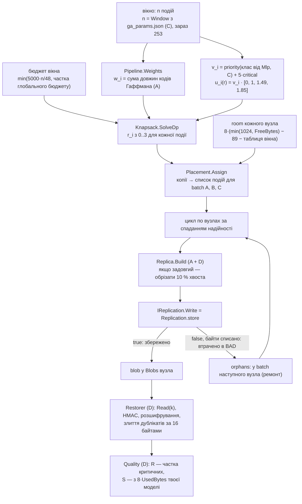

# Зона B — DP & Replication (`Danbrave5662`)

Загальна карта системи — у [README.md](README.md) цього каталогу. Тут лише твоя зона: що вона робить, як працює кожен рядок, які числа вона дає і що в ній можна змінити наживо на захисті. Номери рядків звірено з поточним кодом (останній коміт `d86c2b8`).

## 1. Коротко про зону

Твоя частина системи відповідає планувальнику на два питання. Перше: скільки копій кожної події зберегти. Це багатоваріантний рюкзак, який розв'язується динамічним програмуванням за розділом 3.5 специфікації; поруч лежить жадібний baseline. Друге: на які вузли і в якому порядку ці копії записати. Тут працює жадібна евристика «найцінніше на біт — на найнадійніший вузол». Третя частина — модель вузлів: порт виданого `replication.py` у C#, разом із генератором випадкових чисел Python, щоб відмови збігалися з оригіналом. До зони також належать контракт `IReplication` між планувальником і моделлю, облік байтів і ремонт втрачених batch у `Pipeline.Send` і таблиця 2 звіту.

| Файл | Що в ньому |
|---|---|
| [IReplication.cs](../../src/SecureLog.Core/IReplication.cs) | контракт «планувальник ↔ модель вузлів»: записати batch, прочитати вцілілі, бюджет, місткість, надійність |
| [ReplicaException.cs](../../src/SecureLog.Core/ReplicaException.cs) | коди відхилення `E_*` і тип винятку для «поганих даних»; властивість `Detail` додано в зоні D |
| [Knapsack.cs](../../src/SecureLog.DP/Knapsack.cs) | ДП O(n·W·R) і жадібний baseline для вибору кількості копій `r_i` |
| [Placement.cs](../../src/SecureLog.DP/Placement.cs) | розкладання копій по вузлах: порядок, вибір вузла, місце в batch |
| [Replication.cs](../../src/SecureLog.DP/Replication.cs) | порт `replication.py` рядок у рядок + `PyRandom` (MT19937 з Python) |
| [Pipeline.cs](../../src/SecureLog.App/Pipeline.cs) (власник D) | твої частини: облік за `UsedBytes` після `Write`, ремонт (`saved`/`orphans`), `RunOptions.Repair` |
| [Report.cs](../../src/SecureLog.App/Report.cs) (власник D) | твоя частина: таблиця 2 (копії з ремонтом і без) і рядок «без ремонту» в таблиці 3 |
| тести | `Knapsack_*`, `Placement_*`, `PyRandom_MatchesPython`, `Replication_MatchesReplicationPy` (Unit), `D5` (D1), `C06`–`C08` (C1) |

## 2. Що входить у твою частину

Коміти зони B, згруповані за етапами.

**Етап 1. Контракти (31.10–01.11).**

| Коміт | Дата | Зміст |
|---|---|---|
| `580a09f` | 31.10 | `IReplication` і `ReplicaException` у `SecureLog.Core` |
| `0c064c1` | 01.11 | прибрано заглушку `DP/Class1.cs`, `SecureLog.DP.csproj` посилається на Core |

Інтерфейс з'явився раніше за будь-яку модель вузлів. Перший коментар до нього пояснює навіщо: модель відокремлено від системи, її можна замінити, не чіпаючи планувальник. `SecureLog.DP` знає лише `SecureLog.Core`, тому `Knapsack` не знає про Гаффмана, а `Replication` — про шифрування.

**Етап 2. ДП і baseline (04.11).** `e389fd0`: `Knapsack.SolveDp` (точний розв'язок) і `SolveGreedy` (жадібний за приростом на біт), а також допоміжні `Utility` і `Cost`. Відтоді файл не змінювався.

**Етап 3. Розміщення (05.11).** `d7506bf`: `Placement.Assign` — копії однієї події лише на різних вузлах, місце в batch кожного вузла обмежене. Перша версія вирівнювала заповнення вузлів, але вимірювання показали, що це шкодить ([decisions.md](../decisions.md), §6, останній абзац): одиничні копії розходились по трьох вузлах (три заголовки й три таблиці замість одного), а частина критичних записів опинялась на найслабшому вузлі.

**Етап 4. Власна модель вузлів, згодом замінена (05.11 → 14.11).** `51e6f3f`: `SimReplication` — ланцюг Гілберта–Елліота на кожен пакет. На той момент `replication.py` команді ще не видали, тож це був замінник: свій `System.Random(seed·1000 + k)` на вузол, місткість вузла — половина глобального бюджету. Головна відмінність від майбутнього оригіналу: `Write` повертав `true` навіть для втраченого пакета («відправник про втрату не дізнається»). 14.11 файл видалено.

**Етап 5. Тести (08.11, 11.11).** `c2112f1` — тест `D5` у `tests/SecureLog.Tests.D1` (вплив кількості копій на R в аварійному сценарії; `D4` у тому самому файлі належить зоні C). `c698510` — юніт-тести `Knapsack_GreedyCounterExample`, `Knapsack_DpMatchesBruteForce`, `Placement_PutsCopiesOnDistinctNodesWithinRoom`.

**Етап 6. Інтеграція виданого `replication.py` (14.11).**

| Коміт | Зміст |
|---|---|
| `70a48bb` | `Replication.cs` — порт рядок у рядок і `PyRandom`; `SimReplication.cs` видалено; коментар до `IReplication.Write` тепер описує обидва випадки `false` |
| `9e086e9` | тести порту: перші числа генератора і 600 операцій запису проти виводу `replication.py` |
| `b58949b` | fix тесту: очікувані рядки `S/F/R` згенеровано запуском `replication.py`, а не переписано вручну (у ручній копії було кілька помилкових символів) |
| `4eaf674` | `docs/roles.md`: `Replication.cs` замість `SimReplication` |

**Етап 7. Виправлення після переходу на оригінал (14.11).** Облік і ремонт виникли через одну відмінність оригіналу від замінника: `store()` повертає `False` не лише тоді, коли запис відхилено до списання байтів, а й тоді, коли копію втрачено у стані BAD уже після списання ([decisions.md](../decisions.md), §1 і §6). Вимикач і звіт — наслідок ремонту: його ефект треба було виміряти окремо.

| Коміт | Що і чому |
|---|---|
| `bace88a` | **облік за `UsedBytes`.** Раніше було `if (nodes.Write(k, packet)) { share -= …; batchSeq++; … }`. Втрачений batch (байти списано, але `false`) не зменшував частку бюджету вікна `share`, і наступні вузли того самого вікна могли витратити більше, ніж дозволено; у трасі вікна такої спроби теж не було видно. Тепер облік іде за фактичною зміною `nodes.UsedBytes` |
| `323e725` | **ремонт втрачених batch.** Оригінал повідомляє про втрату, тож події з неуспішного batch, які ще не мають збереженої копії, переходять у batch наступного вузла того самого вікна. Причина: з вікном 178 записів критичні події мали дві копії (A і B), і коли обидва batch одного вікна губились, зникало ~15 % критичних — більше за поріг деградованого сценарію 10 % (seed 1). З ремонтом деградований сценарій дає R = 1.000 на всіх 41 перевірених seeds |
| `1959f84` | `RunOptions.Repair` — вимикач ремонту для вимірювань. `D5` переведено на вікно 48 з конфігу і `Repair = false`: з ремонтом R майже не залежить від кількості копій, і тест перестав би міряти саме копії |
| `0ed3bf3` | звіт: таблиця 2 рахується для параметрів ГА і конфігу, з ремонтом і без; у таблиці 3 з'явився рядок «без ремонту втрачених batch» |

Що в `Pipeline.cs` не з твоїх комітів, хоча стосується твоєї теми: обчислення бюджету вікна і виклик ДП ([Pipeline.cs:81-92](../../src/SecureLog.App/Pipeline.cs#L81-L92)) за `git blame` прийшли в коміті зони D `7c94bcf`. Це постановка твоєї задачі, тому пояснювати їх на захисті все одно доведеться тобі (розділ 4.5).

## 3. Де твоя зона в системі

Одне вікно конвеєра:



**Хто викликає твій код:**

| Твій код | Хто викликає | Що передається |
|---|---|---|
| `Knapsack.SolveDp` / `SolveGreedy` | `Pipeline.Send` ([Pipeline.cs:91](../../src/SecureLog.App/Pipeline.cs#L91)), `Report.Solve` (таблиця 1), тест `C06` | ваги `int[]` у бітах, корисності `double[][]`, бюджет `int` → `int[] copies` |
| `Knapsack.Utility` / `Cost` | `Report`, `Pipeline` (траса вікна, [Pipeline.cs:134](../../src/SecureLog.App/Pipeline.cs#L134)), тести | сумарна корисність і вартість рішення |
| `Placement.Assign` | `Pipeline.Send` ([Pipeline.cs:92](../../src/SecureLog.App/Pipeline.cs#L92)) | копії, ваги, цінності, надійності, місце → `List<int>[]` по вузлах |
| `new Replication(cfg, scenario, seed)` | `Pipeline.RunSim` ([Pipeline.cs:37](../../src/SecureLog.App/Pipeline.cs#L37)), вебконсоль ([Web/Program.cs:49](../../src/SecureLog.Web/Program.cs#L49)), тест порту | модель вузлів сценарію |
| `IReplication.Write/Read/UsedBytes/FreeBytes/…` | `Pipeline.Run` і `Send`, вебконсоль | batch → `true/false`; вцілілі blob; списані байти |
| `ReplicaException`, `ErrorCode` | кидають `Log3` (D), `Payload`, `Huffman`, `BitIO`, `EventCodec` (A); ловлять `Restorer`, `Program` (D), `Reference`, `ReplicaFile` (A), вебконсоль | код `E_*` і пояснення |

**Чий код використовує твоя зона:**

| Що | Чиє | Де |
|---|---|---|
| `TeamConfig`, `Scenario`, `NodeConfig` | D | конструктор `Replication` ([Replication.cs:19-25](../../src/SecureLog.DP/Replication.cs#L19-L25)) |
| `Huffman.CodeLengths` через `Pipeline.Weights` | A через D | ваги `w_i` ([Pipeline.cs:148-160](../../src/SecureLog.App/Pipeline.cs#L148-L160)) |
| `Mlp.Predict` через `Pipeline.Classify` | C через D | клас події → пріоритет у `v_i` |
| `Replica.Build` | D + A | пакет, який іде у `Write` |
| `Tuning.Decode` → `data/ga_params.json` | C | розмір вікна і `SecondCopyFactor`, що потрапляють у твій рюкзак |
| `Quality.Compute` | D | S рахується з `8 · UsedBytes` твоєї моделі ([Pipeline.cs:51](../../src/SecureLog.App/Pipeline.cs#L51)) |

**Звідки беруться входи рюкзака:**

| Вхід | Звідки | Зона |
|---|---|---|
| `w_i` | одна таблиця Гаффмана на вікно, `w_i = Σ length(byte)` по 16 байтах запису | A (через `Pipeline.Weights`, D) |
| `v_i` | `cfg.ClassPriority[клас] + cfg.CriticalBonus·[critical]`: 1 / 5 / 4 і бонус 5 | C (клас) + D (конфіг) |
| коефіцієнти | `[0, 1, P.SecondCopyFactor, cfg.ThirdCopyFactor]`: з ГА 1.4906, без ГА 1.55; третій 1.85 | C (ген ГА), D (конфіг) |
| `R` | `min(MaxCopies, 3, кількість вузлів)` | D (`RunOptions`) |
| бюджет | `replication_budget_bits`, `replication_window_records`, `BudgetBytes − UsedBytes` твоєї моделі | твоя постановка в коді D |
| розмір вікна | ген ГА, логарифмічна шкала 16…256 ([Tuning.cs:19-20](../../src/SecureLog.App/Tuning.cs#L19-L20)) | C |

## 4. Розбір коду по файлах

### 4.1. `IReplication.cs` — контракт планувальника і моделі

[IReplication.cs:7-24](../../src/SecureLog.Core/IReplication.cs#L7-L24). Інтерфейс описує все, що конвеєру потрібно від вузлів, і нічого більше:

- `NodeCount`, `MaxBatchBytes`, `BudgetBytes` ([рядки 9-11](../../src/SecureLog.Core/IReplication.cs#L9-L11)) — кількість вузлів, межа batch з конфігу (1024) і глобальний байтовий бюджет сценарію;
- `UsedBytes` ([рядок 14](../../src/SecureLog.Core/IReplication.cs#L14)) — це `global_used_bytes` з `replication.py`: **усі списані спроби, включно з втраченими у BAD**. Саме з нього рахується S;
- `Reliability(node)` — `reliability_weight` вузла, `FreeBytes(node)` — місткість мінус списане;
- `Write(node, batch)` ([рядок 20](../../src/SecureLog.Core/IReplication.cs#L20)) — `true` означає збережено; `false` означає або відхилено до списання, або втрачено у BAD після списання. Відрізнити ці випадки можна лише за зміною `UsedBytes`;
- `Read(node)` — вцілілі blob; їх читає відновлювач.

Навіщо інтерфейс, а не одразу клас: модель уже раз замінили (`SimReplication` → `Replication`). Заміна зачепила лише місце, де модель створюється (`RunSim`), і обробку `false` після `Write` (розділ 4.8); вибір копій і розміщення не змінились. `Pipeline.Run` приймає будь-який `IReplication`, і вебконсоль цим користується: створює модель сама, а після прогону показує blob на її вузлах.

### 4.2. `ReplicaException.cs` — відмова прийняти репліку

[ReplicaException.cs:4-12](../../src/SecureLog.Core/ReplicaException.cs#L4-L12) — шість кодів із розділу 5 специфікації (`E_SHORT`, `E_MAGIC`, `E_LENGTH`, `E_HMAC`, `E_PAYLOAD`, `E_CODE`). [Рядки 15-21](../../src/SecureLog.Core/ReplicaException.cs#L15-L21) — `sealed` виняток з первинним конструктором; `Message` = `"E_XXX: пояснення"`, `Code` — сам код. `Detail` ([рядок 20](../../src/SecureLog.Core/ReplicaException.cs#L20)) додано в зоні D (`158f1ed`): пояснення без коду, щоб `ReplicaFile` міг доповнити його номером репліки.

Навіщо окремий тип: `Restorer` ловить лише `ReplicaException` ([Replica.cs:35](../../src/SecureLog.App/Replica.cs#L35)). Пошкоджена копія — очікувана ситуація, і відновлення продовжується з інших вузлів. Помилка самої програми (наприклад, `IndexOutOfRangeException`) так не ховається.

### 4.3. `Knapsack.cs` — скільки копій

Постановка ([Knapsack.cs:3-6](../../src/SecureLog.DP/Knapsack.cs#L3-L6), специфікація 3.5): для кожної події `i` обрати `r_i ∈ {0, …, R}`, вартість `r_i · w_i`, корисність `u_i(r_i)`:

```text
maximize  Σ u_i(r_i)      за умови   Σ r_i · w_i ≤ W
```

Це багатоваріантний (multiple-choice) рюкзак: з кожної «групи» (події) береться рівно один варіант 0…R.

**`Utility`, `Cost`** ([рядки 9, 11](../../src/SecureLog.DP/Knapsack.cs#L9-L11)) — сума `utility[i][r_i]` і сума `r_i · cost[i]` (у `long`, щоб не переповнитись). Ними користуються звіт і тести.

#### `SolveDp` — точний розв'язок

**Рекурентне співвідношення.** `f_i[c]` — найкраща корисність перших `i` подій за вартості **не більше** `c`:

```text
f_0[c] = 0                                         для всіх c = 0..W
f_i[c] = max  over r = 0..R, r·w_i ≤ c  of  ( f_{i-1}[c − r·w_i] + u_i(r) )
відповідь: f_n[W]
```

«Не більше `c`», а не «рівно `c`», бо `f` стартує з нулів для всіх `c` ([рядок 25](../../src/SecureLog.DP/Knapsack.cs#L25)): невикористаний бюджет дозволено.

**Крок за кроком:**

1. **Скорочення «free»** ([рядки 18-23](../../src/SecureLog.DP/Knapsack.cs#L18-L23)). Для кожної події шукається найкращий варіант без обмеження (`free[i]` = argmax `u_i(r)`, за рівності — менше `r`, бо порівняння строге). Якщо всі ці варіанти разом уміщуються в бюджет, обмеження не діє, і це вже оптимум: таблиця не будується. У системі корисності зростають з `r`, тож `free[i] = R` для всіх, і скорочення спрацьовує, коли `R · Σw ≤ W`. З вікном 253 і трьома копіями це 3 · 18660 = 55980 > 26354 бітів, тому ДП рахується. З `MaxCopies = 1` (рядки «макс. копій 1» таблиці 2) Σw ≈ 18660 ≤ 26354, і у штатному сценарії ДП повертає «по одній копії всім» без таблиці.
2. **Пам'ять** ([рядки 25-27](../../src/SecureLog.DP/Knapsack.cs#L25-L27)): два рядки `f` і `next` по `W + 1` чисел (поточний і попередній шар, міняються місцями на [рядку 50](../../src/SecureLog.DP/Knapsack.cs#L50)) і `choice[i][c]` — найкраще `r` для події `i` за бюджету `c`, тип `byte` (R ≤ 3).
3. **Основний цикл** ([рядки 28-51](../../src/SecureLog.DP/Knapsack.cs#L28-L51)): для кожної події `i` і кожного `c` починаємо з `r = 0` (`best = f[c]`), потім перебираємо `r = 1..R`, поки `used = r·w ≤ c` ([рядок 38](../../src/SecureLog.DP/Knapsack.cs#L38)). Порівняння строге (`>`, [рядок 41](../../src/SecureLog.DP/Knapsack.cs#L41)): за рівної корисності береться менше копій. Локальні `w`, `u`, `ch` ([рядки 31-33](../../src/SecureLog.DP/Knapsack.cs#L31-L33)) — оптимізація найгарячішого циклу системи.
4. **Відновлення вибору** ([рядки 53-58](../../src/SecureLog.DP/Knapsack.cs#L53-L58)): від останньої події до першої, починаючи з `c = W`: `r_i = choice[i][c]`, потім `c −= r_i · w_i`. Це працює, бо `choice[i][c]` записано саме для шару `i` і бюджету `c`, який лишився після подій `i+1..n`.

**Складність.** Час O(n · W · R): для вікна 48 і 5000 бітів це 48 · 5001 · 3 ≈ 720 тис. кроків; для вікна 253 і 26354 бітів — 253 · 26355 · 3 ≈ 20 млн, близько 25 мс на вікно в Release (таблиця 1: 100–165 мс на сесію з 5 вікон). Пам'ять O(W) для значень і O(n · W) байтів для `choice` (≈ 6.7 МБ на вікно 253). Алгоритм псевдополіноміальний: точний, бо ваги цілі (біти).

**Крайні випадки:** бюджет 0 — масиви на 1 елемент, усі `r = 0`; порожнє вікно не доходить сюди (`Send` повертається на [Pipeline.cs:58](../../src/SecureLog.App/Pipeline.cs#L58)); `utility[i].Length = 1` (`MaxCopies = 0`) — `free` нульовий і вміщується; від'ємні прирости (тест з ціною) — ДП бере менше копій, ніж дозволяє бюджет.

**Приклад вручну (3 події, W = 6, коефіцієнти 1 / 1.55 / 1.85):**

| подія | w | v | u(1) | u(2) | u(3) |
|---|---|---|---|---|---|
| 1 — штатна, critical (1 + 5) | 2 | 6 | 6 | 9.3 | 11.1 |
| 2 — штатна | 3 | 1 | 1 | 1.55 | 1.85 |
| 3 — перехід до інциденту (4) | 2 | 4 | 4 | 6.2 | 7.4 |

«free» = (3, 3, 3) коштує 3 · 7 = 21 > 6, тож будується таблиця:

| c | 0 | 1 | 2 | 3 | 4 | 5 | 6 |
|---|---|---|---|---|---|---|---|
| f₁ (choice₁) | 0 (0) | 0 (0) | 6 (1) | 6 (1) | 9.3 (2) | 9.3 (2) | 11.1 (3) |
| f₂ (choice₂) | 0 (0) | 0 (0) | 6 (0) | 6 (0) | 9.3 (0) | 9.3 (0) | 11.1 (0) |
| f₃ (choice₃) | 0 (0) | 0 (0) | 6 (0) | 6 (0) | 10 (1) | 10 (1) | 13.3 (1) |

Наприклад, `f₃[6] = max(f₂[6] = 11.1; f₂[4] + 4 = 13.3; f₂[2] + 6.2 = 12.2; f₂[0] + 7.4 = 7.4) = 13.3`, тобто `r₃ = 1`. Відновлення: `c = 6 → r₃ = 1 → c = 4 → r₂ = choice₂[4] = 0 → r₁ = choice₁[4] = 2`. Відповідь `r = (2, 0, 1)`, корисність 9.3 + 4 = 13.3, вартість 6. Числа перевірено прогоном того самого алгоритму.

#### `SolveGreedy` — жадібний baseline

[Рядки 63-80](../../src/SecureLog.DP/Knapsack.cs#L63-L80). Черга з пріоритетами за **приростом корисності на біт** наступної копії: `Ratio(i) = (u_i(r_i + 1) − u_i(r_i)) / w_i` ([рядок 67](../../src/SecureLog.DP/Knapsack.cs#L67)). `PriorityQueue` у .NET — мін-купа, тому кладеться `−Ratio`.

- Беремо найкращу копію; якщо найкращий приріст уже ≤ 0, далі лише гірші — стоп ([рядок 73](../../src/SecureLog.DP/Knapsack.cs#L73));
- якщо копія не вміщується — подію викидаємо зовсім (усі її копії коштують так само), але дешевші події ще можуть уміститися ([рядок 74](../../src/SecureLog.DP/Knapsack.cs#L74));
- інакше — списуємо `w_i`, `r_i++`, і, якщо є наступна копія, кладемо її з новим приростом ([рядки 75-77](../../src/SecureLog.DP/Knapsack.cs#L75-L77)).

Складність O(n · R · log n). На прикладі вище жадібний дає ту саму відповідь (2, 0, 1).

**Чому він не оптимальний — контрприклад з тесту** ([UnitTests.cs:115-122](../../tests/SecureLog.Tests.Unit/UnitTests.cs#L115-L122)): ваги (6, 5, 5), корисності 7, 5, 5, бюджет 10. Відношення 7/6 ≈ 1.17 > 1 = 5/5, тож жадібний бере першу подію; лишається 4, і жодна з подій вартістю 5 не влазить. Разом 7. ДП бере другу й третю: 10. Жадібний «по відношенню» не враховує, що бюджет лишиться невикористаним.

**Чому на реальних даних він майже оптимальний:** прирости спадні (коефіцієнти дають 1, 0.49, 0.36 від v), а вага однієї копії (60–106 бітів) мала порівняно з бюджетом (17–26 тис. бітів). Тоді жадібний за відношенням відстає від оптимуму не більше ніж на корисність однієї копії. Виміряно: 4731.8 проти 4732.7 у штатному сценарії (таблиця 1).

### 4.4. Ваги, цінності й корисності (`Pipeline.Send`, рядки 66, 73-75)

- **Вага.** `Weights(win)` ([Pipeline.cs:148-160](../../src/SecureLog.App/Pipeline.cs#L148-L160), код D, довжини — `Huffman.CodeLengths` з зони A): одна таблиця Гаффмана на все вікно, `w_i` = сума довжин кодів 16 байтів запису. Друге значення — розмір таблиці в байтах: `2 · nsym` (пари «символ, довжина»). У першому вікні з 253 записів 251 різний байт, тож таблиця займає 502 байти; середня вага там 73.8 біта (від 62 до 96, а по всіх вікнах сесії — від 60 до 106).
- **Цінність** ([Pipeline.cs:74](../../src/SecureLog.App/Pipeline.cs#L74)): `v_i = ClassPriority[клас] + (critical ? CriticalBonus : 0)`. `ClassPriority` будується в [TeamConfig.cs:96-97](../../src/SecureLog.Core/TeamConfig.cs#L96-L97): клас "0" → «штатна подія» → 1, "1" → «аномальна» → 5, "2" → «перехід до інциденту» → 4. Можливі значення: 1, 5, 4 для некритичних і 6, 10, 9 для критичних.
- **Корисність** ([Pipeline.cs:66](../../src/SecureLog.App/Pipeline.cs#L66), [рядок 75](../../src/SecureLog.App/Pipeline.cs#L75)): `factor = [0, 1, SecondCopyFactor, ThirdCopyFactor]`, обрізаний до `min(MaxCopies, 3, кількість вузлів) + 1` елементів; `u_i(r) = v_i · factor[r]`. Коефіцієнти **кумулятивні** (специфікація 3.5): `u(2) = 1.55·v`, а не `v + 1.55·v`. З конфігу 1.55 / 1.85, з ГА 1.4906 / 1.85.

**Спадна віддача.** Прирости: `v`, `(f₂ − 1)·v`, `(f₃ − f₂)·v`. Для 1.55 / 1.85 це v, 0.55v, 0.30v; для 1.49 / 1.85 — v, 0.49v, 0.36v. Вони спадають, лише поки `f₂ ≥ (1 + f₃)/2 = 1.425`. ГА шукає `f₂` від 1 до `f₃` ([Tuning.cs:20](../../src/SecureLog.App/Tuning.cs#L20)), щоб третя копія не стала гіршою за другу. Спадності ця межа не гарантує, але знайдене 1.49 її має.

У першому вікні з параметрами ГА у штатному сценарії ДП дає всім 85 подіям з `v ≥ 4` по три копії, 97 штатним подіям (`v = 1`) — по одній, 71 — жодної. Причина: третя копія події з `v = 4` дає 4 · 0.36 = 1.44 на ~74 біти, а перша копія штатної — лише 1.

### 4.5. Бюджет вікна ([Pipeline.cs:85-88](../../src/SecureLog.App/Pipeline.cs#L85-L88))

Код зони D, постановка твоя:

```csharp
long share = (nodes.BudgetBytes - nodes.UsedBytes) / (windows - w);                        // рівна частка залишку, байти
double ratio = weight.Average() / (8.0 * EventCodec.RecordSize);                            // середнє стиснення вікна
long windowBudget = (long)cfg.ReplicationBudgetBits * win.Length / cfg.ReplicationWindowRecords; // 5000·n/48
int budget = (int)Math.Clamp((share - nodeCount * Replica.Overhead) * 8 * ratio, 0, windowBudget);
```

1. **Масштаб за довжиною вікна:** специфікація дає 5000 бітів саме на 48 записів, а розмір вікна — ген ГА. Тому `5000 · n / 48` (≈ 104 біти на запис за будь-якого вікна). Для 253 записів — 26354, для останнього вікна з 188 — 19583. Зі сталими 5000 ГА збільшував вікно, на запис припадало менше бітів, і некритичні події відкидались (коментар у [рядках 81-82](../../src/SecureLog.App/Pipeline.cs#L81-L82)).
2. **Частка глобального бюджету:** `share` — рівна частка залишку глобального байтового бюджету на кожне з вікон, що лишились. З неї віднімається резерв на заголовки трьох batch (`Replica.Overhead` = 43 + 32 + 14 = 89 байтів кожен), байти множаться на 8 і на `ratio` («біти Гаффмана» за середнім стисненням вікна). Бюджет ДП — менше з двох.
3. **Приклади (seed 427243, перше вікно):** штатний — `share` = 42182 / 5 = 8436 Б, `(8436 − 267) · 8 · 0.577` ≈ 37 тис. > 26354, тож бюджет = 26354. Аварійний — 20132 / 5 = 4026 Б → 17327 бітів, менше за 26354: тут обмежує частка. Вікно 48 з конфігу, аварійний: 805 Б → 2229 бітів замість 5000.

**Що насправді обмежує, а що ні.** З вікном 253 місце в batch ([Pipeline.cs:79](../../src/SecureLog.App/Pipeline.cs#L79)) — `8 · (1024 − 89 − 502)` = 3464 біти на вузол, разом ≈ 10.4 тис. бітів на вікно. ДП планує ≈ 26 тис., тобто `Placement` розкладає лише близько 40 % запланованих копій. **Обмежує місце в batch, а не бюджет ДП.** З вікном 48 навпаки: усі копії ДП уміщуються (у першому вікні штатного сценарію розкладено 75 копій з 75, ≈ 4975 бітів із 5000), тож обмежує бюджет ДП. Це головне пояснення, чому ДП і жадібний дають майже однаковий Q (розділ 8).

### 4.6. `Placement.cs` — на які вузли

[Placement.cs:12-41](../../src/SecureLog.DP/Placement.cs#L12-L41). Входи: `copies` (`r_i` від ДП), `cost` (ваги в бітах), `value` (`v_i`), `reliability` (вага надійності вузлів), `room` (місце в batch кожного вузла в бітах). Вихід — для кожного вузла номери подій у порядку запису.

**Алгоритм:**

1. Стан ([рядки 18-22](../../src/SecureLog.DP/Placement.cs#L18-L22)): `free` — лишок місця, `left` — скільки копій події ще розкласти, `miss[i] = 1` — імовірність, що жодна вже розкладена копія події не вціліє, `placed[i, k]` — чи є копія `i` на вузлі `k`.
2. Перші копії стають у чергу з пріоритетом `v_i / w_i` ([рядки 23-24](../../src/SecureLog.DP/Placement.cs#L23-L24)).
3. Дістаємо подію з найбільшим пріоритетом і шукаємо найнадійніший вузол, де її ще немає і куди вона вміщується ([рядки 29-31](../../src/SecureLog.DP/Placement.cs#L29-L31)); за рівної надійності — менший номер.
4. Якщо такого вузла немає — решта копій події відкидається ([рядок 32](../../src/SecureLog.DP/Placement.cs#L32)).
5. Інакше: додати в batch, позначити, зменшити `free`, `miss[i] *= 1 − reliability[best]`, і якщо копії лишились — повернути подію в чергу з пріоритетом `v_i · miss[i] / w_i` ([рядки 34-38](../../src/SecureLog.DP/Placement.cs#L34-L38)).

**Чому пріоритет `v · miss / w`.** Очікувана цінність події з копіями на вузлах з надійностями ρ₁, ρ₂, … дорівнює `v · (1 − Π(1 − ρ_k))`. Нова копія на вузлі з надійністю ρ додає `v · miss · ρ`, де `miss = Π(1 − ρ_k)` — імовірність, що всі попередні копії загинули. Поділивши на `w`, отримуємо приріст на біт. ρ наступного вузла наперед невідома, тому в пріоритеті лише `v · miss / w`. **`miss` множиться на (1 − ρ)**, бо вузли незалежні (кожен має свій ланцюг GOOD/BAD і свій генератор): імовірність втратити і всі попередні копії, і нову — добуток.

Наслідок: другі копії програють першим. У штатному сценарії A має ρ = 1.0, тож після копії на A `miss = 0` і решта копій іде в самий кінець черги. У деградованому після A лишається 0.04: друга копія критичної події з `v = 6` має пріоритет ≈ 6 · 0.04 / 74 ≈ 0.003, а перша копія штатної ≈ 1/74 ≈ 0.014. Тому в перше вікно (ГА, штатний) потрапили: на A — 45 подій (усі 36 критичних і 9 з `v = 5`), на B — 45 (24 з `v = 4`, 16 з `v = 5`, 5 штатних), на C — 50 (49 штатних, одна з `v = 4`). Пакети вийшли 782 / 762 / 793 байти. Критичну подію фактично захищає одна копія плюс ремонт.

**Складність:** кожна копія ставиться в чергу і дістається один раз: O(C · (log n + N)), де C = Σ r_i ≤ 3n, N — кількість вузлів.

**Чому не вирівнювати заповнення:** кожен зайвий batch — ще один заголовок (89 Б) і таблиця довжин, а критичні копії опинялися б на слабшому вузлі (коментар у [рядку 28](../../src/SecureLog.DP/Placement.cs#L28), [decisions.md](../decisions.md) §6). Це евристика; оптимальність не доводиться.

Зверни увагу: `free` тут — лишок місця вузла, а в `Knapsack` `free` — рішення без обмеження бюджету. Це різні змінні.

### 4.7. `Replication.cs` — порт `replication.py`

Правило файлу ([рядки 9-14](../../src/SecureLog.DP/Replication.cs#L9-L14)): власної логіки немає, усе як в оригіналі. Відповідність:

| `replication.py` | `Replication.cs` |
|---|---|
| `Replication.__init__`, `global_budget`, `nodes` | конструктор [19-25](../../src/SecureLog.DP/Replication.cs#L19-L25), `BudgetBytes` |
| `global_used`, `global_rejected` | `UsedBytes` [30](../../src/SecureLog.DP/Replication.cs#L30), `Rejected` [33](../../src/SecureLog.DP/Replication.cs#L33) |
| `store(node, blob)` | `Write` [48-69](../../src/SecureLog.DP/Replication.cs#L48-L69) |
| `_node_seed` | `NodeSeed` [72-73](../../src/SecureLog.DP/Replication.cs#L72-L73) |
| `_Node.__init__`, `p_gb` | `Node` [76-88](../../src/SecureLog.DP/Replication.cs#L76-L88) |
| `_Node.next_is_bad` | `NextIsBad` [91-107](../../src/SecureLog.DP/Replication.cs#L91-L107) |
| `random.Random` | `PyRandom` [115-180](../../src/SecureLog.DP/Replication.cs#L115-L180) |
| `surviving_blobs_by_node` | `Read(node)` [42](../../src/SecureLog.DP/Replication.cs#L42) |

Конструктор бере сценарій з `cfg.Scenarios` за внутрішньою назвою (`normal` → «штатний» тощо, [TeamConfig.cs:28-33](../../src/SecureLog.Core/TeamConfig.cs#L28-L33)); вузли йдуть у порядку з JSON — A, B, C, як `NODES` в оригіналі. `MaxBatchBytes` модель лише передає далі: розмір batch вона не обмежує, це робить планувальник ([рядок 13](../../src/SecureLog.DP/Replication.cs#L13)).

#### `Write`: «відхилено» і «втрачено в BAD»

```csharp
if (UsedBytes + size > BudgetBytes || nd.Used + size > nd.Cfg.CapacityBytes)
{ nd.Rejected++; Rejected++; return false; }      // відхилено: байти НЕ списано, генератор НЕ чіпали
nd.Used += size; UsedBytes += size; nd.Attempts++; // списано до того, як відомий результат
if (nd.NextIsBad()) { nd.Failed++; return false; } // втрачено: байти списано
nd.Stored++; nd.Blobs.Add((byte[])batch.Clone()); return true;
```

- **Відхилено** ([рядки 52-57](../../src/SecureLog.DP/Replication.cs#L52-L57)): перевищено глобальний бюджет або місткість вузла. Байти не списуються, `NextIsBad` не викликається, тож **стан ланцюга і генератора не змінюється**.
- **Втрачено в BAD** ([рядки 58-65](../../src/SecureLog.DP/Replication.cs#L58-L65)): байти списано (і в S, і в місткості вузла), blob не збережено.
- Збережено — копія масиву (`Clone`), як `bytes(blob)` в оригіналі: зміна масиву ззовні не змінить «диск» вузла.

Обидва `false` однакові для викликача, тому `Pipeline` і тест порту розрізняють їх за `UsedBytes` до і після виклику. У конвеєрі відхилення практично не трапляється: пакет пишеться, лише якщо він не більший за `min(1024, FreeBytes(k), share)`, а `share` не перевищує залишку глобального бюджету.

#### `NodeSeed` — окреме зерно на вузол

[Рядки 72-73](../../src/SecureLog.DP/Replication.cs#L72-L73): рядок `"427243:A"` (InvariantCulture, як `"%d:%s"` у Python) → UTF-8 → SHA-256 → перші 8 байтів як беззнакове ціле big-endian. Для seed 427243 і вузла A це 2442669452478512891 (перевіряє тест).

#### `NextIsBad` — ланцюг GOOD/BAD

[Рядки 91-107](../../src/SecureLog.DP/Replication.cs#L91-L107). Стан вузла — лічильник `_inBurst`, скільки ще операцій лишилось у поточній пачці відмов:

1. Якщо пачка триває — зменшити лічильник і повернути BAD ([рядки 93-97](../../src/SecureLog.DP/Replication.cs#L93-L97)).
2. Інакше, якщо `loss > 0` і `random() < p_gb` ([рядок 98](../../src/SecureLog.DP/Replication.cs#L98)), — перехід у BAD. **Поточна операція — перша невдала.** Довжина пачки: `length = 1`, і поки `random() > 1/B`, `length++` ([рядки 100-102](../../src/SecureLog.DP/Replication.cs#L100-L102)). Отже `P(L = k) = (1 − 1/B)^(k−1) · (1/B)` — геометричний розподіл із середнім `B`. При `B = 1` пачка завжди з однієї операції і генератор на довжину не витрачається.
3. Порядок `loss > 0 && random()` важливий: при `loss = 0` генератор не викликається — так само в Python. Будь-яке зайве чи пропущене звертання до генератора зсунуло б усю послідовність відмов.

**Звідки `p_gb = loss / (loss + B·(1 − loss))`** ([рядки 79-82](../../src/SecureLog.DP/Replication.cs#L79-L82)). Між пачками в середньому `(1 − p)/p` вдалих операцій, пачка в середньому має `B` невдалих. Частка невдалих: `B / (B + (1 − p)/p)`. Прирівнюємо до `loss` і розв'язуємо: `p · (loss + B(1 − loss)) = loss`. Тобто в довгому прогоні частка втрачених операцій дорівнює `failure_probability` з конфігу.

| сценарій | A | B | C |
|---|---|---|---|
| штатний (B = 1) | loss 0 → p_gb 0 | 0.005 | 0.01 |
| деградований (B = 1.5) | 0.027 | 0.0374 | 0.0478 |
| аварійний (B = 2 / 3 / 4) | 0.0811 | 0.0682 | 0.0588 |

В аварійному C переходить у BAD найрідше, зате має найдовші пачки (у середньому 4 операції). Відмова стосується **операції** (одного batch), а не байта: BAD губить увесь batch.

#### Навіщо окремий генератор на кожен вузол

Так написано в docstring `replication.py`: тоді кількість операцій на одному вузлі не змінює послідовність відмов іншого. Важливий наслідок: результат k-ї **списаної** операції на вузлі X залежить лише від (seed, X, k) і не залежить ні від розміру batch, ні від решти вузлів, бо відхилені операції генератор не чіпають. З вікном 253 кожен вузол отримує щонайбільше 5 записів за сесію (один на вікно). Тобто для кожного seed наперед визначено, які з 15 «слотів» загинуть. Планувальник вирішує, що в ці слоти покласти, а ремонт — що перекласти після втрати.

#### `PyRandom` — `random.Random` з Python

[Рядки 115-180](../../src/SecureLog.DP/Replication.cs#L115-L180). `System.Random` у .NET — інший алгоритм, тож для однакових відмов потрібен саме вихор Мерсенна MT19937 з тим самим посівом.

1. **Ключ** ([рядок 124](../../src/SecureLog.DP/Replication.cs#L124)): Python ділить ціле зерно на 32-бітні слова від молодшого; 64-бітне зерно — два слова, а якщо старша половина нульова (і для нуля) — одне.
2. **`init_genrand(19650218)`** ([рядки 126-127](../../src/SecureLog.DP/Replication.cs#L126-L127)): `mt[0] = 19650218`, `mt[n] = 1812433253 · (mt[n−1] ⊕ (mt[n−1] >> 30)) + n`.
3. **`init_by_array`** ([рядки 129-152](../../src/SecureLog.DP/Replication.cs#L129-L152)): перший прохід (max(624, довжина ключа) кроків) змішує ключ з множником 1664525, другий (623 кроки) — з 1566083941 і відніманням `i`. Коли `i` доходить до 624, `mt[0] = mt[623]` і `i = 1`. Наприкінці `mt[0] = 0x80000000`. Арифметика `uint` у C# за замовчуванням іде за модулем 2³², як `& 0xffffffff` у C-коді CPython.
4. **`NextUInt32`** ([рядки 155-172](../../src/SecureLog.DP/Replication.cs#L155-L172)): коли 624 числа вичерпано — «twist» (старший біт `mt[k]` + молодші 31 біт `mt[k+1]`, зсув, XOR з `mt[k+397]` і з `0x9908b0df` для непарних); потім «tempering» зсувами 11, 7 (`& 0x9d2c5680`), 15 (`& 0xefc60000`), 18. Індекси за модулем дають той самий результат, що й два цикли в C-коді: для `k ≥ 227` використовуються вже оновлені елементи.
5. **`NextDouble`** = `random.random()` ([рядки 175-179](../../src/SecureLog.DP/Replication.cs#L175-L179)): `a = u32 >> 5` (27 бітів), `b = u32 >> 6` (26 бітів), результат `(a · 2²⁶ + b) / 2⁵³` — рівномірне число з [0, 1) з 53 випадковими бітами (стільки має мантиса `double`).

### 4.8. `Pipeline.Send` повністю ([Pipeline.cs:56-136](../../src/SecureLog.App/Pipeline.cs#L56-L136))

Метод належить зоні D. Позначка **[B]** — рядки з твоїх комітів (за `git blame`), решта — D.

| Рядки | Що відбувається | Чиє |
|---|---|---|
| [58](../../src/SecureLog.App/Pipeline.cs#L58) | порожній журнал — нічого не пишемо (тест C02) | D |
| [59](../../src/SecureLog.App/Pipeline.cs#L59) | класи всіх подій (перцептрон C; без моделі всі класу 0) | D, C |
| [60-61](../../src/SecureLog.App/Pipeline.cs#L60-L61) | одна сіль на сесію, ключі PBKDF2 | D |
| [63-66](../../src/SecureLog.App/Pipeline.cs#L63-L66) | розмір вікна, надійності вузлів, коефіцієнти корисності | D (твоя постановка) |
| [68-69](../../src/SecureLog.App/Pipeline.cs#L68-L69) | кількість вікон `⌈n / size⌉`, наскрізний `batchSeq` | D |
| [72-75](../../src/SecureLog.App/Pipeline.cs#L72-L75) | зріз вікна, ваги, цінності, корисності (розділ 4.4) | D |
| [78-79](../../src/SecureLog.App/Pipeline.cs#L78-L79) | `Limit(k) = min(1024, FreeBytes(k))`; `room` = місце під записи в бітах | D |
| [85-88](../../src/SecureLog.App/Pipeline.cs#L85-L88) | бюджет ДП (розділ 4.5) | D (твоя постановка) |
| [90-92](../../src/SecureLog.App/Pipeline.cs#L90-L92) | гачок для звіту й тесту C06; ДП або жадібний; розміщення | D |
| [96-97](../../src/SecureLog.App/Pipeline.cs#L96-L97) | `saved`, `orphans` | **[B]** |
| [100](../../src/SecureLog.App/Pipeline.cs#L100) | вузли за спаданням надійності (A, B, C у всіх сценаріях) | D |
| [104-105](../../src/SecureLog.App/Pipeline.cs#L104-L105) | склад batch з урахуванням сиріт | **[B]** |
| [106-129](../../src/SecureLog.App/Pipeline.cs#L106-L129) | зібрати пакет; якщо не влазить — обрізати 10 % хвоста і повторити | D; [108](../../src/SecureLog.App/Pipeline.cs#L108), [128](../../src/SecureLog.App/Pipeline.cs#L128) — **[B]** (перехід на `ids`) |
| [111-115](../../src/SecureLog.App/Pipeline.cs#L111-L115) | запис і перевірка, чи списано байти | **[B]** |
| [117-120](../../src/SecureLog.App/Pipeline.cs#L117-L120) | облік частки, `batchSeq`, траса | D; [119](../../src/SecureLog.App/Pipeline.cs#L119) — **[B]** |
| [122-124](../../src/SecureLog.App/Pipeline.cs#L122-L124) | позначити збережені або додати в сироти | **[B]** |
| [125](../../src/SecureLog.App/Pipeline.cs#L125) | `break`: на вузол — щонайбільше одна спроба запису за вікно | D |
| [130](../../src/SecureLog.App/Pipeline.cs#L130), [133-134](../../src/SecureLog.App/Pipeline.cs#L133-L134) | траса вікна для вебконсолі | D |

**Пакет і обрізання** ([рядки 108-128](../../src/SecureLog.App/Pipeline.cs#L108-L128)). `Replica.Build` будує batch із власною таблицею Гаффмана (номер групи — номер вікна `w`). Пакет пишеться, лише якщо `packet.Length ≤ min(Limit(k), share)`. Інакше відкидаються останні 10 % (`ids.Count * 9 / 10` — ціле ділення, тож завжди хоча б один елемент), і пакет будується знову. Порядок у batch — за цінністю (з `Placement` або після сортування), тож обрізається найменш цінне. Обрізані події в сироти **не** переходять: це свідомий вибір планувальника, а не втрата.

**Облік за `UsedBytes`** ([рядки 113-121](../../src/SecureLog.App/Pipeline.cs#L113-L121)). Якщо `UsedBytes` зріс, модель спробу прийняла: частка вікна зменшується на розмір пакета, `batchSeq++`, траса запам'ятовує склад. Так рахується і втрачена у BAD спроба, бо її байти вже списано. Без цього наступні вузли вікна думали б, що частка ціла.

**Ремонт** ([рядки 96-97, 104-105, 122-124](../../src/SecureLog.App/Pipeline.cs#L96-L124)):

```csharp
List<int> ids = orphans.Count == 0 ? batches[k]
    : orphans.Where(i => !saved[i] && !batches[k].Contains(i)).Concat(batches[k]).OrderByDescending(i => value[i]).ToList();
...
foreach (int i in ids)
    if (stored) saved[i] = true;
    else if (options.Repair && !orphans.Contains(i)) orphans.Add(i);
```

1. Після кожного запису: якщо `stored` — усі події batch отримують `saved = true`; якщо ні — кожна стає сиротою (лише коли `Repair` увімкнено, і без повторів у списку).
2. Для наступного вузла до його batch додаються сироти, які досі не збережені (`!saved[i]`) і яких у цьому batch ще немає (`!batches[k].Contains(i)`). Список сортується за спаданням цінності. Сортування стабільне, тож за рівної цінності сироти йдуть перед власними подіями вузла.
3. Далі звичайне обрізання хвоста: сирота з високою цінністю витісняє найменш цінні власні події вузла.

**Чому правила не порушуються:**

- *Один batch на вузол за вікно:* `foreach` проходить кожен вузол один раз, а внутрішній `while` робить щонайбільше один `Write` і виходить через `break`. Обрізання відбувається до запису.
- *Копії однієї події — на різних вузлах:* `Placement` кладе подію на вузол щонайбільше раз (`placed[i, k]`); ремонт додає сироту лише туди, де її немає. Кожен вузол відвідується в вікні один раз, тож двічі на один вузол подія не потрапить. Вікна не перетинаються, тож і між вікнами дублів немає.
- *Більше копій, ніж запланувало ДП, не буде:* сиротами стають лише події з batch (отже з `r_i ≥ 1`), а збережена подія далі не переноситься.

**Межі ремонту:** він працює лише в межах вікна і лише «вперед». Втрата на останньому вузлі (C) не ремонтується, як і подія, яку обрізали з batch наступного вузла. Байти втраченої спроби вже списані, тож ремонт коштує додаткового місця (трохи нижчий S). `Repair = false` ([рядок 15](../../src/SecureLog.App/Pipeline.cs#L15)) лишає `orphans` порожнім — поведінка до `323e725`.

### 4.9. `Report.cs` — таблиця 2 і рядок «без ремонту»

[Report.cs:42-51](../../src/SecureLog.App/Report.cs#L42-L51): чотири вкладені цикли — параметри (ГА / конфіг) × ремонт (так / ні) × сценарій (деградований, аварійний; штатний пропущено, бо там майже немає втрат) × `MaxCopies` 1…3. Кожна клітинка — середнє за 20 seeds (21–40, [рядок 15](../../src/SecureLog.App/Report.cs#L15)). Колонка «збережено, кбіт» — `8 · UsedBytes / 1000`. [Рядок 58](../../src/SecureLog.App/Report.cs#L58) — варіант `full with { Repair = false }` у таблиці 3. Рядок «бюджет −30 %» у таблиці 1 ([рядки 35-39](../../src/SecureLog.App/Report.cs#L35-L39)) — ті самі вікна аварійного сценарію з бюджетом × 0.7; конвеєр при цьому не перезапускається.

### 4.10. Тонкі місця, про які можуть спитати

- **Перехід байтів у біти бюджету ([рядок 88](../../src/SecureLog.App/Pipeline.cs#L88)).** `share` — уже байти стиснених пакетів, а множення на `ratio` (≈ 0.52–0.58) робить бюджет ще приблизно в 1.8 раза тіснішим за `share · 8`. Це консервативно: частково покриває таблиці batch, яких у вагах немає. В аварійному сценарії саме це обмежує ДП (17327 замість 26354).
- **Резерв під таблицю вікна в `room` ([рядок 79](../../src/SecureLog.App/Pipeline.cs#L79)).** Це верхня межа: таблиця batch не довша за таблицю вікна, а власний код Гаффмана не довший за чужий. Тому batch ніколи не перевищить 1024 Б. Але з вікном 253 резерв великий (502 Б), і пакети виходять 760–800 Б, а не 1024; до ~1007 Б доходять лише batch із сиротами. Якщо `max_batch_bytes` стане ≤ 591 Б (89 + 502), `room` першого вікна з 253 записів обнулиться, і з нього нічого не буде записано. У [decisions.md](../decisions.md) §8 сказано «на вузол іде 1024 байти»: межа справді походить від `max_batch_bytes`, але фактичні пакети менші.
- **Копії ДП — лише верхня межа.** ДП не знає ні про `room`, ні про надійність вузлів; зайві копії відкидає `Placement`.
- `ids = batches[k]` без сиріт — той самий список, тож обрізання змінює список `Placement`. Зараз це безпечно, бо далі цей список не використовується.

## 5. Числа, які треба знати

Джерело — [docs/results/tables.md](../results/tables.md) і [decisions.md](../decisions.md) §12 (видані дані, Release, середнє за seeds 21–40). Журнал: 1200 подій, 182 критичні; одна сира копія — 19200 байтів (153600 бітів).

**Параметри ГА** (`data/ga_params.json`): вікно 253, поріг NO_COMPRESSION 0, коефіцієнт другої копії 1.4906. Q зростає з 0.789 (вікно 48 з конфігу) до 0.866. 1200 / 253 → 5 вікон (4 × 253 + 188), отже 5 екземплярів рюкзака на сесію.

**Таблиця 1 — ДП проти жадібного:**

| сценарій | корисність ДП / жадібного | біти ДП / жадібного | час ДП / жадібного, мс |
|---|---|---|---|
| normal | 4732.7 / 4731.8 | 124999 / 124812 | 163.1 / 1.6 |
| degraded | 4717.9 / 4716.8 | 123929 / 123728 | 121.6 / 1.0 |
| emergency | 4384.0 / 4382.8 | 104797 / 104623 | 103.8 / 0.3 |
| emergency, бюджет −30 % | 3703.2 / 3700.6 | 73355 / 73198 | 68.3 / 0.3 |

ДП ніде не гірший (тест C06 перевіряє це для кожного вікна), але виграш крихітний (0.02–0.07 %), а часу йде в 100–350 разів більше. Розрив росте, коли бюджет тісніший (1.2 → 2.6). З бюджетом −30 % корисність падає лише на 15.5 % (4384.0 → 3703.2): через спадну віддачу першими зникають найдешевші для втрати копії.

**Таблиця 2 — вплив кількості копій** (R; у дужках кбіт):

| параметри, ремонт | degraded 1 / 2 / 3 копії | emergency 1 / 2 / 3 копії |
|---|---|---|
| ГА, так | 1.000 / 1.000 / 1.000 (95) | 1.000 / 1.000 / 1.000 (96) |
| ГА, ні | 0.935 / 0.935 / 0.948 (94) | 0.778 / 0.816 / 0.892 (94) |
| конфіг, так | 0.998 / 0.998 / 0.997 (162 / 222 / 229) | 0.976 / 0.956 / 0.960 (148 / 160 / 161) |
| конфіг, ні | 0.920 / 0.997 / 0.999 (153 / 221 / 229) | 0.839 / 0.944 / 0.943 (140 / 159 / 161) |

- З ремонтом копії на R майже не впливають: втрачений batch замінює наступний вузол.
- Без ремонту з вікном 48 друга копія в аварійному сценарії піднімає R з 0.839 до 0.944 і коштує 159 кбіт замість 140; третя нічого не додає. Це перевіряє тест D5.
- Без ремонту з вікном 253 R росте 0.778 → 0.892, а обсяг стоїть (94 кбіт): batch уже повні, і зайві копії критичних витісняють некритичні події.
- Конфіг із ремонтом в аварійному: R навіть трохи падає з копіями, бо 160 кбіт ≈ 20000 Б — майже весь глобальний бюджет (20132 Б), і копії ранніх вікон з'їдають частку пізніших. У деградованому друга копія коштує S (0.488 → 0.409) без виграшу в R.

**Таблиця 3 — вплив блоків (середній Q):** повна система 0.8655; без ремонту 0.8397 (деградований 0.8403, аварійний 0.8124) — найсильніший блок після ГА; без ДП (жадібний) 0.8661; без перцептрона 0.8651; без ГА 0.7886.

**Таблиця 5 — сценарії:** R = 1.000 у всіх трьох; Q = 0.866 / 0.865 / 0.864; відновлено 658 / 636 / 496 подій з 1200; використано 28 / 41 / 60 % глобального бюджету.

**Найгірші випадки.** З ремонтом найгірший прогін серед seeds 1–40 і 427243 — аварійний, seed 1: R = 0.824 (150 з 182; поріг дозволяє втратити 45 %). Деградований з ремонтом дає R = 1.000 на всіх 41 seeds. Без ремонту (окреме вимірювання під час підготовки посібника, тимчасова програма поза репозиторієм) найгірші: деградований R = 0.588 (seed 24), аварійний — 0.505 (seed 32); а на seed 1 деградований без ремонту дає 0.808 — це порушило б поріг 10 %.

## 6. Тести твоєї зони

| Тест | Що перевіряє і навіщо |
|---|---|
| `Knapsack_GreedyCounterExample` ([UnitTests.cs:114-122](../../tests/SecureLog.Tests.Unit/UnitTests.cs#L114-L122)) | ваги (6, 5, 5), корисності 7 / 5 / 5, бюджет 10: жадібний дає 7, ДП — 10. Явний доказ, що жадібний не оптимальний |
| `Knapsack_DpMatchesBruteForce` ([124-151](../../tests/SecureLog.Tests.Unit/UnitTests.cs#L124-L151)) | 200 випадкових екземплярів (до 6 подій, бюджет < 40, R = 3) проти повного перебору всіх 4ⁿ варіантів: рішення ДП вміщується в бюджет і має ту саму корисність (9 знаків). Корисності мають спадну віддачу мінус «ціну зберігання», тож прирости бувають від'ємними — так перевіряється, що ДП уміє взяти менше копій, ніж дозволяє бюджет. Тут же неявно перевіряється скорочення «free» |
| `Placement_PutsCopiesOnDistinctNodesWithinRoom` ([153-172](../../tests/SecureLog.Tests.Unit/UnitTests.cs#L153-L172)) | 200 подій, `room` 1500 / 1500 / 900: на вузлі немає повторів подій (різні вузли), сума ваг не перевищує місця, копій події не більше за `r_i`, щось розкладено |
| `PyRandom_MatchesPython` ([174-184](../../tests/SecureLog.Tests.Unit/UnitTests.cs#L174-L184)) | `NodeSeed(427243, "A") = 2442669452478512891` і перші три `random()`: 0.35212687917463037, 0.3228960588590014, 0.7632280240017555 — значення надруковано самим Python |
| `Replication_MatchesReplicationPy` ([186-203](../../tests/SecureLog.Tests.Unit/UnitTests.cs#L186-L203)) | для кожного сценарію 600 записів на вузли A, B, C по колу розміром `40 + i·37 % 160` байтів (40…199). Перші 150 результатів `S`/`F`/`R` і підсумок збігаються з виводом `replication.py`: штатний 354 / 1 / 245, `global_used` 42172; деградований 221 / 23 / 356, 28755; аварійний 144 / 27 / 429, 20132. `F` від `R` відрізняється за зміною `UsedBytes` |
| `D5_ExtraCopiesRaiseRInEmergencyAndCostBits` ([D1Tests.cs:28-48](../../tests/SecureLog.Tests.D1/D1Tests.cs#L28-L48)) | аварійний сценарій, seeds 1–5, вікно 48 з конфігу, без ремонту: R з 2 і з 3 копіями більший, ніж з 1, і копії коштують біти. Ремонт вимкнено, бо інакше він сам замінює копії |
| `C06_DpIsNotWorseThanGreedyOnEveryWindow` ([C1Tests.cs:103-124](../../tests/SecureLog.Tests.C1/C1Tests.cs#L103-L124)) | кожен екземпляр рюкзака з реальних прогонів (3 сценарії × 5 seeds, параметри конфігу): обидва рішення вміщуються в бюджет, ДП ≥ жадібного |
| `C07_NormalScenarioRestoresAllCriticalEvents` ([126-135](../../tests/SecureLog.Tests.C1/C1Tests.cs#L126-L135)) | штатний сценарій, параметри ГА, seeds 427243 і 1–4: відновлено всі критичні події (поріг 0) |
| `C08_DegradedScenarioLossIsWithinThreshold` ([137-146](../../tests/SecureLog.Tests.C1/C1Tests.cs#L137-L146)) | деградований сценарій: втрата критичних ≤ 10 % **на кожному** seed, а не в середньому. Без ремонту тест падає (seed 1: втрачено 19.2 %) |

Урок коміту `b58949b`: очікувані значення для звірки з оригіналом треба генерувати запуском оригіналу, а не переписувати вручну.

## 7. Як це запустити й показати

```bash
dotnet build -c Release
# лише тести зони B (13 тестів)
dotnet test -c Release --no-build --filter "FullyQualifiedName~Knapsack|FullyQualifiedName~Placement|FullyQualifiedName~PyRandom|FullyQualifiedName~Replication_Matches|FullyQualifiedName~D5_|FullyQualifiedName~C06|FullyQualifiedName~C07|FullyQualifiedName~C08"
# один тест
dotnet test -c Release --no-build --filter "FullyQualifiedName~C08"
```

Вивід 19.11.2026 (скорочено): `SecureLog.Tests.Unit` — 7 passed (`Knapsack_*` ×2, `Placement_*`, `PyRandom_*`, `Replication_MatchesReplicationPy` ×3); `SecureLog.Tests.D1` — 1 passed (D5); `SecureLog.Tests.C1` — 5 passed (C06 ×3, C07, C08). Разом 13 з 13, кілька секунд.

```bash
dotnet run -c Release --project src/SecureLog.App -- run
```

```text
normal     S=0.621 R=1.000 T=0.990 Q=0.8657 | критичних 182/182, подій відновлено 661, збережено 11736 байт, 0.30 с
degraded   S=0.613 R=1.000 T=0.994 Q=0.8636 | критичних 182/182, подій відновлено 599, збережено 12139 байт, 0.17 с
emergency  S=0.612 R=1.000 T=0.994 Q=0.8635 | критичних 182/182, подій відновлено 502, збережено 12152 байт, 0.17 с
```

```bash
dotnet run -c Release --project src/SecureLog.App -- run emergency 3
dotnet run -c Release --project src/SecureLog.App -- run emergency 1   # найгірший seed
```

```text
emergency  S=0.616 R=1.000 T=0.992 Q=0.8645 | критичних 182/182, подій відновлено 526, збережено 11958 байт, 0.23 с
emergency  S=0.607 R=0.824 T=0.986 Q=0.7726 | критичних 150/182, подій відновлено 335, збережено 12424 байт, 0.41 с
```

Як читати: «збережено» — `UsedBytes` моделі, включно з втраченими спробами; S = 153600 / (153600 + 8 · 11736) = 0.621. Відкритий seed за замовчуванням — 427243. T і час залежать від машини; решта детермінована (сіль і nonce випадкові, але на рішення планувальника й відмови не впливають).

**Показати збіг з Python** (необов'язково, Python 3 у корені репозиторію; `-B` — щоб не створювати `__pycache__`):

```bash
python -B -c "import replication as r, random; s = r._node_seed(427243, 'A'); g = random.Random(s); print(s, [g.random() for _ in range(3)])"
# 2442669452478512891 [0.35212687917463037, 0.3228960588590014, 0.7632280240017555]
```

Ті самі числа стоять у `PyRandom_MatchesPython`. Команди `train`, `ga` і `report` перезаписують дані й таблиці — на захисті їх не запускай без потреби.

## 8. Питання на захисті

1. **Рекурентне співвідношення і складність ДП?** `f_i[c] = max_{r: r·w_i ≤ c} (f_{i−1}[c − r·w_i] + u_i(r))`, `f_0 ≡ 0`, відповідь `f_n[W]`. Час O(n·W·R), пам'ять O(W) для значень + O(n·W) для вибору. Для 48 записів і 5000 бітів — ≈ 720 тис. кроків, для 253 і 26354 — ≈ 20 млн (≈ 25 мс).
2. **Як відновлюється вибір?** Від останньої події до першої: `r_i = choice[i][c]`, `c −= r_i·w_i`, починаючи з `c = W`.
3. **Чому жадібний не оптимальний?** Він бере найкраще відношення приросту до ваги і не бачить, що лишок бюджету згорить. Контрприклад: ваги 6, 5, 5, корисності 7, 5, 5, бюджет 10 — жадібний 7, оптимум 10.
4. **Чому тоді жадібний майже не гірший на реальних даних?** Спадні прирости і копії, малі відносно бюджету: відставання не більше за корисність однієї копії. Виміряно 4731.8 проти 4732.7.
5. **Що таке спадна віддача і навіщо?** Кожна наступна копія додає менше: v, 0.55v, 0.30v (конфіг). Без неї жадібний ламається сильніше, а ДП лишається точним. Спадність тримається, поки `f₂ ≥ (1 + f₃)/2 = 1.425`.
6. **Навіщо «free»?** Якщо найкращі варіанти всіх подій без обмеження вже вміщуються, це оптимум, і таблиця не потрібна. Спрацьовує, наприклад, з `MaxCopies = 1` і вікном 253 у штатному сценарії.
7. **Чому копії однієї події мають бути на різних вузлах?** Так вимагає 3.5: `r_i = 2` — два різні вузли, повтор на тому самому вузлі `r_i` не збільшує. По суті: відмова губить цілий batch, а на вузол іде один batch за вікно, тож дві копії на одному вузлі загинули б разом. Захищає лише незалежність різних вузлів.
8. **Чому пріоритет `v·miss/w` і чому `miss *= 1 − ρ`?** Нова копія додає `v·miss·ρ` очікуваної цінності, на біт — `/w`. `miss` — імовірність, що всі попередні копії загинули; вузли незалежні, тож множимо на ймовірність втрати нового вузла `1 − ρ`.
9. **Чому ДП обирає три копії, а в batch потрапляє одна?** ДП не знає ні місця в batch, ні надійності. З вікном 253 місця ≈ 10.4 тис. бітів на вікно проти ≈ 26 тис. запланованих. `Placement` кладе спершу перші копії, бо другі мають пріоритет, помножений на 1 − ρ.
10. **Чому порт має бути біт у біт?** Офіційний Q викладач рахує з `replication.py` на прихованих seeds. Якщо порт дає іншу послідовність відмов, ГА налаштовується і результати міряються на іншій моделі. Будь-яке зайве звертання до генератора зсуває всі подальші відмови. Тому `PyRandom`, а не `System.Random`, і тест на 600 операцій проти виводу Python.
11. **Навіщо окремий генератор на вузол?** Щоб операції на одному вузлі не змінювали відмов іншого. Результат k-ї списаної операції вузла визначається лише seed і k, тож різні стратегії порівнюються на тих самих «слотах» відмов.
12. **Чим «відхилено» відрізняється від «втрачено»?** Відхилено — до списання (бюджет або місткість), байти не списано, генератор не чіпали. Втрачено — байти списано, стан BAD. Обидва повертають `false`; конвеєр розрізняє їх за зміною `UsedBytes`.
13. **Як працює ремонт і що він не порушує?** Події з неуспішного batch без збереженої копії йдуть у batch наступного вузла того самого вікна, якщо їх там немає; batch сортується за цінністю й обрізається з хвоста. Один batch на вузол за вікно і різні вузли для копій зберігаються (розділ 4.8). Q без ремонту 0.8397 проти 0.8655.
14. **Що буде, якщо вузол стане вдвічі менш надійним?** ДП не зміниться взагалі — надійність він не бачить. `Placement` обирає цей вузол пізніше, копії на ньому лишають більший `miss` (тож події частіше отримують ще одну копію), а якщо вузол стане найслабшим, `Send` ще й пише на нього останнім. У моделі зросте `p_gb`: для C в аварійному `failure_probability` 0.2 → 0.4 дає 0.0588 → 0.143. Виміряно (seeds 21–40, з ремонтом): R лишається 1.000, відновлених подій 496 → 464; A 0.15 → 0.30 — R 0.999, мінімум 0.995. Без ремонту результат шумний: на сесію лише 15 записів, тож один втрачений batch важить дуже багато.
15. **Що буде, якщо бюджет зменшиться на 30 %?** Корисність ДП падає на 15.5 % (таблиця 1), бо першими відкидаються найменш цінні прирости. З бюджетом вікна 3500 замість 5000 на 48 записів (виміряно): Q майже той самий (0.8651 → 0.8653, деградований), збережені байти ті самі (обмежує місце в batch), подій відновлено 636 → 467, R з ремонтом 1.000. Без ремонту R навіть росте (0.948 → 0.971): менше некритичних подій претендує на місце.
16. **Чому перцептрон майже не змінює Q?** R рахує лише критичні події, а критична має `v ≥ 6` проти максимум 5 у некритичної, тож за рідкісним винятком через вагу вона йде першою за будь-якого класу. Клас лише переставляє некритичні події. 0.8651 без перцептрона проти 0.8655 з ним.
17. **Чому в таблиці 3 жадібний має трохи вищий Q, ніж ДП (0.8661 проти 0.8655)?** R = 1.000 в обох, S майже однаковий, бо обмежує місце в batch, а не бюджет ДП. Різницю дає T = 30 / (30 + t): ДП додає 0.1–0.16 с на сесію (таблиця 1), `ΔT ≈ Δt / 30 ≈ 0.003–0.005`, і `γ · ΔT ≈ 0.15 · 0.004 ≈ 0.0006` — якраз ця різниця (0.0005–0.0008 по сценаріях). Виграш ДП у корисності (0.02 %) не стає відновленими критичними записами.

## 9. Мікрозміни: що і де змінити

Після кожної зміни: `dotnet build -c Release`, тести з розділу 7, `run`. **Не змінюй `team_config.json` і `replication.py`** — це видані файли. Для змін сценарію використовуй тимчасовий тест або код. Числа нижче виміряно під час підготовки посібника тимчасовою програмою, яка змінювала ті самі параметри (seeds 21–40).

**1. Максимум 2 копії.** [Pipeline.cs:66](../../src/SecureLog.App/Pipeline.cs#L66): `Math.Min(options.MaxCopies, 3)` → `Math.Min(options.MaxCopies, 2)`. Масив коефіцієнтів стає `[0, 1, f₂]`, ДП рахує R = 2 (на третину менше кроків). Саме тут, а не в значенні за замовчуванням `MaxCopies = 3` ([рядок 12](../../src/SecureLog.App/Pipeline.cs#L12)), бо звіт передає `MaxCopies` явно. Тести лишаються зеленими: у D5 `Mean(3)` стане рівним `Mean(2)`, а умови `three.R > one.R` і `three.Bits >= two.Bits` виконуються. У таблиці 2 рядки «3» дорівнюватимуть «2». На тестових seeds R не змінюється, Q трохи вищий за рахунок T.

**2. Інший `third_copy_factor`.** У [Pipeline.cs:66](../../src/SecureLog.App/Pipeline.cs#L66) замінити `cfg.ThirdCopyFactor` числом. З `1.4` (менше за `f₂` = 1.49) `u(3) < u(2)`: трьох копій ДП не обирає ніколи (розподіл r = 0…3 за сесію в деградованому: 32 / 684 / 484 / 0), і жадібний збігається з ДП. Подій відновлюється більше (636 → 683), але без ремонту R падає (0.948 → 0.935, аварійний 0.892 → 0.816). З `2.5` прирости 1, 0.49, 1.01 перестають спадати: зникають двокопійні рішення, а розрив ДП−жадібний в аварійному росте з 1.13 до 3.57. Тести зелені (C06 тримається, бо ДП точний). [Tuning.cs:20](../../src/SecureLog.App/Tuning.cs#L20) використовує той самий коефіцієнт як межу гена — не чіпай без потреби.

**3. `Placement` по колу (round-robin).** [Placement.cs:29-31](../../src/SecureLog.DP/Placement.cs#L29-L31): перед циклом `int turn = 0;`, вибір вузла:

```csharp
int best = -1;
for (int t = 0; t < nodes && best < 0; t++)
{
    int k = (turn + t) % nodes;
    if (!placed[i, k] && free[k] >= cost[i]) best = k;
}
if (best < 0) continue;
turn = (best + 1) % nodes;
```

`Placement_PutsCopiesOnDistinctNodesWithinRoom` лишається зеленим: він перевіряє лише обмеження. Очікувано гірше (див. §6 decisions): критичні копії йдуть і на найслабший вузол. Перевір `run degraded 1` і `run emergency 1`.

**4. Вимкнути ремонт.** [Pipeline.cs:15](../../src/SecureLog.App/Pipeline.cs#L15): `= true` → `= false`. **C08 падає**: деградований seed 1 дає R = 0.808, тобто втрачено 19.2 % > 10 %. C07 лишається зеленим (у штатному A не відмовляє, а критичні події лежать на A). Середній R деградованого за seeds 21–40 — 1.000 → 0.948 (як у таблиці 2); `run degraded` на seed 427243 дасть 0.995, `run degraded 1` — 0.808. У таблиці 3 «повна система» стане рівною рядку «без ремонту» (0.8397).

**5. Бюджет вікна.** [Pipeline.cs:87](../../src/SecureLog.App/Pipeline.cs#L87).
- −30 %: `long windowBudget = (long)(cfg.ReplicationBudgetBits * 0.7) * win.Length / cfg.ReplicationWindowRecords;` (3500 бітів на 48 записів). Виміряно: у деградованому нулів у рішенні ДП 430 → 723, трьох копій 415 → 254; Q 0.8651 → 0.8653; відновлено 636 → 467; R з ремонтом 1.000, без ремонту 0.948 → 0.971; розрив ДП−жадібний 1.13 → 2.53.
- Сталий бюджет, як було до масштабування: `long windowBudget = cfg.ReplicationBudgetBits;`. З вікном 253 це 5000 замість 26354 бітів (у 5.3 раза менше): копії дістануться майже лише критичним подіям. Перевір `run`.
- Без частки глобального бюджету: на [рядку 88](../../src/SecureLog.App/Pipeline.cs#L88) `int budget = (int)windowBudget;`. Зміниться лише аварійний сценарій (там обмежувала частка). Перевірка `packet ≤ share` на [рядку 109](../../src/SecureLog.App/Pipeline.cs#L109) лишається.

Тести зелені в усіх трьох варіантах (C06 порівнює алгоритми на тому самому бюджеті).

**6. Четвертий вузол.** У тимчасовому тесті (конфіг лишається без змін):

```csharp
TeamConfig cfg = Workspace.Config();
Scenario s = cfg.Scenarios["emergency"];
cfg.Scenarios["emergency"] = s with { Nodes = [.. s.Nodes, s.Nodes[^1] with { Name = "D" }] };
var r = new Pipeline(cfg, Workspace.Model(), "pw").RunSim(Workspace.Session(), "emergency", 21, new RunOptions(Workspace.BestParams(cfg)));
```

`Replication` бере вузли з конфігу ([рядок 24](../../src/SecureLog.DP/Replication.cs#L24)), `NodeSeed(seed, "D")` дає вузлу D власний генератор, і слоти відмов A, B, C не змінюються. `Placement` працює з будь-якою кількістю вузлів. Копій усе одно не більше 3 ([Pipeline.cs:66](../../src/SecureLog.App/Pipeline.cs#L66)); щоб дозволити 4, додай четвертий коефіцієнт у масив і заміни `3` на `4`. Виміряно (копія C як D): з ремонтом R 1.000, але S 0.615 → 0.545 і Q 0.8645 → 0.840 — четвертий batch на вікно коштує байти; без ремонту R 0.892 → 0.953. Застереження: `replication.py` має `NODES = ("A", "B", "C")`, тож це вже не модель викладача, лише експеримент.

**7. Пріоритет `Placement` без `miss`.** [Placement.cs:38](../../src/SecureLog.DP/Placement.cs#L38): `-value[i] * miss[i] / cost[i]` → `-value[i] / cost[i]`. Другі й треті копії стануть рівні першим: критичні події отримають більше реальних копій, некритичних у batch стане менше. Без ремонту очікувано вищий R і менше відновлених подій. Тест `Placement_*` зелений. Варіант точнішої формули: множити ще на ρ найкращого вільного вузла.

**8. Вузол удвічі менш надійний.** У тимчасовому тесті:

```csharp
Scenario s = cfg.Scenarios["emergency"];
NodeConfig[] n = s.Nodes.ToArray();
n[2] = n[2] with { FailureProbability = 0.4, ReliabilityWeight = 0.6 };   // C: 0.2 → 0.4
cfg.Scenarios["emergency"] = s with { Nodes = n };
```

`p_gb` вузла C 0.0588 → 0.143. Результати — у питанні 14 розділу 8. `Replication_MatchesReplicationPy` не зміниться: він читає `Workspace.Config()` заново.

Після будь-якої зміни поверни код (`git checkout -- <файл>`) і перезапусти 13 тестів зони.
