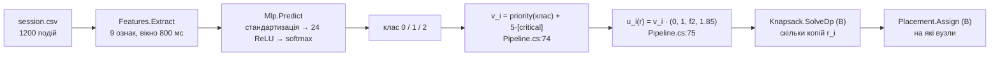
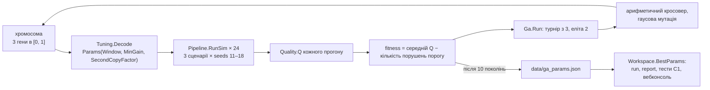

# Зона C — ML & GA (`uozawo`): посібник до захисту

Загальна карта системи й контракти між зонами — у [README.md](README.md) цієї теки. Тут розібрано лише твою частину, зате до кожного рядка: що вона робить, чому саме так, які числа дає і що в ній можна змінити наживо.

Усі номери рядків перевірено за поточним кодом. Посилання мають вигляд [Mlp.cs:40](../../src/SecureLog.ML/Mlp.cs#L40).

---

## 1. Коротко про зону

Твоя зона відповідає за дві «розумні» частини системи. **Перцептрон** дивиться на кожну подію журналу разом з її недавньою історією (800 мс) і відносить її до одного з трьох класів: 0 — штатна, 1 — аномальна, 2 — перехід до інциденту. Від класу залежить цінність події `v_i`, а від цінності — скільки копій події виділить ДП зони B. **Генетичний алгоритм** підбирає три параметри всієї системи (розмір вікна реплікації, поріг NO_COMPRESSION, коефіцієнт другої копії) так, щоб метрика Q була найбільшою, і порівнюється з випадковим пошуком за однакової кількості обчислень. Той самий загальний ГА зона D використовує в атаці на слабкий XOR-шифр.

Сторонніх бібліотек машинного навчання немає: проєкт `SecureLog.ML` посилається лише на `SecureLog.Core` ([SecureLog.ML.csproj:4](../../src/SecureLog.ML/SecureLog.ML.csproj#L4)). Усе — прямий прохід, зворотне поширення, Adam, macro-F1, ГА — написано в трьох файлах C#.

| Файл | Призначення |
|---|---|
| [Features.cs](../../src/SecureLog.ML/Features.cs) | 9 ознак кожної події з ковзного вікна часу (7 обов'язкових з конфігу + 2 допоміжні) |
| [Mlp.cs](../../src/SecureLog.ML/Mlp.cs) | перцептрон: прямий прохід, backprop, Adam, матриця помилок, macro-F1, протокол «3 ініціалізації → вибір за valid», JSON |
| [Ga.cs](../../src/SecureLog.ML/Ga.cs) | загальний ГА (турнір, кросовер, мутація, елітизм) і випадковий пошук з тим самим числом обчислень |
| [Tuning.cs](../../src/SecureLog.App/Tuning.cs) | обгортка ГА для системи: гени → `Params`, пристосованість = середній Q за 24 прогонами з жорсткими порогами втрат. Файл створено в зоні D, пороги — твоя частина |
| `Train()` у [Program.cs:123](../../src/SecureLog.App/Program.cs#L123) | команда `train`: ознаки → `TrainBest` → `data/model.json` і `docs/results/confusion.md` |
| [Attack.cs](../../src/SecureLog.App/Attack.cs) | власник — зона D; від тебе — пояснення, як там працює `Ga.Run` |
| `data/model.json` | навчена модель 9 → 24 → 3 разом із Mean/Std стандартизації |
| `data/ga_params.json` | параметри, знайдені ГА: вікно 253, поріг 0, коефіцієнт 1.4906 |
| `docs/results/ga_log.csv` | збіжність ГА проти випадкового пошуку по поколіннях |
| `docs/results/confusion.md` | матриця помилок перцептрона на `valid.csv` |
| тести | `Mlp_LearnsXor`, `D4_ElitismNeverLosesBestAndRandomSearchGetsSameBudget`, `C09_PerceptronReachesMacroF1`; виправлення в `AnyCorruptionIsRejectedWithCode` |

---

## 2. Що входить у твою частину

Коміти зони C за `git log` (2026 рік), згруповані за етапами.

### Етап 1. Каркас і алгоритми (01–06.11)

| Коміт | Дата | Що |
|---|---|---|
| `bb5cdf1` | 01.11 | прибрано шаблонний `Class1.cs`; `SecureLog.ML` посилається на `SecureLog.Core` |
| `123d1fe` | 04.11 | `Features` — перша версія: вікно з останніх N **записів**, 13 ознак (серед них `critical`, z-оцінка `metric_value`, прискорення потоку) |
| `d8b860f` | 05.11 | `Mlp` — прямий і зворотний проходи, Adam, macro-F1 |
| `3030e18` | 06.11 | `Ga` — генетичний алгоритм і випадковий пошук |

### Етап 2. Власні дані-замінники (09–11.11)

Поки матеріалів T01 не було, команда працювала на власних даних.

| Коміт | Дата | Що |
|---|---|---|
| `c683e20` | 09.11 | генератор видає `train/valid/holdout` і демо-потік. Прибрано 14.11 комітом зони D `db8e724`, коли видали справжні дані |
| `c363750` | 10.11 | навчена модель 13 → 24 → 3 і матриця помилок на власному holdout (macro-F1 0.9769) |
| `adb532e` | 11.11 | юніт-тест `Mlp_LearnsXor` |
| `ca3c5e3` | 11.11 | перший `ga_params.json` (вікно 56) і журнал прогону. На тих даних випадковий пошук навіть обійшов ГА: 0.87950 проти 0.87802 |

### Етап 3. Перехід на видані дані (14.11)

| Коміт | Час | Що і чому |
|---|---|---|
| `9dab4dd` | 09:06 | ознаки переписано: конфіг вимагає 7 «мінімальних часових ознак» і **ковзне вікно часу**, а не N записів. Тепер 7 обов'язкових у порядку конфігу + 2 допоміжні, вікно 800 мс |
| `6fc7ff2` | 09:28 | `holdout.csv` не видається, тому `train` обирає модель за `valid.csv` і пише матрицю помилок на valid. Модель перенавчено: 9 → 24 → 3, macro-F1 0.9329 |
| `03e0e6c` | 11:58 | ГА перезапущено з вагами Q і пріоритетами класів з виданого конфігу → вікно 247 |

### Етап 4. Виправлення ГА і тесту (14.11)

| Коміт | Час | Що і чому |
|---|---|---|
| `55ba7d0` | 12:24 | **жорсткі пороги втрат для всіх трьох сценаріїв.** Раніше жорсткою була лише одна умова: у штатному сценарії відновлено всі критичні події (кейс C1-7). ГА обрав вікно 247; Q зростав, але на тестовому seed 1 деградований сценарій втрачав 21 % критичних подій за порога 10 %, тобто тест C08 (поріг на кожному seed) з такими параметрами не проходив. Після виправлення ГА дав вікно 178 |
| `87cca70` | 13:11 | ГА перезапущено після ремонту втрачених batch (зона B, `323e725`). З вікном 178 критичні події мали по дві копії, на A і B; якщо губилися обидва batch одного вікна, зникало ~15 % критичних ([decisions.md §6](../decisions.md)). З ремонтом пороги вже не заважають великому вікну: ГА знайшов 253, журнал збіжності оновлено |
| `bfad0ab` | 15:08 | виправлення тесту обрізання файлу реплік (розділ 6) |

Історія вікна: **56** (власні дані) → **247** (офіційні ваги, одна умова) → **178** (усі пороги, без ремонту) → **253** (усі пороги + ремонт).

---

## 3. Де твоя зона в системі

### 3.1 Класифікація: від події до цінності



`Pipeline.Classify` (зона D, [Pipeline.cs:138-142](../../src/SecureLog.App/Pipeline.cs#L138)) — єдине місце, де система питає твою модель:

```csharp
if (!useModel || model is null) return new int[events.Length];   // без перцептрона всі події вважаються штатними
return Features.Extract(events, cfg.HistoryMs).Select(model.Predict).ToArray();
```

Ознаки рахуються один раз для всієї сесії, ще до поділу на вікна реплікації. Далі [Pipeline.cs:74](../../src/SecureLog.App/Pipeline.cs#L74):

```csharp
double[] value = win.Select((e, i) => cfg.ClassPriority[classes[w * size + i]] + (e.Critical ? cfg.CriticalBonus : 0)).ToArray();
```

`ClassPriority` читається з конфігу ([TeamConfig.cs:96-97](../../src/SecureLog.Core/TeamConfig.cs#L96)): клас 0 → 1, клас 1 → 5, клас 2 → 4; `critical_bonus` = 5. Отже цінності такі:

| | клас 0 | клас 1 | клас 2 |
|---|---|---|---|
| некритична подія | 1 | 5 | 4 |
| критична подія | 6 | 10 | 9 |

Будь-яка критична подія цінніша за будь-яку некритичну, незалежно від класу. Це пояснює, чому перцептрон майже не змінює Q (розділ 5).

### 3.2 Налаштування: цикл ГА



`Params(Window, MinGain, SecondCopyFactor)` — запис зони D у Core ([TeamConfig.cs:6](../../src/SecureLog.Core/TeamConfig.cs#L6)). ГА його створює, `Pipeline` споживає:

| Параметр | Де використовується | Що змінює |
|---|---|---|
| `Window` | [Pipeline.cs:63](../../src/SecureLog.App/Pipeline.cs#L63) `size`, [:68](../../src/SecureLog.App/Pipeline.cs#L68) кількість вікон, [:87](../../src/SecureLog.App/Pipeline.cs#L87) бюджет ДП | бюджет вікна = `5000 · n / 48` бітів, тобто ~104 біти на запис за будь-якого вікна (але не більше частки глобального бюджету, [:88](../../src/SecureLog.App/Pipeline.cs#L88)); одне вікно = не більше одного batch (≤ 1024 байти) на вузол |
| `MinGain` | [Pipeline.cs:108](../../src/SecureLog.App/Pipeline.cs#L108) → `Replica.Build` → `Payload.Pack` зони A, [Payload.cs:33](../../src/SecureLog.Compression/Payload.cs#L33) | Гаффман обирається, лише якщо таблиця + потік ≤ `сирі байти · (1 − MinGain)`; інакше NO_COMPRESSION |
| `SecondCopyFactor` | [Pipeline.cs:66](../../src/SecureLog.App/Pipeline.cs#L66) | `u(2) = v · SecondCopyFactor` у масиві коефіцієнтів `{0, 1, second, third}` |

`Workspace.BestParams` ([Workspace.cs:27-31](../../src/SecureLog.App/Workspace.cs#L27)) читає `data/ga_params.json` (snake_case через `TeamConfig.Json`), а якщо файлу немає — бере `cfg.DefaultParams()` = (48, 0, 1.55) ([TeamConfig.cs:69](../../src/SecureLog.Core/TeamConfig.cs#L69)). Пристосованість — `Quality.Q` зони D ([Quality.cs:12](../../src/SecureLog.Core/Quality.cs#L12)): `Q = 0.35·S + 0.5·R + 0.15·T`, і `Q = 0`, якщо не відновлено жодної критичної події.

### 3.3 Хто викликає твій код

| Твій код | Хто викликає | Де |
|---|---|---|
| `Features.Extract` | `Pipeline.Classify` (D); `Program.Train`; тест C09 | [Pipeline.cs:141](../../src/SecureLog.App/Pipeline.cs#L141), [Program.cs:127](../../src/SecureLog.App/Program.cs#L127), [C1Tests.cs:154](../../tests/SecureLog.Tests.C1/C1Tests.cs#L154) |
| `Mlp.Predict` | `Pipeline.Classify` | [Pipeline.cs:141](../../src/SecureLog.App/Pipeline.cs#L141) |
| `Mlp.Load` | `Workspace.Model` (D) → CLI, вебконсоль, тести C1 і D5 | [Workspace.cs:24](../../src/SecureLog.App/Workspace.cs#L24) |
| `Mlp.TrainBest`, `Save`, `Confusion`, `MacroF1` | `Program.Train`; C09; `Mlp_LearnsXor` | [Program.cs:128-132](../../src/SecureLog.App/Program.cs#L128) |
| `Ga.Run` | `Tuning.Run`; `Attack.RecoverKey` (D); D4 | [Tuning.cs:53](../../src/SecureLog.App/Tuning.cs#L53), [Attack.cs:40](../../src/SecureLog.App/Attack.cs#L40), [D1Tests.cs:18](../../tests/SecureLog.Tests.D1/D1Tests.cs#L18) |
| `Ga.RandomSearch` | `Tuning.Run`; D4 | [Tuning.cs:54](../../src/SecureLog.App/Tuning.cs#L54) |
| `Tuning.Run` | команда `ga` | [Program.cs:55](../../src/SecureLog.App/Program.cs#L55) |
| `Tuning.Scenarios` | команда `run`, `Report`, тести C1 | [Program.cs:48](../../src/SecureLog.App/Program.cs#L48) |
| `Tuning.Create/Crossover/Mutate` | D4 | [D1Tests.cs:18-19](../../tests/SecureLog.Tests.D1/D1Tests.cs#L18) |
| `data/ga_params.json` | `Workspace.BestParams` → `run`, `report`, вебконсоль, тести C02, C07, C08, C12 | [C1Tests.cs:22](../../tests/SecureLog.Tests.C1/C1Tests.cs#L22) |

### 3.4 Чий код викликаєш ти

| Чий код | Навіщо | Де |
|---|---|---|
| `LogEvent` (Core) | поля події для ознак | [Features.cs:13](../../src/SecureLog.ML/Features.cs#L13) |
| `TeamConfig` (D): `ThirdCopyFactor`, `CriticalLossMax`, `F1Min`, `HistoryMs`, `Hidden` | межа гена, пороги, поріг тесту, вікно ознак, шари | [TeamConfig.cs:49-65](../../src/SecureLog.Core/TeamConfig.cs#L49) |
| `Params` (D) | результат декодування хромосоми | [Tuning.cs:19-20](../../src/SecureLog.App/Tuning.cs#L19) |
| `Pipeline.RunSim` (D; усередині A, B, D) | один повний прогін для пристосованості | [Tuning.cs:29](../../src/SecureLog.App/Tuning.cs#L29) |
| `Quality` (D) | Q і R прогону | [Tuning.cs:35-36](../../src/SecureLog.App/Tuning.cs#L35) |
| `Workspace.Csv` → `EventCodec.ReadCsv` (A) | `train.csv`, `valid.csv` з мітками | [Program.cs:125-126](../../src/SecureLog.App/Program.cs#L125) |

`HistoryMs = 800` і `Hidden = [24]` — командні параметри: у виданому конфігу їх немає, тому вони мають значення за замовчуванням ([TeamConfig.cs:64-65](../../src/SecureLog.Core/TeamConfig.cs#L64)).

---

## 4. Розбір коду по файлах

### 4.1 `Features.cs` — ознаки з вікна історії

Один публічний метод: `Extract(IReadOnlyList<LogEvent> events, int windowMs)` ([Features.cs:13](../../src/SecureLog.ML/Features.cs#L13)) повертає `double[N][9]`, рядок на подію.

**Ковзне вікно двома вказівниками** ([Features.cs:18-23](../../src/SecureLog.ML/Features.cs#L18)):

```csharp
int from = 0;
for (int t = 0; t < events.Count; t++)
{
    var cur = events[t];
    while (cur.Time - events[from].Time >= windowMs) from++;
    int n = t - from + 1;
```

- Вікно події `t` — це події з часом у `(Time_t − 800, Time_t]`, включно з самою подією. Лише минуле: агент класифікує потік у реальному часі, майбутніх подій він ще не бачив.
- `from` лише зростає, тож зсув вікна коштує O(N) на весь журнал. Внутрішній цикл ([Features.cs:27-35](../../src/SecureLog.ML/Features.cs#L27)) проходить вікно ще раз (у середньому ~9–11 подій), тому загалом O(N·k).
- `Time` має тип `uint`, тож різниця коректна лише для впорядкованих подій. У `train.csv`, `valid.csv` і `session.csv` час строго зростає (перевірено скриптом).

**Внутрішній цикл** рахує по вікну: множину джерел, суму severity, а для пар сусідніх подій `(j−1, j)` усередині вікна — зміни category і пари кодів, що різняться на 1. Рядок `if (j == from) continue;` пропускає першу подію вікна: для неї немає попередньої **у вікні**.

**Поза вікном** ([Features.cs:37-39](../../src/SecureLog.ML/Features.cs#L37)): інтервал до попередньої події (для першої події журналу — `windowMs`, тобто «давно нічого не було») і стрибок `metric_value` відносно попередньої події **того самого джерела**. Останнє значення кожного джерела зберігає словник `lastMetric` на весь журнал, не лише на вікно; перша подія джерела дає стрибок 0.

**Дев'ять ознак** ([Features.cs:41-54](../../src/SecureLog.ML/Features.cs#L41)). Середні по класах пораховано на `data/train.csv` (8000 подій) Python-скриптом, що повторює `Extract` рядок у рядок:

| № | Ознака | Формула | Рядок | Середнє: клас 0 / 1 / 2 | Що відділяє |
|---|---|---|---|---|---|
| 1 | інтервал до попередньої події | `ln(1 + gap)`, gap у мс | [44](../../src/SecureLog.ML/Features.cs#L44) | 4.57 / 4.56 / **4.11** (сирий gap 100.3 / 99.2 / **63.6** мс) | клас 2: потік частішає |
| 2 | кількість подій у вікні | `n` | [45](../../src/SecureLog.ML/Features.cs#L45) | 8.66 / 9.23 / **10.78** | клас 2 |
| 3 | зміни category у вікні | кількість пар з різною category | [46](../../src/SecureLog.ML/Features.cs#L46) | 0.78 / 1.34 / **3.73** | клас 2: категорія «скаче» |
| 4 | різні `source_id` у вікні | розмір множини `sources` | [47](../../src/SecureLog.ML/Features.cs#L47) | 2.13 / 2.82 / **4.70** | клас 2: джерела змінюються |
| 5 | частка пар із сусідніми кодами | `nearCodes / (n − 1)`, 0 при n = 1 | [48](../../src/SecureLog.ML/Features.cs#L48) | 0.037 / 0.111 / **0.350** | клас 2: серія кодів |
| 6 | зміна `metric_value` того самого джерела | `ln(1 + abs(Δmetric))` | [49](../../src/SecureLog.ML/Features.cs#L49) | 3.27 / **7.62** / 4.20 (сирий 91 / **3113** / 260) | клас 1: стрибок показника |
| 7 | severity | `severity` | [50](../../src/SecureLog.ML/Features.cs#L50) | 0.79 / **4.06** / 0.84 | клас 1 |
| 8 | середня severity у вікні (допоміжна) | `Σ severity / n` | [52](../../src/SecureLog.ML/Features.cs#L52) | 0.92 / **2.38** / 1.48 | клас 1: аномалії йдуть короткими серіями |
| 9 | код сусідній з попереднім (допоміжна) | 1, якщо `abs(code_t − code_{t−1}) = 1`, інакше 0 | [53](../../src/SecureLog.ML/Features.cs#L53) | 0.015 / 0.014 / **0.614** | клас 2: 61 % проти 1.5 % |

Висновки, які варто вміти сказати:

- **Клас 1 видно з самої події**: severity 4.06 проти ~0.8, стрибок показника в середньому ~3100 проти ~90.
- **Клас 2 за полями події не відрізнити від штатного**: severity 0.84 проти 0.79. Його видно лише з часової структури: інтервали 63 мс замість 100, втричі-вчетверо більше змін категорії, удвічі більше джерел, і 61 % подій мають код, сусідній з попереднім (у класах 0 і 1 — 1.5 %). Тому вимога «ознаки з вікном історії» для класу 2 обов'язкова.
- **Логарифм** у ознаках 1 і 6 стискає важкий хвіст: стрибок показника буває тисячами, і без логарифма кілька викидів визначали б масштаб ознаки.

Розподіл класів: train 6234 / 802 / 964 (77.9 / 10.0 / 12.1 %), valid 1568 / 196 / 236, session 936 / 119 / 145.

### 4.2 `Mlp.cs` — перцептрон

#### Дані моделі ([Mlp.cs:11-22](../../src/SecureLog.ML/Mlp.cs#L11))

- `Sizes` — розміри шарів, зараз `[9, 24, 3]`.
- `W[l]` — ваги між шаром `l` і `l+1`, **плоский масив**: `W[l][j * Sizes[l] + i]` — вага від нейрона `i` шару `l` до нейрона `j` шару `l+1` ([Mlp.cs:14](../../src/SecureLog.ML/Mlp.cs#L14)). Тобто рядок `j` — вхідні ваги одного нейрона наступного шару. Плоский масив просто серіалізується в JSON і швидко обходиться.
- `B[l]` — зсуви нейронів шару `l+1`.
- `Mean`, `Std` — параметри стандартизації, пораховані на train і збережені в моделі.
- Параметрів: 9·24 + 24 + 24·3 + 3 = **315**.

#### `Create` — ініціалізація Хе ([Mlp.cs:24-36](../../src/SecureLog.ML/Mlp.cs#L24))

```csharp
double scale = Math.Sqrt(2.0 / sizes[l]);
w[l] = Enumerable.Range(0, sizes[l] * sizes[l + 1]).Select(_ => Gauss(rng) * scale).ToArray();
```

Ваги ~ N(0, 2/n_in), зсуви нулі. Для ReLU дисперсія 2/n_in тримає дисперсію сигналу приблизно сталою від шару до шару: ReLU обнуляє в середньому половину входів, двійка це компенсує. Менші ваги — сигнал згасає, більші — вибухає. `Gauss` ([Mlp.cs:211-212](../../src/SecureLog.ML/Mlp.cs#L211)) — перетворення Бокса — Мюллера: `sqrt(−2 ln u1) · cos(2π u2)`; `1 − NextDouble()` лежить у (0, 1], тож `ln 0` не буває.

#### `Forward` — прямий прохід ([Mlp.cs:154-177](../../src/SecureLog.ML/Mlp.cs#L154))

1. `a[0] = x` (уже стандартизований вхід).
2. Для кожного шару: `z_j = B[l][j] + Σ_i W[l][j·nIn + i] · a[l][i]` ([Mlp.cs:164-165](../../src/SecureLog.ML/Mlp.cs#L164)).
3. Прихований шар — ReLU `max(0, z)`, вихідний — лінійний ([Mlp.cs:166](../../src/SecureLog.ML/Mlp.cs#L166)).
4. Softmax ([Mlp.cs:172-175](../../src/SecureLog.ML/Mlp.cs#L172)): спершу віднімається максимум, бо `exp(z)` для z > ~709 переповнює `double`. Результат не змінюється: `e^(z_k − m) / Σ e^(z_i − m) = e^(z_k) / Σ e^(z_i)`. Масив виходу перезаписується на місці, тож `a[^1]` — уже ймовірності класів.

Повертаються **усі** активації: backprop потрібні `a[l]` кожного шару.

#### `Predict` ([Mlp.cs:38-42](../../src/SecureLog.ML/Mlp.cs#L38))

`Scale` → `Forward` → номер найбільшої ймовірності (`Array.IndexOf(p, p.Max())`; за рівності — менший номер).

#### Стандартизація: `FitScaler` і `Scale` ([Mlp.cs:179-192](../../src/SecureLog.ML/Mlp.cs#L179))

`x'_j = (x_j − Mean_j) / Std_j`, де Mean і Std — середнє і стандартне відхилення ознаки на **train**. Якщо дисперсія < 1e-12 (стала ознака), `Std = 1`, щоб не ділити на нуль. Числа зберігаються в `model.json` і під час прогнозу застосовуються ті самі: valid і сесія не впливають на масштаб, витоку даних немає. Без стандартизації ознака 2 (`n` ~ 9) і ознака 5 (частка ~ 0.08) мали б різні масштаби, і градієнтний спуск ішов би «вузькою ущелиною». Поточні значення з `model.json`:

```
Mean = [4.515, 8.97, 1.191, 2.512, 0.082, 3.816, 1.122, 1.133, 0.087]
Std  = [0.347, 1.397, 1.711, 1.554, 0.169, 1.766, 1.289, 0.786, 0.281]
```

#### `Train` — навчання ([Mlp.cs:44-102](../../src/SecureLog.ML/Mlp.cs#L44))

Сигнатура: `Train(x, y, epochs, rng, learningRate = 0.003, batch = 32)`.

1. **Стандартизація** ([Mlp.cs:47-48](../../src/SecureLog.ML/Mlp.cs#L47)): `FitScaler(x)`, далі всі приклади масштабуються один раз.
2. **Ваги класів** ([Mlp.cs:51-52](../../src/SecureLog.ML/Mlp.cs#L51)): `weight_c = n / (classes · count_c)`. На train: 0.428 / 3.325 / 2.766. Середня вага по прикладах дорівнює 1, тож масштаб кроку не змінюється, але кожен клас дає однакову сумарну вагу. Без цього мережа, яка майже завжди каже «0», уже мала б 78 % точності, а рідкісні класи 1 і 2 «губилися б» — і macro-F1 падав би.
3. **Стан Adam** ([Mlp.cs:54](../../src/SecureLog.ML/Mlp.cs#L54)): `m` і `v` для кожної ваги й зсуву, нулі.
4. **Епохи і міні-batch** ([Mlp.cs:57-63](../../src/SecureLog.ML/Mlp.cs#L57)): на початку епохи порядок прикладів перемішується (`rng.Shuffle`); прохід batch по 32. На train 8000 / 32 = 250 кроків за епоху, за 30 епох — 7500 кроків Adam на одну ініціалізацію. Для кожного batch градієнти накопичуються в нових `gW`, `gB`.
5. **Помилка виходу** ([Mlp.cs:69-72](../../src/SecureLog.ML/Mlp.cs#L69)):

   ```csharp
   var delta = (double[])a[^1].Clone();
   delta[y[sample]] -= 1;                                   // p − onehot
   for (int j = 0; j < delta.Length; j++) delta[j] *= classWeight[y[sample]];
   ```

   **Звідки `p − onehot`.** Втрата — крос-ентропія `L = −Σ_k y_k ln p_k`, `p = softmax(z)`. Похідна softmax: `∂p_k/∂z_j = p_k(δ_kj − p_j)`. Тоді `∂L/∂z_j = −Σ_k y_k(δ_kj − p_j) = −y_j + p_j·Σ_k y_k = p_j − y_j`, бо `Σ y_k = 1`. Окремо рахувати якобіан softmax не треба.
6. **Зворотне поширення** ([Mlp.cs:74-92](../../src/SecureLog.ML/Mlp.cs#L74)), від останнього шару до першого:

   ```csharp
   gB[l][j] += delta[j];
   gW[l][j * nIn + i] += delta[j] * a[l][i];          // ∂L/∂W = δ_j · вхід_i
   previous[i] += W[l][j * nIn + i] * delta[j];       // δ попереднього шару = Wᵀ·δ
   ...
   if (l > 0) for (...) if (a[l][i] <= 0) previous[i] = 0;   // похідна ReLU
   delta = previous;
   ```

   - Індекс `j * nIn + i` той самий, що в `Forward`: вага «від i до j».
   - Похідна ReLU — 1 для активного нейрона, 0 для неактивного. `a[l][i] <= 0` еквівалентно `z ≤ 0`, бо `a = max(0, z)`.
   - `previous` рахується зі **старими** вагами: оновлення буде лише після всього batch.
   - На `l = 0` результат — градієнт за входом; він не потрібен і просто відкидається.
7. **Крок Adam** ([Mlp.cs:94-99](../../src/SecureLog.ML/Mlp.cs#L94)): `step++` один раз на batch, потім `AdamStep` для ваг і зсувів кожного шару; `size` — фактичний розмір batch.

#### `AdamStep` ([Mlp.cs:194-206](../../src/SecureLog.ML/Mlp.cs#L194))

```csharp
double grad = g[i] / batch;                                   // середній градієнт batch
m[i] = b1 * m[i] + (1 - b1) * grad;                           // ковзне середнє градієнта, b1 = 0.9
v[i] = b2 * v[i] + (1 - b2) * grad * grad;                    // ковзне середнє квадрата, b2 = 0.999
double mHat = m[i] / (1 - Math.Pow(b1, step)), vHat = v[i] / (1 - Math.Pow(b2, step));
p[i] -= lr * mHat / (Math.Sqrt(vHat) + 1e-8);
```

- `m` — імпульс: згладжує шум міні-batch.
- `v` — масштаб градієнта кожного параметра окремо: параметри з великими градієнтами отримують менший крок, з малими — більший.
- **Поправка на зміщення**: `m` і `v` починаються з нуля, тому на перших кроках вони занижені; ділення на `1 − β^step` це виправляє. На кроці 1: `mHat = g`, `vHat = g²`, тож крок = `lr · g/|g|` = `lr · sign(g)`, рівно 0.003 для кожного параметра з ненульовим градієнтом.
- Відносно звичайного SGD (`p −= lr·g`) Adam не залежить від масштабу градієнта і швидше сходиться без ручного підбору кроку.

#### Розрахунковий приклад: мережа 2 → 2 → 2, один крок

Вхід уже стандартизований: `x = [1, 2]`, правильний клас `y = 0`, вага класу 1.
`W[0] = [0.5, −0.5, 0.25, 0.75]` (нейрон 0: 0.5 і −0.5; нейрон 1: 0.25 і 0.75), `B[0] = [0, 0]`;
`W[1] = [1, −1, −1, 1]`, `B[1] = [0, 0]`.

**Прямий прохід:**
- `z¹ = [0.5·1 − 0.5·2, 0.25·1 + 0.75·2] = [−0.5, 1.75]`, ReLU: `a¹ = [0, 1.75]`.
- `z² = [1·0 − 1·1.75, −1·0 + 1·1.75] = [−1.75, 1.75]`.
- Softmax: віднімаємо максимум 1.75 → `[e^(−3.5), e^0] = [0.0302, 1]` → `p = [0.0293, 0.9707]`. Втрата `−ln 0.0293 = 3.530`.

**Зворотний прохід:**
- `δ² = p − onehot(0) = [−0.9707, 0.9707]`; `gB[1] = δ²`.
- `gW[1][j·2+i] = δ²_j · a¹_i = [0, −1.6987, 0, 1.6987]`.
- `previous_0 = 1·(−0.9707) + (−1)·0.9707 = −1.9414`, `previous_1 = (−1)·(−0.9707) + 1·0.9707 = 1.9414`.
- ReLU: `a¹_0 = 0` → `previous_0 = 0`. Отже `δ¹ = [0, 1.9414]`, `gB[0] = δ¹`.
- `gW[0] = [0, 0, 1.9414·1, 1.9414·2] = [0, 0, 1.9414, 3.8828]`. Ваги неактивного нейрона 0 градієнта не отримують.

**Крок Adam** (крок 1, lr = 0.003): кожен параметр з ненульовим градієнтом зсувається на `−0.003·sign(g)`:
`W[1][1]: −1 → −0.997`, `W[1][3]: 1 → 0.997`, `B[1] = [0.003, −0.003]`, `W[0][2]: 0.25 → 0.247`, `W[0][3]: 0.75 → 0.747`, `B[0][1]: 0 → −0.003`.
Після кроку `p_0` = 0.0305 (було 0.0293), втрата 3.4905 (була 3.5298). Крок малий і однаковий для всіх параметрів — так поводиться Adam на початку.

#### `Confusion` і `MacroF1` ([Mlp.cs:105-128](../../src/SecureLog.ML/Mlp.cs#L105))

`Confusion`: рядок — справжній клас, стовпець — передбачений. `MacroF1` для кожного класу рахує `F1_c = 2·TP / (actual + predicted)`. Це те саме, що `2PR/(P+R)`, бо `P = TP/predicted`, `R = TP/actual`. Якщо класу немає ні серед справжніх, ні серед передбачених, його F1 = 0. Середнє — без ваг класів.

Перевірка на матриці valid (розділ 5):
- клас 0: `2·1507 / (1568 + 1524) = 0.975`;
- клас 1: `2·193 / (196 + 203) = 0.967`;
- клас 2: `2·218 / (236 + 273) = 0.857`;
- macro-F1 = (0.975 + 0.967 + 0.857) / 3 = **0.933**.

#### `TrainBest` — протокол навчання ([Mlp.cs:131-146](../../src/SecureLog.ML/Mlp.cs#L131))

```csharp
int[] sizes = [trainX[0].Length, .. hidden, trainY.Max() + 1];
for (int seed = 1; seed <= seeds; seed++)
{
    var rng = new Random(seed);
    var model = Create(sizes, rng);
    model.Train(trainX, trainY, epochs, rng);
    double f1 = MacroF1(model.Confusion(validX, validY));
    ...
    if (best.Model is null || f1 > best.F1) best = (model, f1);
}
```

- Розмір входу береться з самих ознак, виходу — з найбільшої мітки. Змінивши кількість ознак, код мережі правити не треба.
- Ініціалізація `seed` використовує `new Random(seed)` і для ваг, і для перемішування, тому навчання відтворюється.
- Протокол з конфігу: train для навчання, ≥ 3 ініціалізації, вибір за macro-F1 на valid ([team_config.json:126-131](../../team_config.json#L126)). Типово `seeds = 3`, `epochs = 30`. За рівності лишається раніша модель (`>`).

#### `Save` / `Load` ([Mlp.cs:148-151](../../src/SecureLog.ML/Mlp.cs#L148))

`System.Text.Json` без налаштувань: ключі `Sizes`, `W`, `B`, `Mean`, `Std` (PascalCase). Порожній файл → `InvalidDataException`.

### 4.3 `Ga.cs` — генетичний алгоритм

`Ga` узагальнений за типом хромосоми `T`: створення, кросовер, мутація й пристосованість передаються ззовні. Тому той самий код працює з `double[3]` у `Tuning` і з `byte[7]` в `Attack`.

`Result<T>(Best, Fitness, History, Evaluations)` ([Ga.cs:7](../../src/SecureLog.ML/Ga.cs#L7)): `History[g]` — найкраща пристосованість після покоління g, `History[0]` — початкова популяція.

#### `Run` ([Ga.cs:10-50](../../src/SecureLog.ML/Ga.cs#L10))

Типово `population = 12, generations = 10, elite = 2, tournament = 3`.

1. **Покоління 0** ([Ga.cs:13-18](../../src/SecureLog.ML/Ga.cs#L13)): 12 випадкових хромосом, кожна оцінюється.
2. **Цикл** ([Ga.cs:21-36](../../src/SecureLog.ML/Ga.cs#L21)): сортування за спаданням пристосованості, `History.Add(pop[0].Fitness)`; після покоління `generations` — вихід. Отже `History` має 11 елементів (0…10).
3. **Елітизм** ([Ga.cs:28](../../src/SecureLog.ML/Ga.cs#L28)): дві найкращі особини переходять у нове покоління без змін **і без повторного оцінювання** — разом зі своєю збереженою пристосованістю.
4. **Діти** ([Ga.cs:29-34](../../src/SecureLog.ML/Ga.cs#L29)): `mutate(crossover(Select(), Select()))`, оцінка, `evaluations++`, доки в популяції не стане 12.
5. **Турнір** ([Ga.cs:40-49](../../src/SecureLog.ML/Ga.cs#L40)): 3 випадкові особини (з повторенням, серед них можуть бути еліта й та сама особина двічі), перемагає найкраща. Розмір турніру — тиск відбору: 1 — випадковий вибір, 12 — майже завжди найкращий.

**Чому `History` не спадає.** Нове покоління містить `pop[0]` попереднього з тією самою пристосованістю, тож після сортування `pop[0]` нового покоління не гірший. Це гарантовано конструкцією, навіть якщо пристосованість шумна: еліта не переоцінюється.

**Обчислень пристосованості**: `population + generations · (population − elite)` = 12 + 10·10 = **112**.

#### `RandomSearch` ([Ga.cs:53-71](../../src/SecureLog.ML/Ga.cs#L53))

Ті самі «покоління»: у нульовому 12 випадкових точок, у кожному наступному — `population − elite` = 10, тобто рівно стільки обчислень, скільки ГА витрачає на дітей. Разом теж 112, і `History` такої самої довжини — порівняння чесне. Параметр `elite` тут потрібен лише для підрахунку бюджету.

`Tuning.Run` запускає обидва з `new Random(1)`, а пристосованість генератор не використовує. Тому покоління 0 в обох — **ті самі 12 хромосом**. Різниця в рядку 0 журналу (0.81677 проти 0.81727) може йти лише від складової T, тобто від часу прогону (див. 4.4).

### 4.4 `Tuning.cs` — ГА для параметрів системи

- `Scenarios = ["normal", "degraded", "emergency"]` ([Tuning.cs:11](../../src/SecureLog.App/Tuning.cs#L11)) — внутрішні назви сценаріїв; їх же використовують `run`, звіт і тести.
- `FitnessSeeds = [11..18]` ([Tuning.cs:13](../../src/SecureLog.App/Tuning.cs#L13)) — seeds моделі відмов для пристосованості.

#### `Decode` — хромосома → параметри ([Tuning.cs:19-20](../../src/SecureLog.App/Tuning.cs#L19))

```csharp
new((int)Math.Round(16 * Math.Pow(16, genes[0])), 0.3 * genes[1], 1 + genes[2] * (cfg.ThirdCopyFactor - 1));
```

| Ген | Формула | Діапазон | Приклади |
|---|---|---|---|
| g0 → `Window` | `round(16 · 16^g0)` | 16…256 записів, логарифмічна шкала | 0 → 16, 0.5 → 64, 1 → 256; вікно конфігу 48 ↔ g0 ≈ 0.396; знайдене 253 ↔ g0 ≈ 0.996 |
| g1 → `MinGain` | `0.3 · g1` | 0…0.3 | знайдено 0 (ген притиснуто до межі) |
| g2 → `SecondCopyFactor` | `1 + g2 · (1.85 − 1)` | 1…1.85 | 1.4906 ↔ g2 ≈ 0.577 |

- Логарифмічна шкала: однаковий крок гена множить вікно на однаковий коефіцієнт. Різниця між 16 і 32 записами для системи така сама суттєва, як між 128 і 256.
- Коефіцієнт другої копії не більший за `third_copy_factor`, щоб корисність не спадала: `u(1) ≤ u(2) ≤ u(3)`.

#### `Fitness` ([Tuning.cs:26-37](../../src/SecureLog.App/Tuning.cs#L26))

```csharp
var runs = Scenarios.SelectMany(s => FitnessSeeds.Select(seed => (Scenario: s, Seed: seed))).AsParallel()
    .Select(x => (x.Scenario, Result: pipeline.RunSim(events, x.Scenario, x.Seed, new RunOptions(p)))).ToArray();
int violations = runs.Count(r => 1 - r.Result.Quality.R > cfg.CriticalLossMax[r.Scenario] + 1e-12);
return runs.Average(r => r.Result.Quality.Q) - violations;
```

1. **24 повні прогони** (3 сценарії × 8 seeds), паралельно (`AsParallel`): прогони незалежні, кожен створює свою модель вузлів.
2. **Порушення**: частка втрачених критичних подій `1 − R` більша за поріг сценарію з конфігу (штатний 0, деградований 0.1, аварійний 0.45). `1e-12` — допуск на похибку `double`.
3. **Пристосованість** = середній Q **мінус кількість порушень**. Q лежить у [0, 1], тож одне порушене обмеження важить більше за будь-який виграш Q. Фактично це лексикографічний порядок: спершу менше порушень, потім більший Q. Якщо допустимий розв'язок існує, ГА ніколи не віддасть перевагу недопустимому перед ним.

**Навіщо пороги.** Q рахує лише критичні події (R) і обсяг (S). ГА збільшує вікно: batch упирається в 1024 байти, некритичні події не зберігаються, S росте. Але з вікном ~250 на вузол іде лише 5 batch за сесію, і одна пачка відмов забирає чверть журналу. Коли жорсткою умовою був лише штатний сценарій, ГА обрав вікно 247, і на тестовому seed 1 у деградованому сценарії втрачався 21 % критичних подій (поріг 10 %). Тепер умову перевіряє кожен із 24 прогонів.

**Чому seeds 11–18, а не ті, на яких система оцінюється.** Тести C1 беруть seeds 427243 і 1–4, тест D5 — 1–5, звіт — 21–40 ([Report.cs:15](../../src/SecureLog.App/Report.cs#L15)). Якби ГА підбирав параметри на тих самих seeds, він міг би підігнати вікно під конкретну послідовність відмов, і тести й звіт показали б завищений результат. З окремими seeds видно, чи параметри узагальнюються: на seeds пристосованості ГА має 0.8642, на seeds звіту — 0.8655. Вісім seeds замість одного з тієї ж причини: на малій кількості ГА підганяє вікно під випадковий перебіг відмов ([Tuning.cs:23](../../src/SecureLog.App/Tuning.cs#L23)).

**Шум пристосованості.** Q містить `T = 30 / (30 + секунди)`, а час залежить від навантаження машини й паралельних прогонів. Тому повторне оцінювання тієї самої хромосоми дає трохи інше число (у четвертому знаку), і `ga` на іншій машині може знайти трохи інші параметри.

#### Оператори ([Tuning.cs:39-47](../../src/SecureLog.App/Tuning.cs#L39))

- `Create`: три гени рівномірно з [0, 1).
- `Crossover` — **арифметичний**: `child_i = a_i + r_i·(b_i − a_i)`, `r_i` ∈ [0, 1) свій для кожного гена. Дитина лежить у «коробці» між батьками; за межі цієї коробки виводить лише мутація.
- `Mutate` — **гаусова**: кожен ген з імовірністю 0.3 зсувається на `0.15 · N(0, 1)` і обрізається до [0, 1]. Через обрізання гени можуть «прилипати» до меж — так вийшло `MinGain = 0` і вікно 253 майже на межі 256.
- `Gauss` ([Tuning.cs:70-71](../../src/SecureLog.App/Tuning.cs#L70)) — той самий Бокс — Мюллер, що в `Mlp`.

#### `Run` ([Tuning.cs:50-68](../../src/SecureLog.App/Tuning.cs#L50))

`Fit` декодує гени й рахує `Fitness`. ГА і випадковий пошук — обидва з `new Random(1)`, по 112 обчислень (кожне = 24 прогони, тобто 2688 прогонів на алгоритм). Пише `docs/results/ga_log.csv` (покоління, найкращий Q ГА, найкращий Q випадкового пошуку) і `data/ga_params.json` (параметри **ГА**, не випадкового пошуку), друкує обидва результати.

### 4.5 `Train()` у `Program.cs` ([Program.cs:123-140](../../src/SecureLog.App/Program.cs#L123))

1. Читає `train.csv` і `valid.csv` з мітками через `Workspace.Csv` (парсер зони A).
2. Рахує ознаки з `cfg.HistoryMs` = 800 мс.
3. `Mlp.TrainBest(..., cfg.Hidden, log: Console.WriteLine)` — 3 ініціалізації, кожна друкує свій macro-F1 на valid.
4. Зберігає найкращу модель у `data/model.json`.
5. Будує матрицю помилок на valid і пише `docs/results/confusion.md`. Коментар у [Program.cs:131](../../src/SecureLog.App/Program.cs#L131) прямо каже: holdout не видано, матриця — на тому самому valid, за яким обрано модель, тому оцінка трохи оптимістична.

Базові лінії 0.293 і 0.312 у тексті звіту записано числами ([Program.cs:133](../../src/SecureLog.App/Program.cs#L133)), а не прочитано з конфігу; таблиця розрахована саме на 3 класи ([Program.cs:136](../../src/SecureLog.App/Program.cs#L136)).

Якщо `data/model.json` немає, `NewPipeline` друкує попередження, і всі події вважаються класом 0 ([Program.cs:116-121](../../src/SecureLog.App/Program.cs#L116)).

### 4.6 `Attack.cs`: як зона D використовує твій `Ga.Run`

Власник — зона D. Твоє завдання — пояснити, чому той самий ГА тут працює.

- **Задача**: перші 16384 байти сесії зашифровано XOR з випадковим ключем 7 байтів ([Attack.cs:13-20](../../src/SecureLog.App/Attack.cs#L13)). Нападник має лише шифротекст і частоти байтів окремого `train.csv`.
- **Хромосома** — `byte[7]`. **Пристосованість** ([Attack.cs:28-38](../../src/SecureLog.App/Attack.cs#L28)) — середній `log P(cipher[i] XOR key[i mod 7])` за частотами train зі згладжуванням Лапласа `(count + 1)/(N + 256)`.
- **Оператори** ([Attack.cs:40-54](../../src/SecureLog.App/Attack.cs#L40)): рівномірний кросовер (кожен байт від одного з батьків), мутація одного випадкового байта з імовірністю 0.6. Популяція 100, 300 поколінь; еліта (2) і турнір (3) — типові з `Ga.Run`. Обчислень: 100 + 300·98 = **29500**.
- **Чому працює**: пристосованість розкладається в суму за позиціями ключа: `F(key) = Σ_{r=0..6} f_r(key[r])`, де `f_r` залежить лише від байта `r`. Кожен правильний байт підвищує F незалежно від інших, а рівномірний кросовер збирає правильні байти з різних особин. Повний перебір `256^7 ≈ 7·10^16` неможливий, а по байтах задача розпадається на 7 незалежних по 256 варіантів.
- **Чому 7, а не 8**: 7 взаємно просте з довжиною запису 16, тож кожен байт ключа «бачить» усі поля запису. З ключем 8 байтів байт, що шифрує лише молодші байти часу й показника (майже рівномірні), з частот не відновлюється ([decisions.md §10](../decisions.md)).

### 4.7 Артефакти

| Файл | Хто пише | Хто читає | Вміст зараз |
|---|---|---|---|
| `data/model.json` | `train` | `Workspace.Model` | `Sizes [9, 24, 3]`, `W`, `B`, `Mean`, `Std` |
| `data/ga_params.json` | `ga` | `Workspace.BestParams` | `window 253`, `min_gain 0`, `second_copy_factor 1.4906307281917366` |
| `docs/results/ga_log.csv` | `ga` | людина; звіт (таблиця 6 у `tables.md`) | 11 рядків, покоління 0–10 |
| `docs/results/confusion.md` | `train` | людина | матриця на valid, macro-F1 0.9329 |

---

## 5. Числа, які треба знати

Усі числа — з файлів результатів (`confusion.md`, `ga_log.csv`, `tables.md`, `decisions.md`), якщо не сказано інше.

### Перцептрон

| Що | Значення | Джерело |
|---|---|---|
| macro-F1 на valid | **0.9329** | `confusion.md` |
| три ініціалізації | 0.933 / 0.923 / 0.918 | decisions.md §9 |
| поріг `F1_min` | 0.56 | `team_config.json:109` |
| базові лінії | мажоритарний клас 0.293, випадковий вибір 0.312 (0.3119) | `team_config.json:115-116` |
| шари | 9 → 24 → 3, вікно історії 800 мс | `confusion.md` |

Матриця помилок на valid (рядок — справжній, стовпець — передбачений):

| справжній \ передбачений | 0 | 1 | 2 |
|---|---|---|---|
| 0 | 1507 | 9 | 52 |
| 1 | 0 | 193 | 3 |
| 2 | 17 | 1 | 218 |

- Найчастіша помилка — штатна подія, прийнята за перехід до інциденту (52 з 1568). Ваги класів штовхають модель «підозрювати» клас 2: повнота класу 2 — 0.924, точність — 0.799.
- Точність (accuracy) — 0.959, але мажоритарний класифікатор мав би 0.784 accuracy за macro-F1 0.293. Тому якість міряють macro-F1.
- **Перевірка для посібника, не з файлів результатів:** `session.csv` теж має мітки, і в навчанні та виборі моделі він не брав участі. Python-скрипт, що повторює `Features.Extract` і `Mlp.Forward` (на valid він відтворює матрицю вище точно), дає на сесії macro-F1 **0.901**. Це підтверджує, що 0.933 на valid трохи оптимістичне.

### ГА

| Що | Значення | Джерело |
|---|---|---|
| найкращий Q, покоління 0 | ГА 0.81677, випадковий пошук 0.81727 | `ga_log.csv` |
| після покоління 2 | ГА 0.86332, випадковий 0.84802 | `ga_log.csv` |
| фінал (покоління 10) | **ГА 0.86422**, випадковий 0.86041 | `ga_log.csv` |
| обчислень | по 112 у кожного | `Ga.Run`, `RandomSearch` |
| знайдені параметри | вікно **253**, `MinGain` **0**, коефіцієнт другої копії **1.49** | `ga_params.json` |
| Q на seeds звіту 21–40 | **0.8655** з параметрами ГА проти **0.7886** з параметрами конфігу (вікно 48, 0, 1.55) | `tables.md`, таблиця 3 |
| по сценаріях | 0.866 / 0.865 / 0.864 | `tables.md`, таблиця 5 |

Чому вікно 253 дає більший Q: з ним сесія з 1200 подій — це 5 вікон, на кожен вузол іде не більше 5 batch по 1024 байти. Зберігається ~660 подій із 1200, але всі 182 критичні (R = 1.000). Обсяг менший, S вища: ~0.62 проти 0.40–0.52 з вікном 48 (`tables.md`, таблиці 2 і 5). Q = 0.35·0.621 + 0.5·1 + 0.15·0.993 ≈ 0.866.

### Внесок перцептрона в Q

`tables.md`, таблиця 3: **0.8651 без перцептрона, 0.8655 з ним**. Майже нічого, і це властивість метрики:
- R рахує лише критичні події й не розрізняє їхній клас;
- критична подія має `v ≥ 6`, некритична `v ≤ 5`, тож критичні події виграють місце за будь-якого класу (таблиця в 3.1);
- клас впливає лише на те, **які некритичні** події потраплять у batch, а за них Q балів не дає.

Без ремонту втрачених batch Q падає до 0.8397; ремонт — найсильніший блок після ГА (decisions.md §12).

### Як виглядає `run` зараз

Прогін 19.11.2026 (Release, відкритий seed 427243):

```
normal     S=0.621 R=1.000 T=0.992 Q=0.8660 | критичних 182/182, подій відновлено 661, збережено 11736 байт, 0.24 с
degraded   S=0.613 R=1.000 T=0.994 Q=0.8636 | критичних 182/182, подій відновлено 599, збережено 12139 байт, 0.17 с
emergency  S=0.612 R=1.000 T=0.995 Q=0.8636 | критичних 182/182, подій відновлено 502, збережено 12152 байт, 0.15 с
```

---

## 6. Тести твоєї зони

| Тест | Файл | Що перевіряє | Навіщо |
|---|---|---|---|
| `Mlp_LearnsXor` | [UnitTests.cs:205-218](../../tests/SecureLog.Tests.Unit/UnitTests.cs#L205) | 200 точок XOR з шумом 0.1, мережа 2 → 8 → 2, 3 ініціалізації по 400 епох; macro-F1 = 1.0 (до 6 знаків), `Predict([0,0]) = 0`, `Predict([1,0]) = 1` | XOR лінійно не розділяється. Без прихованого шару, правильної похідної ReLU і правильних індексів у backprop його не вивчити, тож тест ловить помилки в `Forward`/`Train`/`AdamStep` |
| `D4_ElitismNeverLosesBestAndRandomSearchGetsSameBudget` | [D1Tests.cs:12-26](../../tests/SecureLog.Tests.D1/D1Tests.cs#L12) | ГА з операторами `Tuning` на дешевій функції `−((g0−0.3)² + (g1−0.7)² + (g2−0.5)²)`, 12 особин, 20 поколінь: `History` не спадає, фінал ≥ покоління 0, обчислень і довжини історії порівну з випадковим пошуком (12 + 20·10 = 212), ГА підходить до максимуму ближче ніж на 0.01 | Це перевірка D1 «ГА з елітизмом не погіршує найкращу пристосованість порівняно з поколінням 0 і порівнюється з random search». Дешева функція замість Q: тест має бути швидким, а справжній Q логує `ga` |
| `C09_PerceptronReachesMacroF1` | [C1Tests.cs:148-156](../../tests/SecureLog.Tests.C1/C1Tests.cs#L148) | модель з `data/model.json` на `valid.csv` має macro-F1 ≥ `F1_min` (0.56) | приймальний кейс 9. Holdout не видано, тому valid; справжню перевірку виконує викладач на прихованому holdout |
| `AnyCorruptionIsRejectedWithCode` (твоє виправлення) | [RoundTripTests.cs:138-151](../../tests/SecureLog.Tests.Unit/RoundTripTests.cs#L138) | файл з 3 реплік по 10 записів. Обрізання на будь-якій довжині дає код помилки, **крім** зрізу рівно на межі реплік: там лишаються цілі автентичні репліки, і `Unpack` повертає точний початок записів (10 або 20) | стара версія чекала помилку на кожній довжині й падала на межах. Кількість реплік у файлі ніде не записано, тож такий зріз не виявляється; це задокументоване обмеження (decisions.md §3) |

Опосередковано від твоїх артефактів залежать і інші тести: C02, C07, C08 і C12 запускають систему з `Workspace.BestParams` (тобто з `ga_params.json`) і моделлю з `model.json` ([C1Tests.cs:20-22](../../tests/SecureLog.Tests.C1/C1Tests.cs#L20)). Тест `Attack_GaRecoversWeakCipherKey` використовує `Ga.Run`.

---

## 7. Як це запустити й показати

З кореня репозиторію.

**Твої тести** (перевірено 19.11.2026: 4 з 4 пройшли — 1 у D1, 1 у C1, 2 в Unit):

```bash
dotnet test -c Release --filter "FullyQualifiedName~Mlp_LearnsXor|FullyQualifiedName~D4_|FullyQualifiedName~C09_|FullyQualifiedName~AnyCorruptionIsRejectedWithCode"
```

Окремо: `--filter "FullyQualifiedName~C09_"` тощо. Усі 46 тестів: `dotnet test -c Release`.

**Повний прогін** з моделлю і параметрами ГА (нічого не перезаписує):

```bash
dotnet run -c Release --project src/SecureLog.App -- run               # три сценарії
dotnet run -c Release --project src/SecureLog.App -- run emergency 5   # один сценарій, seed 5
```

**Атака** (нічого не перезаписує; ключ щоразу випадковий):

```bash
dotnet run -c Release --project src/SecureLog.App -- attack
```

```
справжній ключ:   B6ACDACA6945FB
відновлений ключ: B6ACDACA6945FB — збіглося 7/7 байтів за 29500 обчислень пристосованості
змінено 1 біт шифротексту: відхилено реплік 1, прийнято подій 0
```

**`train` і `ga` перезаписують артефакти.** Запускай їх лише свідомо:

- `train` перезаписує `data/model.json` і `docs/results/confusion.md`. Друкує три рядки `ініціалізація N: macro-F1 на valid = …`, потім матрицю. Навчання має фіксовані seeds 1–3, і README стверджує, що ваги відтворюються, тож без змін у коді модель має вийти та сама.
- `ga` (близько 2 хв за README) перезаписує `data/ga_params.json` і `docs/results/ga_log.csv`. Друкує `ГА: Q = … за 112 обчислень, Params { … }` і рядок випадкового пошуку. Через шум складової T параметри можуть трохи відрізнятися від закомічених.
- Після експерименту повернути закомічені версії: `git restore data/model.json docs/results/confusion.md data/ga_params.json docs/results/ga_log.csv`.

Від `model.json` і `ga_params.json` залежать тести C1 і результати `run`/`report`, тому після `train` чи `ga` запусти `dotnet test -c Release`.

---

## 8. Питання на захисті

1. **Навіщо часові ознаки, якщо є severity?** Клас 2 за полями події не відрізнити від штатного: severity 0.84 проти 0.79. Його видно лише з контексту: інтервали ~63 мс проти ~100, 3.7 зміни категорії у вікні проти 0.8, 4.7 джерела проти 2.1, у 61 % подій код сусідній з попереднім проти 1.5 %.

2. **Чому вікно лише в минуле?** Агент класифікує потік у момент запису події; майбутніх подій він ще не має. Ознаки з майбутнього дали б кращі числа на valid, але в реальній роботі були б недоступні.

3. **Чому macro-F1, а не accuracy?** Класи незбалансовані (78 / 10 / 12 %). Класифікатор «завжди 0» має accuracy 0.784 на valid, але macro-F1 0.293. Macro-F1 усереднює F1 класів без ваг, тож рідкісні класи важать стільки ж, скільки штатний.

4. **Навіщо ваги класів і як вони пораховані?** `n / (K · count_c)`: 0.43 / 3.33 / 2.77. Без них градієнт майже весь іде від класу 0, і мережа вигідно «не помічає» класи 1 і 2. Середня вага по прикладах — 1, тому крок навчання не змінюється.

5. **Звідки `p − onehot`?** Похідна крос-ентропії за softmax: `∂L/∂z_j = Σ_k (−y_k/p_k)·p_k(δ_kj − p_j) = p_j − y_j`. Тому в коді `delta = p; delta[y] -= 1` ([Mlp.cs:70-71](../../src/SecureLog.ML/Mlp.cs#L70)).

6. **Навіщо віднімати максимум у softmax?** `exp` від великого числа переповнює `double` (Infinity, далі NaN). Віднімання сталої не змінює відношень, а найбільший показник стає 0.

7. **Чому ініціалізація Хе?** Для ReLU дисперсія ваг 2/n_in зберігає дисперсію активацій від шару до шару: ReLU відкидає половину сигналу, двійка це компенсує. Інакше сигнал і градієнти згасають або вибухають.

8. **Що Adam дає порівняно з SGD?** Імпульс `m` згладжує шум міні-batch; `v` дає кожному параметру власний масштаб кроку; поправка `1 − β^t` прибирає заниження на перших кроках. На першому кроці зсув = `lr · sign(g)` для кожного параметра.

9. **Як у backprop працюють індекси `W[l][j*nIn+i]`?** Вага від нейрона `i` шару `l` до нейрона `j` шару `l+1`. Градієнт ваги — `δ_j · a_l[i]`, помилка попереднього шару — `Σ_j W[l][j·nIn+i] · δ_j`, помножена на похідну ReLU (0 для неактивного нейрона).

10. **Чому оцінка 0.933 на valid трохи оптимістична?** Із трьох моделей обрано найкращу саме за valid, тож максимум із трьох шумних оцінок зміщений угору. На `session.csv`, який не брав участі ні в навчанні, ні у виборі, та сама модель дає 0.901. Підсумок рахує викладач на прихованому holdout.

11. **Яка роль елітизму?** Дві найкращі особини переходять без змін і без переоцінювання, тож найкраща пристосованість не спадає (тест D4). Без еліти кросовер і мутація можуть «загубити» найкращий розв'язок.

12. **Чому ГА і випадковий пошук близькі (0.8642 проти 0.8604)?** Простір лише тривимірний, а Q визначає майже один ген — вікно, з оптимумом біля верхньої межі. 112 випадкових точок у кубі [0, 1]³ з високою ймовірністю потрапляють у цю область. Перевага ГА — у доточуванні навколо найкращих, і вона мала. На власних даних 11.11 випадковий пошук навіть виграв (0.87950 проти 0.87802). Тому порівняння за однакової кількості обчислень і обов'язкове.

13. **Чому ГА обирає вікно ~250 і чи це помилка?** Це властивість Q. R рахує лише критичні події, S зростає з кожним незбереженим байтом. З великим вікном batch упирається в 1024 байти: зберігаються критичні й найцінніші події, решта відкидається, S росте, R лишається 1. Q = 0.866 проти 0.789 з вікном 48. Щоб ГА не жертвував надійністю, пороги втрат зроблено жорсткими умовами.

14. **Навіщо штраф −1 за порушення, а не просто доданок?** Q лежить у [0, 1]; одне порушення знімає більше, ніж може дати будь-яке покращення Q. Це робить пороги жорсткими: допустимий розв'язок завжди кращий за недопустимий. М'який доданок ГА «обміняв» би на більший S — саме так вийшло з вікном 247.

15. **Чому в атаці ГА знаходить ключ так легко?** Пристосованість — сума за 7 позиціями ключа, кожна залежить лише від свого байта. Задача розпадається на 7 незалежних по 256 варіантів, а рівномірний кросовер комбінує правильні байти різних особин. AES так не атакується: його гама не повторюється, шифротекст статистично схожий на випадковий, і сигналу для пристосованості немає.

---

## 9. Мікрозміни: що і де змінити

Перед зміною згадай, що від чого залежить: зміни в ознаках чи шарах вимагають `train`, у ГА — `ga`. Після `train`/`ga` прожени тести й за потреби поверни артефакти через `git restore` (розділ 7).

### 9.1 Ширина вікна ознак 800 мс → інша

- **Де**: [TeamConfig.cs:64](../../src/SecureLog.Core/TeamConfig.cs#L64) `HistoryMs { get; init; } = 800;`
- **Що зміниться**: значення ознак 2–5 і 8 (і ознаки 1 для першої події журналу) у `train`, у `Pipeline.Classify`, у C09. Без перенавчання модель отримає ознаки з іншим розподілом, ніж бачила на train, і C09 може впасти. Після `train` — нова модель і `confusion.md` (заголовок покаже нове «вікно історії»).
- **Чого чекати**: за 200 мс у вікно потрапляє 1–3 події, частки й лічильники стають грубими, клас 2 розпізнається гірше. За 2000 мс сусідні епізоди змішуються.

### 9.2 Додати або прибрати ознаку

- **Де**: масив у [Features.cs:41-54](../../src/SecureLog.ML/Features.cs#L41). Наприклад, частка різних джерел: `(double)sources.Count / n,`.
- **Мережу правити не треба**: розмір входу береться з `trainX[0].Length` ([Mlp.cs:134](../../src/SecureLog.ML/Mlp.cs#L134)).
- **Обов'язково `train`**: у старому `model.json` `Sizes[0] = 9` і `Mean`/`Std` на 9 ознак. З 10 ознаками `Scale` вийде за межі `Mean`, з 8 — `Forward` за межі вхідного масиву: `IndexOutOfRangeException` у `run`, C09, C07, C08 і всіх тестах з моделлю.
- Якщо прибрати ознаку 9 (сусідній код), найбільше має постраждати F1 класу 2.

### 9.3 Розмір прихованого шару

- **Де**: [TeamConfig.cs:65](../../src/SecureLog.Core/TeamConfig.cs#L65) `Hidden { get; init; } = [24];` → `[32]` або два шари `[16, 8]`. Код підтримує будь-яку кількість шарів: `Forward` і `Train` ідуть циклом по `W.Length`.
- **Після**: `train`; у `confusion.md` — «Шари: 9 → 16 → 8 → 3». Тест XOR не зміниться: він задає `hidden: [8]` сам.

### 9.4 Епохи, швидкість навчання, розмір batch

- **Де**: `epochs = 30` у [Mlp.cs:132](../../src/SecureLog.ML/Mlp.cs#L132); `learningRate = 0.003, batch = 32` у [Mlp.cs:44](../../src/SecureLog.ML/Mlp.cs#L44). `Train()` у `Program.cs` бере типові значення.
- **Що зачепить**: `train` і, для lr та batch, `Mlp_LearnsXor`: він сам задає `hidden`, `seeds` і `epochs: 400`, а lr і batch бере типові. Зміна типових епох тест XOR не зачепить.
- **Чого чекати**: lr 0.03 — швидше, але шумніше; lr 0.0003 за 30 епох може недонавчитися. Batch 1 — це вже стохастичний спуск, у 32 рази більше кроків Adam.

### 9.5 Кількість ініціалізацій

- **Де**: `seeds = 3` у [Mlp.cs:132](../../src/SecureLog.ML/Mlp.cs#L132). Протокол конфігу вимагає щонайменше 3.
- **Що побачиш**: `train` надрукує 5 рядків `ініціалізація N`; обирається найкраща. Оцінка на valid може зрости, але й стане оптимістичнішою (див. питання 10). Тест XOR передає `seeds: 3` сам.

### 9.6 Вимкнути ваги класів (демонстрація, навіщо вони)

- **Де**: [Mlp.cs:52](../../src/SecureLog.ML/Mlp.cs#L52) → `classWeight[c] = 1;`.
- **Чого чекати після `train`**: менша повнота класів 1 і 2, більше прогнозів «0», нижчий macro-F1, хоча accuracy може навіть зрости. Тест XOR не зміниться: там класи рівні, ваги й так 1.

### 9.7 Параметри ГА: турнір, еліта, мутація, популяція

- **Турнір і еліта**: типові `elite = 2, tournament = 3` у [Ga.cs:11](../../src/SecureLog.ML/Ga.cs#L11). `Tuning.Run` і `Attack` їх не передають, тож зміна зачепить обидва, а також D4 і `Attack_GaRecoversWeakCipherKey`. З `elite: 0` (можна передати прямо у виклику в D4, [D1Tests.cs:18](../../tests/SecureLog.Tests.D1/D1Tests.cs#L18)) монотонність `History` більше не гарантована, і перевірка в D4 може впасти — наочно видно, навіщо елітизм. `tournament: 1` прибирає тиск відбору.
- **Мутація**: імовірність `0.3` і крок `0.15` у [Tuning.cs:47](../../src/SecureLog.App/Tuning.cs#L47). Зачепить `ga` і D4 (D4 використовує `Tuning.Mutate`).
- **Популяція й покоління**: типові `population = 12, generations = 10` у [Tuning.cs:50](../../src/SecureLog.App/Tuning.cs#L50). Наприклад, 20 і 10 → 20 + 10·18 = 200 обчислень; `ga` працюватиме довше пропорційно. Випадковий пошук автоматично отримає стільки ж.

### 9.8 Seeds пристосованості або межі генів

- **Seeds**: [Tuning.cs:13](../../src/SecureLog.App/Tuning.cs#L13). Після `ga` зміниться `ga_params.json`, а з ним `run`, `report`, тести C07/C08. Не бери seeds 1–5 і 21–40: тоді параметри підганятимуться під seeds тестів і звіту.
- **Межа вікна**: [Tuning.cs:20](../../src/SecureLog.App/Tuning.cs#L20) `16 * Math.Pow(16, genes[0])` → `16 * Math.Pow(32, genes[0])` дає 16…512. Вікно зараз упирається у верхню межу 256, тож ГА, імовірно, піде ще вище. Пороги втрат лишаються запобіжником.

### 9.9 Четвертий ген (рецепт)

1. Додати поле в `Params` ([TeamConfig.cs:6](../../src/SecureLog.Core/TeamConfig.cs#L6)) — це файл зони D, узгодь зміну. Наприклад, `int MaxCopies` (1…3).
2. `DefaultParams()` ([TeamConfig.cs:69](../../src/SecureLog.Core/TeamConfig.cs#L69)) — значення без ГА (3).
3. `Create` ([Tuning.cs:39](../../src/SecureLog.App/Tuning.cs#L39)) — четвертий `rng.NextDouble()`. `Crossover` і `Mutate` працюють з масивом будь-якої довжини.
4. `Decode` ([Tuning.cs:19-20](../../src/SecureLog.App/Tuning.cs#L19)) — четвертий аргумент, наприклад `1 + (int)(genes[3] * 2.999)`.
5. Використати поле в `Pipeline` ([Pipeline.cs:66](../../src/SecureLog.App/Pipeline.cs#L66): обмеження кількості копій).
6. Старий `ga_params.json` нового поля не має: перезапусти `ga` або допиши поле вручну.

D4 продовжить працювати: його функція бере лише `g[0..2]`.

---

## Тонкі місця, про які варто знати

- `Features.Extract` віднімає `uint`-час, тож коректна лише для впорядкованих за часом подій. Видані дані впорядковані; на довільному невпорядкованому вході вікно зламалося б.
- Пристосованість ГА містить час прогону (T), тож вона трохи шумна: те саме покоління 0 у ГА і випадкового пошуку дає 0.81677 і 0.81727. Еліта не переоцінюється, тож «щасливе» значення еліти зберігається.
- Коментар у [Tuning.cs:12](../../src/SecureLog.App/Tuning.cs#L12) про seeds виправлено 19.11: «тести — 427243 і 1–5» (C1 — 427243 і 1–4, D5 — 1–5). З seeds пристосованості 11–18 не перетинаються жодні.
- `MacroF1` дає 0 класу, якого немає ні серед справжніх, ні серед передбачених, і такий клас знижує середнє. На трикласових даних цього не трапляється.
