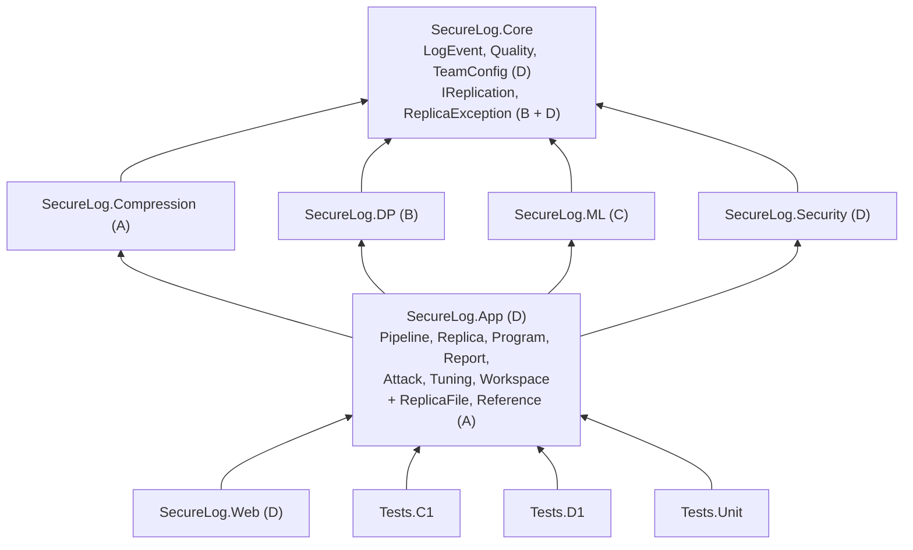
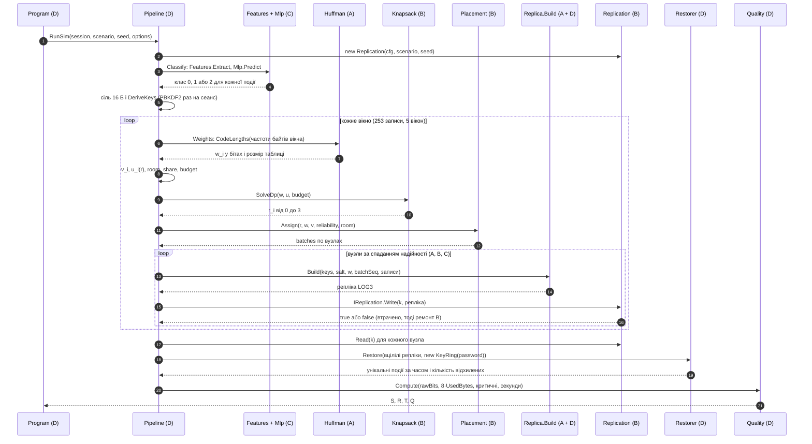

# Зона D — Security + Integration (`nykytenkovictoria`)

Посібник до захисту твоєї частини SecureLog. Тут пояснено, що робить кожен файл зони D, чому його зроблено саме так і що змінити, якщо на захисті попросять мікрозміну. Загальна карта системи й зони інших учасників — у [README.md](README.md) цієї папки.

Номери рядків звірено з кодом станом на 19.11.2026. Якщо код зміниться, посилання можуть з'їхати на кілька рядків: шукай за назвою методу.

---

## 1. Коротко про зону

Зона D складається з двох частин. Перша — **безпека**. З пароля сеансу PBKDF2 виводить два ключі. Навантаження репліки шифрується AES-256-CTR, а заголовок разом із шифротекстом підписується HMAC-SHA256. Відновлювач приймає репліку лише в порядку з розділу 5 специфікації. Друга частина — **інтеграція**. Зони A, B і C — окремі бібліотеки, які одна про одну не знають. Разом їх зводить конвеєр `Pipeline`, а навколо нього працюють відновлювач, CLI, звіт, атака на слабкий шифр, вебконсоль і документація. До зони D належить і спільне ядро: тип запису, конфіг і метрика Q.

**Безпека — `src/SecureLog.Security/`**

| Файл | Що робить |
|---|---|
| [Crypto.cs](../../src/SecureLog.Security/Crypto.cs) | PBKDF2 → `K_enc` і `K_mac`; AES-256-CTR, зібраний вручну поверх одного блоку AES; HMAC-SHA256; кеш ключів `KeyRing` |
| [Log3.cs](../../src/SecureLog.Security/Log3.cs) | заголовок репліки 43 байти; `Seal` — зашифрувати й підписати; `Open` — порядок приймання `E_SHORT → E_MAGIC → E_LENGTH → E_HMAC` → розшифрування |
| [WeakCipher.cs](../../src/SecureLog.Security/WeakCipher.cs) | навмисно слабкий XOR-шифр — мішень для атаки ГА; у LOG3 не використовується |

**Ядро — `src/SecureLog.Core/`**

| Файл | Що робить |
|---|---|
| [LogEvent.cs](../../src/SecureLog.Core/LogEvent.cs) | запис журналу: 8 полів, порівняння за значенням |
| [Quality.cs](../../src/SecureLog.Core/Quality.cs) | метрика `Q = α·S + β·R + γ·T` і правило `Q = 0` |
| [TeamConfig.cs](../../src/SecureLog.Core/TeamConfig.cs) | читає виданий `team_config.json` за українськими ключами; типи `Params`, `NodeConfig`, `Scenario` |
| [ReplicaException.cs](../../src/SecureLog.Core/ReplicaException.cs) | коди `E_*` і виняток «репліку відхилено». Файл створено в зоні B, властивість `Detail` — у зоні D |

**Інтеграція — `src/SecureLog.App/`**

| Файл | Що робить |
|---|---|
| [Pipeline.cs](../../src/SecureLog.App/Pipeline.cs) | повний прогін: класи → вікна → ДП → розміщення → репліки → вузли → відновлення → Q. Ремонт утрачених batch — частина B |
| [Replica.cs](../../src/SecureLog.App/Replica.cs) | `Replica.Build`/`Open` (A + D разом) і відновлювач `Restorer` |
| [Workspace.cs](../../src/SecureLog.App/Workspace.cs) | корінь репозиторію, пароль, завантаження конфігу, даних, моделі й параметрів ГА |
| [Program.cs](../../src/SecureLog.App/Program.cs) | CLI: `pack`, `unpack`, `check`, `train`, `run`, `ga`, `attack`, `report`; коди виходу 0/1/2. `Train()` — частина C |
| [Report.cs](../../src/SecureLog.App/Report.cs) | шість таблиць `docs/results/tables.md`. Таблицю 2 змінено в зоні B |
| [Attack.cs](../../src/SecureLog.App/Attack.cs) | атака на `WeakCipher`. Сам ГА (`Ga.Run`) — зона C |
| [Tuning.cs](../../src/SecureLog.App/Tuning.cs) | обгортка ГА над трьома параметрами системи. Пороги втрат у пристосованості — частина C |

**Вебконсоль — `src/SecureLog.Web/`**

| Файл | Що робить |
|---|---|
| [Program.cs](../../src/SecureLog.Web/Program.cs) | minimal API: `/api/info`, `/api/run`, `/api/tamper`, `/api/restore`, `/api/attack` |
| [index.html](../../src/SecureLog.Web/wwwroot/index.html), [app.js](../../src/SecureLog.Web/wwwroot/app.js), [app.css](../../src/SecureLog.Web/wwwroot/app.css) | сторінка, що відтворює вже виконаний прогін вікно за вікном |

**Тести.** У [UnitTests.cs](../../tests/SecureLog.Tests.Unit/UnitTests.cs) — `AesCtr_MatchesRfc3686` і `Attack_GaRecoversWeakCipherKey`. У [C1Tests.cs](../../tests/SecureLog.Tests.C1/C1Tests.cs) — налаштування класу, `C10`, `C11`, `C12` (увесь файл переведено на видані дані 14.11 у зоні D).

**Документація й зразки.** [README.md](../../README.md), [docs/decisions.md](../decisions.md), [docs/results/c1.md](../results/c1.md), [docs/attack.md](../attack.md), [samples/](../../samples/README.md), [.gitattributes](../../.gitattributes).

---

## 2. Що входить у твою частину

Твої коміти, згруповані за етапами. Після кожного — навіщо була потрібна зміна.

### Етап 1. Ядро (31.10–01.11)

- **31.10 «ядро — LogEvent, Quality, TeamConfig + team_config.json».** Спільні типи, на які спираються всі зони. Без них A, B і C не могли б працювати паралельно: кожна бібліотека посилається лише на `Core`. Конфіг тоді був власний; 14.11 його замінено виданим.
- **01.11 «прибрати Security/Class1, посилання на Core у csproj».** Шаблонний порожній клас прибрано. `SecureLog.Security` отримала посилання на `Core`, бо `Log3` кидає `ReplicaException` з ядра.

### Етап 2. Криптографія (03.11–04.11)

- **03.11 «Crypto — AES-CTR, HMAC-SHA256, PBKDF2-HMAC».** Розділ 4 специфікації: PBKDF2 на 100000 ітерацій, `K_enc`/`K_mac`, лічильник `nonce || uint32_BE(i)` від 1.
- **03.11 «Log3 — заголовок репліки, Encrypt-then-MAC».** Розділи 2 і 5: формат заголовка, HMAC над заголовком і шифротекстом, порядок приймання.
- **04.11 «WeakCipher — підкладка під ГА-атаку».** Завдання вимагає атаки ГА, а AES так не ламається. Тому потрібна окрема навмисно слабка мішень.

### Етап 3. Інтеграційний шар (06.11–07.11)

- **06.11 «SecureLog.App — Program, команда gen».** Перша версія CLI. Генератор `gen` потрібен був, доки не було виданих даних; 14.11 його прибрано.
- **07.11 «Workspace і Replica — куди складати, як писати і читати».** Пошук кореня репозиторію (тести й CLI запускаються з різних `bin/`), складання репліки з частин A і D, відновлювач.
- **07.11 «Pipeline — вікно → ДП → репліки → відновлення».** Місце, де вперше з'єднуються всі чотири зони.

### Етап 4. Тести, атака, налаштування (09.11–13.11)

- **09.11 «UnitTests — AES-CTR проти RFC 3686».** CTR зібрано вручну, тож без зовнішніх тест-векторів немає певності в порядку байтів лічильника й у тому, що лічильник починається з 1.
- **09.11 «Attack — ГА на слабкий шифр і колізії солей, docs/attack.md».** Увага: у назві коміту згадано колізії солей, але в `Attack.cs` (і в тому коміті, і зараз) є лише атака на XOR. Якщо спитають про солі, відповідь — у розділах 4.1 і 5 цього посібника (сіль одна на сеанс, nonce випадковий у кожної репліки).
- **10.11 «Tuning — обгортка ГА на 8 сценаріях».** «8» — це вісім seeds моделі відмов (`FitnessSeeds` 11–18) у кожному з трьох сценаріїв, разом 24 прогони на одне обчислення пристосованості. 14.11 у зоні C жорстку умову розширено з «усі критичні в штатному сценарії» до порогів усіх трьох сценаріїв ([decisions.md](../decisions.md), п. 8).
- **13.11 «юніт-тест Attack проти слабкого шифру».** Тест із фіксованим ключем: ключ має відновлюватися щоразу, а не лише в демонстрації з випадковим ключем.

### Етап 5. Звіт і вебконсоль (12.11)

- **12.11 «Report — таблиці по сценаріях і фінальне зведення».** Шість обов'язкових таблиць з одного коду, щоб їх можна було відтворити однією командою.
- **12.11 «вебконсоль — ASP.NET Core API на тому самому конвеєрі»** і **«вебконсоль — сторінка, стилі і скрипти».** Вебконсоль не має власної логіки: вона викликає той самий `Pipeline` і ловить підсумок кожного вікна через гачок `OnWindow`.

### Етап 6. Документи й результати (13.11)

- **«результати — C1 і шість таблиць звіту»**, **«README, зони відповідальності, конспект»** (`docs/roles.md`, `docs/notes.md`), **«лог рішень (п. 1–12)»**.

### Етап 7. Перехід на видані матеріали T01 (14.11)

14.11 команда отримала видані матеріали. Усі власні замінники треба було прибрати, а код — перевести на видані файли.

- **«видані матеріали T01 — team_config.json, replication.py, дані й еталонні пакети; власні замінники прибрано».** Прибрано власну модель вузлів `SimReplication`, власний конфіг, генератор і власні еталони ([decisions.md](../decisions.md), п. 1).
- **«TeamConfig читає виданий team_config.json за його ключами».** Виданий файл змінювати не можна, тому код підлаштовано під його українські ключі.
- **«конвеєр, CLI і звіт на Replication; пароль сеансу й seed з конфігу».** Конвеєр тепер працює з портом `replication.py` (зона B) через `IReplication`. Пароль береться з `пароль_сеансу`, типовий seed — `427243`.
- **«прибрати генератор gen — дані й еталони тепер видані».**
- **«Log3.Seal із заданим nonce — для звірки з еталонами».** Щоб зібрати еталонний пакет байт у байт, nonce треба задати ззовні. У самій системі nonce завжди випадковий.
- **«C1 на виданих даних — еталони викладача, пороги з конфігу, session.bin»** і **«таблиці звіту на виданих даних».**
- **«вебконсоль — вузли й бюджет сценарію з конфігу, відкритий seed 427243».**

### Етап 8. Виправлення й обмін файлами (14.11)

- **«fix вебконсолі — вага надійності з трьома знаками».** Надійність вузла B — 0.995, а `toFixed(2)` показувало 0.99. Тепер `toFixed(3)`: [app.js:230](../../src/SecureLog.Web/wwwroot/app.js#L230).
- **«ReplicaException.Detail — пояснення без коду помилки».** `ReplicaFile` (A) доповнює пояснення номером репліки й діапазоном байтів, а `Program` друкує `ВІДХИЛЕНО E_X: …`. Без `Detail` код помилки друкувався б двічі.
- **«команди pack і unpack, коди виходу, check [каталог]».** Перехресне оцінювання вимагає, щоб чужа команда могла запакувати свої дані й розпакувати наші. Коди виходу 0/1/2 розрізняють успіх, відхилену репліку й поганий вхід.
- **«довідка CLI — вирівняні колонки».**
- **«samples/ для перехресної перевірки, .gitattributes для .bin».** `*.bin binary` забороняє git міняти в бінарних файлах закінчення рядків. Інакше один змінений байт ламає HMAC репліки.
- **«README — встановлення, команди, таблиця для рецензента»**, **«c1.md і attack.md — прогін на виданих даних»**, **«лог рішень — матеріали T01, ремонт, ГА, файли реплік».**

---

## 3. Де твоя зона в системі

### 3а. Посилання між проєктами

Стрілка означає «посилається на» (`ProjectReference` у `.csproj`).



`SecureLog.Security` не знає про `Compression`. Тому `Log3.Open` повертає лише розшифроване навантаження, а розбирає його `Replica.Open` у `App`, де доступні обидві бібліотеки.

### 3б. Один повний `run` (сценарій, seed 427243)



### 3в. Хто викликає твій код і чий код викликаєш ти

| Твій код | Хто його викликає |
|---|---|
| `Crypto.DeriveKeys` | `Pipeline.Send` (D), `ReplicaFile.Pack` (A), `AttackDemo` (D), налаштування `C1Tests` |
| `KeyRing` | `Log3.Open`, `Restorer` (D); `ReplicaFile.Unpack`, `Reference.Check` (A); вебконсоль `/api/restore` |
| `Log3.Seal` | `Replica.Build` (D); `ReplicaFile.Pack` (A); `Reference.Compare` (A, із заданим nonce); тест `C11` |
| `Log3.Open` | `Replica.Open` (D); `ReplicaFile.Unpack`, `Reference.Compare` (A) |
| `Log3` константи | `ReplicaFile.Boundary` (A), `/api/tamper`, тести `C10`, round-trip тести (A) |
| `Crypto.AesCtr` | `Log3`; таблиця 4 у `Report`; тест RFC 3686 |
| `LogEvent`, `TeamConfig`, `Params` | усі зони: `EventCodec` (A), `Replication` (B), `Tuning.Decode` (C) |
| `Quality.Compute` | `Pipeline.Run` |
| `ReplicaException` | кидають `Log3` (D), `Payload`, `Huffman`, `EventCodec` (A); ловлять `Restorer`, `Program`, `ReplicaFile`, `Reference`, вебконсоль |
| `Pipeline.RunSim`/`Run` | `Program run`, `Tuning.Fitness` (C), `Report`, `/api/run`, тести C02, C06–C08, C12, D5 |
| `Replica.Build`/`Open`, `Restorer` | `Pipeline`, `AttackDemo`, `Reference.Check` (A, для `bad_*`), вебконсоль, тести C1 |
| `Workspace` | `Program`, `Report`, вебконсоль, усі три тестові проєкти |

| Чий код викликаєш ти | Де саме |
|---|---|
| A: `EventCodec.Encode`/`Decode`/`ReadCsv` | `Replica`, `Pipeline.Weights`, `Workspace.Csv`, `Attack`, `Report` |
| A: `Huffman.CodeLengths` | `Pipeline.Weights` — довжини кодів стають вагами `w_i` |
| A: `Payload.Pack`/`Unpack`, `Payload.FixedSize` | `Replica.Build`/`Open`, `Replica.Overhead`, таблиця 4 |
| A: `ReplicaFile`, `Reference` | команди `pack`, `unpack`, `check` |
| B: `Knapsack.SolveDp`/`SolveGreedy`/`Cost`/`Utility` | `Pipeline.Send`, `Report` |
| B: `Placement.Assign` | `Pipeline.Send` |
| B: `Replication` через `IReplication` | `Pipeline.RunSim`/`Send`, вебконсоль |
| C: `Features.Extract`, `Mlp.Predict`/`Load` | `Pipeline.Classify`, `Workspace.Model` |
| C: `Ga.Run`, `Ga.RandomSearch` | `Attack.RecoverKey`, `Tuning.Run` |
| .NET | `Rfc2898DeriveBytes.Pbkdf2`, `Aes.EncryptEcb`, `HMACSHA256.HashData`, `CryptographicOperations.FixedTimeEquals`, `RandomNumberGenerator` |

---

## 4. Розбір коду по файлах

### 4.1. `Crypto.cs` — ключі, AES-256-CTR, HMAC

**`Keys`** ([Crypto.cs:7](../../src/SecureLog.Security/Crypto.cs#L7)) — пара ключів: `Enc` для AES, `Mac` для HMAC.

**Константи** ([Crypto.cs:11](../../src/SecureLog.Security/Crypto.cs#L11)): `SaltSize = 16`, `NonceSize = 12`, `MacSize = 32`.

**`DeriveKeys`** ([Crypto.cs:14–18](../../src/SecureLog.Security/Crypto.cs#L14-L18)):

```csharp
byte[] master = Rfc2898DeriveBytes.Pbkdf2(password, salt, 100_000, HashAlgorithmName.SHA256, 64);
return new(master[..32], master[32..]);
```

1. PBKDF2-HMAC-SHA256: пароль (у UTF-8), сіль 16 байтів, 100000 ітерацій, 64 байти виходу. Усе це — розділ 4 специфікації.
2. `K_enc = master[0:32]`, `K_mac = master[32:64]`. Оператори `[..32]` і `[32..]` створюють копії.

Деталь, яку варто знати. SHA-256 дає 32 байти, тож для 64 байтів PBKDF2 рахує два незалежні блоки: `T1` (стає `K_enc`) і `T2` (стає `K_mac`), кожен на 100000 ітерацій. Тобто одне виведення — це 200000 обчислень HMAC. Нападнику, що перебирає паролі, досить порахувати `T2` і перевірити HMAC, тобто 100000 на спробу. Це відома особливість PBKDF2 з `dkLen` більшим за довжину хешу; параметри задає специфікація.

**`AesCtr`** ([Crypto.cs:24–43](../../src/SecureLog.Security/Crypto.cs#L24-L43)) — режим CTR, зібраний вручну:

1. [Рядок 26](../../src/SecureLog.Security/Crypto.cs#L26): ключ має бути 32 байти (AES-256), nonce — 12, інакше `ArgumentException`.
2. [Рядок 27](../../src/SecureLog.Security/Crypto.cs#L27): кількість блоків — `⌈довжина / 16⌉`.
3. [Рядки 28–33](../../src/SecureLog.Security/Crypto.cs#L28-L33): в один буфер записуються всі блоки лічильника. Байти 0–11 — nonce, байти 12–15 — `uint32` big-endian зі значенням `i + 1`. Лічильник починається з 1, як у специфікації і в RFC 3686.
4. [Рядки 35–38](../../src/SecureLog.Security/Crypto.cs#L35-L38): `aes.EncryptEcb(counters, PaddingMode.None)` шифрує кожен 16-байтовий блок лічильника окремо. Результат — гама `S_i = AES_K(nonce || i)`.
5. [Рядки 40–41](../../src/SecureLog.Security/Crypto.cs#L40-L41): `res[i] = data[i] ^ stream[i]`. Хвіст останнього блоку гами відкидається, тому доповнення (padding) не потрібне.

**Чому тут ECB і чому це не той «небезпечний ECB».** У класі `Aes` у .NET немає режиму CTR. ECB без доповнення над буфером лічильників — це просто «застосувати блочну функцію AES до кожного блоку окремо», а саме це й потрібно для CTR. Слабкість ECB (однакові блоки відкритого тексту дають однакові блоки шифротексту) тут не проявляється з двох причин: усі блоки лічильника різні, і дані через ECB не проходять — вони лише складаються з гамою через XOR.

**Чому шифрування й розшифрування — одна функція.** `C = P ⊕ S`, тоді `C ⊕ S = P ⊕ S ⊕ S = P`. Тому `Log3.Open` викликає той самий `AesCtr` ([Log3.cs:59](../../src/SecureLog.Security/Log3.cs#L59)), а тест RFC 3686 перевіряє обидва напрямки.

**Межа.** Лічильник 32-бітний: на один nonce — до 2³² блоків (64 ГіБ). У конвеєрі репліка не більша за 1024 байти, у `pack` — близько 1 МБ (65535 записів).

**`Hmac`** ([Crypto.cs:45](../../src/SecureLog.Security/Crypto.cs#L45)) — `HMACSHA256.HashData(key, data)`, 32 байти.

**`KeyRing`** ([Crypto.cs:49–59](../../src/SecureLog.Security/Crypto.cs#L49-L59)) — кеш ключів за сіллю:

```csharp
string id = Convert.ToHexString(salt);
if (!_cache.TryGetValue(id, out Keys? keys)) _cache[id] = keys = Crypto.DeriveKeys(password, salt);
```

- Зберігає пароль, а не ключ: ключі залежать від солі, записаної в заголовку кожної репліки. Тому відновлювач — окрема сторона, якій досить знати пароль ([Pipeline.cs:43](../../src/SecureLog.App/Pipeline.cs#L43)).
- PBKDF2 навмисно повільний. Відновлювач отримує до 15 реплік сеансу (5 вікон × 3 вузли), і в усіх одна сіль. Без кешу PBKDF2 рахувався б для кожної, і складова T помітно впала б. З кешем — один раз на сіль.
- `Dictionary` не потокобезпечний і не обмежений за розміром. Тут це нормально: кожен прогін і кожен запит вебконсолі створює свій `KeyRing`.

### 4.2. `Log3.cs` — формат репліки, `Seal` і `Open`

**Розкладка заголовка** ([Log3.cs:14–18](../../src/SecureLog.Security/Log3.cs#L14-L18)), усі числа big-endian:

| Зсув | Розмір | Поле | У коді |
|---:|---:|---|---|
| 0 | 4 | `"LOG3"` | `Magic` (рядок 18) |
| 4 | 1 | `version = 1` | `Version`, `s[4]` |
| 5 | 2 | `replica_group_id` (u16) | `GroupOffset = 5` — номер вікна |
| 7 | 4 | `batch_seq` (u32) | `SeqOffset = 7` — наскрізний номер batch у сеансі |
| 11 | 16 | `salt` | `SaltOffset = 11` |
| 27 | 12 | `nonce` | `NonceOffset = 27` |
| 39 | 4 | `ciphertext_len` (u32) | `LengthOffset = 39` |
| 43 | `ciphertext_len` | шифротекст | `HeaderSize = 43` |
| 43 + len | 32 | HMAC-SHA256 | `Crypto.MacSize` |

`Overhead = 43 + 32 = 75` ([рядок 16](../../src/SecureLog.Security/Log3.cs#L16)). Повна довжина — `75 + ciphertext_len`.

Приклад — [samples/01_one_record.replica.bin](../../samples/01_one_record.replica.bin), 105 байтів: `LOG3`, версія 1, група 0, `batch_seq` 0, сіль `1e46bb16…8376`, nonce `0a72aad2…a9550f`, `ciphertext_len = 30`. Тут 30 = 14 байтів обов'язкових полів навантаження + 16 байтів сирого запису (NO_COMPRESSION), і 43 + 30 + 32 = 105.

**`Seal`** ([Log3.cs:21–40](../../src/SecureLog.Security/Log3.cs#L21-L40)) — стиснене навантаження → репліка:

1. [Рядок 24](../../src/SecureLog.Security/Log3.cs#L24): буфер на `75 + payload.Length` байтів. CTR не змінює довжину, тому шифротекст має ту саму довжину, що й навантаження.
2. [Рядки 26–30](../../src/SecureLog.Security/Log3.cs#L26-L30): magic, версія, група, `batch_seq`, сіль.
3. [Рядки 32–34](../../src/SecureLog.Security/Log3.cs#L32-L34): nonce — це ділянка самого пакета. Типово її заповнює `RandomNumberGenerator.Fill` (криптографічний генератор). `fixedNonce` використовується лише тоді, коли `Reference` (A) збирає еталонний пакет заново.
4. [Рядок 35](../../src/SecureLog.Security/Log3.cs#L35): `ciphertext_len`.
5. [Рядок 37](../../src/SecureLog.Security/Log3.cs#L37): шифрування `AesCtr(K_enc, nonce, payload)` — одразу після заголовка.
6. [Рядок 38](../../src/SecureLog.Security/Log3.cs#L38): `HMAC(K_mac, packet[..^32])` — над заголовком **і** шифротекстом; результат записується в останні 32 байти.

Це **Encrypt-then-MAC**: підпис рахується над шифротекстом, а не над відкритим текстом. Заголовок теж підписаний, тому підмінити сіль, nonce, групу чи номер batch непомітно не вийде.

**`Open`** ([Log3.cs:46–61](../../src/SecureLog.Security/Log3.cs#L46-L61)) — порядок приймання з розділу 5:

```csharp
// скорочено; повний текст — у файлі
if (packet.Length < Overhead) throw new ReplicaException(ErrorCode.Short, ...);                         // 1
if (!packet[..4].SequenceEqual(Magic) || packet[4] != Version) throw new ReplicaException(ErrorCode.Magic, ...); // 2
if (Overhead + (long)ReadUInt32BigEndian(packet[LengthOffset..]) != packet.Length) throw ... ErrorCode.Length   // 3
Keys k = keys.Get(packet.Slice(SaltOffset, Crypto.SaltSize));
byte[] mac = Crypto.Hmac(k.Mac, packet[..^Crypto.MacSize]);
if (!CryptographicOperations.FixedTimeEquals(mac, packet[^Crypto.MacSize..])) throw ... ErrorCode.Hmac         // 4
byte[] payload = Crypto.AesCtr(k.Enc, nonce, ciphertext);                                                      // 5
```

1. [Рядок 48](../../src/SecureLog.Security/Log3.cs#L48) — **`E_SHORT`**: коротше за 75 байтів. Немає навіть повного заголовка й HMAC.
2. [Рядок 49](../../src/SecureLog.Security/Log3.cs#L49) — **`E_MAGIC`**: не `LOG3` або версія не 1.
3. [Рядки 50–51](../../src/SecureLog.Security/Log3.cs#L50-L51) — **`E_LENGTH`**: `75 + ciphertext_len ≠ довжина`. Приведення до `long` потрібне, бо `ciphertext_len` може дорівнювати `0xFFFFFFFF`, і в `int` сума переповнилася б.
4. [Рядки 53–57](../../src/SecureLog.Security/Log3.cs#L53-L57) — **`E_HMAC`**: ключі виводяться із солі заголовка (через кеш), HMAC порівнюється за сталий час.
5. [Рядок 59](../../src/SecureLog.Security/Log3.cs#L59): **лише тепер** розшифрування.
6. [Рядок 60](../../src/SecureLog.Security/Log3.cs#L60): повертаються група, `batch_seq` і відкрите навантаження. Крок 6 специфікації (строгий розбір, `E_PAYLOAD`/`E_CODE`) виконує код A у `Replica.Open`.

**Чому саме такий порядок.** Дешеві структурні перевірки йдуть першими: на сміття не витрачається PBKDF2 чи HMAC, і код помилки точний. HMAC перевіряється до розшифрування, тому неавтентичні байти взагалі не доходять до розшифрування й розбору. Розбір — останній, бо тільки він може виявити, що автентичне навантаження порушує формат.

**Який код дає зміна кожного байта** (перевіряє `C10`, звірено прогоном):

| Байти | Код | Чому |
|---|---|---|
| 0–3, 4 | `E_MAGIC` | magic або версія |
| 5–38 | `E_HMAC` | група, `batch_seq`, nonce підписані; змінена сіль дає інші ключі, і HMAC теж не збігається |
| 39–42 | `E_LENGTH` | заявлена довжина вже не відповідає фактичній |
| 43 і далі | `E_HMAC` | шифротекст і сам HMAC захищені лише HMAC |

**Сталий час.** `CryptographicOperations.FixedTimeEquals` завжди порівнює всі 32 байти. Звичайне `SequenceEqual` зупиняється на першій розбіжності. Тоді час відповіді показував би, скільки перших байтів підробленого HMAC правильні, і HMAC можна було б підбирати байт за байтом.

### 4.3. `WeakCipher.cs` — навмисно слабкий шифр

[WeakCipher.cs:9–14](../../src/SecureLog.Security/WeakCipher.cs#L9-L14): `res[i] = data[i] ^ key[i % key.Length]` — XOR з ключем, що повторюється. Шифрування й розшифрування — та сама функція. У форматі LOG3 він не використовується, лише в атаці.

**Чому довжина ключа 7 взаємно проста з 16.** Байт ключа `j` шифрує позиції `i ≡ j (mod 7)`, а всередині запису це зсув `i mod 16`. Оскільки НСД(7, 16) = 1, за китайською теоремою про остачі пари `(i mod 7, i mod 16)` за 112 байтів проходять усі 112 комбінацій. Отже, кожен байт ключа зустрічає всі 16 полів запису, зокрема дуже нерівномірні: старші байти полів (переважно нулі), `category` ≤ 15, `severity` ≤ 7, `critical` 0 або 1. Їхні частоти й видають ключ. З ключем у 8 байтів байт `j` потрапляв би лише на зсуви `j` і `j + 8`. Байт 3 шифрував би зсуви 3 і 11 — молодші байти `timestamp_ms` і `metric_value`, які майже рівномірні, тож за частотами його не відновити. Перша версія тесту з ключем у 8 байтів саме на цьому й упала ([decisions.md](../decisions.md), п. 10; [attack.md](../attack.md)).

### 4.4. `LogEvent.cs` — запис журналу

[LogEvent.cs:7–8](../../src/SecureLog.Core/LogEvent.cs#L7-L8): `readonly record struct LogEvent(uint Time, ushort Source, ushort Code, int Metric, byte Category, byte Severity, bool Critical, byte Flags)` — поля розділу 1 у тому самому порядку.

- `record struct` дає порівняння за значенням усіх полів і відповідний `GetHashCode`. Тому `HashSet<LogEvent>` у відновлювачі й `restoredSet.Contains(e)` у конвеєрі порівнюють записи за змістом.
- Окремого номера запис не має: ідентичність — це точне 16-байтове подання (розділ 1 специфікації). `Critical` має тип `bool`, але `EventCodec.Decode` (A) відхиляє будь-яке значення, крім 0 і 1. Тому рівність `LogEvent` еквівалентна рівності 16 байтів.

### 4.5. `Quality.cs` — метрика Q

[Quality.cs:6–14](../../src/SecureLog.Core/Quality.cs#L6-L14):

```csharp
double s = rawBits == 0 ? 0 : (double)rawBits / (rawBits + storedBits);
double r = critTotal == 0 ? 1 : (double)critRestored / critTotal;
double t = c.TRef / (c.TRef + seconds);
double q = critTotal > 0 && critRestored == 0 ? 0 : c.Alpha * s + c.Beta * r + c.Gamma * t;
```

- **S** — ефективність ресурсу: `B_ref / (B_ref + B_stored)`, де `B_ref = 8 · 16 · n` бітів сирого журналу, `B_stored = 8 · global_used_bytes`. Чим менше записано на вузли, тим S ближче до 1. Якщо записано стільки ж, скільки займає сирий журнал, S = 0.5. Для порожнього журналу S = 0.
- **R** — частка відновлених критичних подій; якщо критичних немає — 1.
- **T** — `30 / (30 + t)`, де `t_ref = 30 с` з конфігу.
- **Q** = `0.35·S + 0.5·R + 0.15·T` (ваги з `метрика_Q`). Правило з умови: якщо критичні події були, але не відновлено жодної, Q = 0 ([рядок 12](../../src/SecureLog.Core/Quality.cs#L12)).

Звідки беруться аргументи: [Pipeline.cs:49–52](../../src/SecureLog.App/Pipeline.cs#L49-L52). Приклад із `run normal`: сирий журнал 19200 байтів, на вузли списано 11736 байтів. Тоді S = 153600 / (153600 + 93888) = 0.621, і Q = 0.35·0.621 + 0.5·1 + 0.15·0.993 ≈ 0.866.

### 4.6. `TeamConfig.cs` — виданий конфіг

**Допоміжні типи:** `Params(Window, MinGain, SecondCopyFactor)` — три параметри, які налаштовує ГА ([рядок 6](../../src/SecureLog.Core/TeamConfig.cs#L6)); `NodeConfig` — вузол сценарію ([рядок 9](../../src/SecureLog.Core/TeamConfig.cs#L9)); `Scenario` — глобальний бюджет і вузли ([рядок 12](../../src/SecureLog.Core/TeamConfig.cs#L12)).

**`Json`** ([рядки 21–25](../../src/SecureLog.Core/TeamConfig.cs#L21-L25)) — налаштування серіалізації `snake_case` для власних файлів команди `data/ga_params.json` і `model.json`. Саме тому в `ga_params.json` ключі `window`, `min_gain`, `second_copy_factor`.

**`ScenarioKeys`** ([рядки 28–33](../../src/SecureLog.Core/TeamConfig.cs#L28-L33)): внутрішні назви `normal`/`degraded`/`emergency` (CLI, тести, звіт) → ключі `штатний`/`деградований`/`аварійний` у конфігу.

**`Load`** ([рядки 71–103](../../src/SecureLog.Core/TeamConfig.cs#L71-L103)) читає файл через `JsonDocument` і `GetProperty`:

| Ключ у `team_config.json` | Властивість | Значення T01 |
|---|---|---|
| `команда`, `seed`, `пароль_сеансу` | `Team`, `Seed`, `Password` | T01, 3001, `algo2026` |
| `метрика_Q.alpha/beta/gamma/t_ref_секунд` | `Alpha`, `Beta`, `Gamma`, `TRef` | 0.35, 0.5, 0.15, 30 |
| `реплікація.replication_window_records` | `ReplicationWindowRecords` | 48 |
| `реплікація.max_batch_bytes` | `MaxBatchBytes` | 1024 |
| `реплікація.replication_budget_bits` | `ReplicationBudgetBits` | 5000 |
| `second_copy_factor`, `third_copy_factor` | `SecondCopyFactor`, `ThirdCopyFactor` | 1.55, 1.85 |
| `seed_моделі_реплікації` | `ReplicationSeed` | 427243 |
| `сценарії.<назва>` | `Scenarios["normal"…]` через `ReadScenario` | бюджет і вузли A, B, C |
| `класифікатор.класи` + `пріоритети_класів` | `ClassPriority` | `[1, 5, 4]` |
| `critical_bonus` | `CriticalBonus` | 5 |
| `пороги_втрати_критичних_подій` | `CriticalLossMax` | 0, 0.1, 0.45 |
| `ліміт_часу_повного_прогону_секунд` | `TimeLimitS` | 180 |
| `класифікатор.F1_min` | `F1Min` | 0.56 |

`ClassPriority` ([рядки 96–97](../../src/SecureLog.Core/TeamConfig.cs#L96-L97)) збирається у два кроки, бо класи в конфігу названо словами: `"0"` → `"штатна подія"` → пріоритет 1. Класи впорядковуються за номером, тож `ClassPriority[c]` — пріоритет класу `c`.

`ReadScenario` ([рядки 105–112](../../src/SecureLog.Core/TeamConfig.cs#L105-L112)) читає вузли в порядку файлу: A, B, C.

Не читаються: `версія_формату`, коментарі, рядок `формула`, `class_table_у_задачі`, базові лінії класифікатора, список ознак, протокол навчання, `довідково`. Командних параметрів, яких у конфігу немає, три, і вони мають значення за замовчуванням: `HistoryMs = 800`, `Hidden = [24]`, `NoCompressionMinGain = 0` ([рядки 64–66](../../src/SecureLog.Core/TeamConfig.cs#L64-L66)). `DefaultParams()` ([рядок 69](../../src/SecureLog.Core/TeamConfig.cs#L69)) — параметри «без ГА»: вікно 48, поріг 0, коефіцієнт 1.55.

Якщо ключа немає, `GetProperty` кидає `KeyNotFoundException` одразу під час запуску. Для виданого файлу, який не змінюється, це правильна поведінка.

### 4.7. `ReplicaException.cs` — коди відхилення

- `ErrorCode` ([рядки 4–12](../../src/SecureLog.Core/ReplicaException.cs#L4-L12)) — шість кодів з розділу 5: `E_SHORT`, `E_MAGIC`, `E_LENGTH`, `E_HMAC`, `E_PAYLOAD`, `E_CODE`.
- `ReplicaException` ([рядки 15–21](../../src/SecureLog.Core/ReplicaException.cs#L15-L21)): `Message` = `"E_X: пояснення"`, `Code` — сам код, `Detail` — пояснення без коду (частина D, 14.11).
- Окремий тип потрібен, щоб `catch (ReplicaException)` ловив лише «погані дані». Справжня помилка програми (наприклад, вихід за межі масиву) не маскується під відхилену репліку, а падає явно.
- Кидають: `Log3.Open` (перші чотири коди), `Payload`, `Huffman`, `EventCodec` (A: `E_PAYLOAD`, `E_CODE`). Ловлять: `Restorer`, `Program` (код виходу 1), `ReplicaFile.Unpack` (додає номер репліки через `Detail`), `Reference.Check`, `/api/restore`.

### 4.8. `Replica.cs` — репліка і відновлювач

**`Replica.Overhead`** ([рядок 11](../../src/SecureLog.App/Replica.cs#L11)) = `Log3.Overhead + Payload.FixedSize` = 75 + 14 = **89** байтів. Це заголовок, HMAC і обов'язкові поля навантаження: `record_count` 2, `flags` 1, `reserved` 1, `table_nsym` 2, `symbol_count` 4, `bitstream_len` 4. Конвеєр віднімає їх, коли рахує місце в batch і бюджет.

**`Build`** ([рядки 13–15](../../src/SecureLog.App/Replica.cs#L13-L15)): `EventCodec.Encode` (A) → `Payload.Pack` (A: Гаффман або NO_COMPRESSION за порогом `minGain`) → `Log3.Seal` (D). Тобто стиснути → зашифрувати → підписати.

**`Open`** ([рядки 18–19](../../src/SecureLog.App/Replica.cs#L18-L19)): `Log3.Open` (D) → `Payload.Unpack` (A) → `EventCodec.Decode` (A). Будь-яке порушення дає `ReplicaException`.

**`Restorer.Restore`** ([рядки 25–41](../../src/SecureLog.App/Replica.cs#L25-L41)):

```csharp
var unique = new HashSet<LogEvent>();
foreach (byte[] packet in replicas)
{
    try { unique.UnionWith(Replica.Open(packet, keys)); }
    catch (ReplicaException) { rejected++; }
}
return (unique.OrderBy(e => e.Time).ToArray(), rejected);
```

1. Перебирає всі вцілілі копії з усіх вузлів.
2. `UnionWith` додає лише нові записи. Та сама подія з другого чи третього вузла вже є в множині, тож не дублюється. Дедуплікація — за точними 16 байтами, бо окремого номера в запису немає (див. 4.4).
3. Зіпсована копія дає `rejected++` і **не зупиняє** відновлення: той самий запис може вціліти на іншому вузлі. Ловиться лише `ReplicaException`, тому помилки самої програми не ховаються.
4. Підсумок упорядковано за `timestamp_ms` (у сеансі він унікальний), тобто відновлено порядок журналу.

Відновлювач не перевіряє `batch_seq` і `replica_group_id`: специфікація цього не вимагає, а втрати вимірює R. Наслідок — розділ 5 (повтор старої репліки).

### 4.9. `Pipeline.cs` — конвеєр

**Типи-обгортки.** `RunOptions` ([рядки 12–22](../../src/SecureLog.App/Pipeline.cs#L12-L22)): параметри ГА `P`; перемикачі `UseMlp`, `UseDp`, `MaxCopies` для експериментів «з блоком / без блоку»; `Repair` (частина B, рядок 15); гачки `OnKnapsack` (порівняння ДП із жадібним у звіті й тесті C06) і `OnWindow` (вебконсоль). `WindowTrace` ([рядок 28](../../src/SecureLog.App/Pipeline.cs#L28)) — підсумок вікна для UI. `RunResult` ([рядки 30–31](../../src/SecureLog.App/Pipeline.cs#L30-L31)) — результат прогону.

**`RunSim`** ([рядки 36–37](../../src/SecureLog.App/Pipeline.cs#L36-L37)) створює модель вузлів `Replication` (B) для сценарію й seed і викликає `Run`.

**`Run`** ([рядки 39–54](../../src/SecureLog.App/Pipeline.cs#L39-L54)):

1. Таймер вмикається до `Send` і зупиняється після відновлення, тож T охоплює все: класифікацію, ДП, стиснення, обидва PBKDF2 (передавача й відновлювача), шифрування й розбір.
2. Відновлювач отримує лише репліки з вузлів і `new KeyRing(password)`. Ключів передавача він не бачить.
3. Рахуються критичні події — усього і відновлених ([рядки 48–50](../../src/SecureLog.App/Pipeline.cs#L48-L50)). Сирі біти — `8 · n · 16`, збережені — `8 · nodes.UsedBytes` ([рядок 51](../../src/SecureLog.App/Pipeline.cs#L51)).

**`Send`** ([рядки 56–136](../../src/SecureLog.App/Pipeline.cs#L56-L136)) — серце конвеєра. Частини зони B позначено **[B]**.

*Підготовка сеансу:*

- [Рядок 58](../../src/SecureLog.App/Pipeline.cs#L58): порожній журнал — нічого не пишемо (кейс C02).
- [Рядок 59](../../src/SecureLog.App/Pipeline.cs#L59): класи всіх подій (`Classify`).
- [Рядки 60–61](../../src/SecureLog.App/Pipeline.cs#L60-L61): **одна випадкова сіль на сеанс**, `DeriveKeys` — один раз.
- [Рядок 63](../../src/SecureLog.App/Pipeline.cs#L63): кількість вузлів і розмір вікна (не менше 1).
- [Рядок 64](../../src/SecureLog.App/Pipeline.cs#L64): `reliability_weight` вузлів з конфігу.
- [Рядок 66](../../src/SecureLog.App/Pipeline.cs#L66): кумулятивні коефіцієнти `[0, 1, second, third]`, обрізані до `min(MaxCopies, 3, вузлів) + 1`. Довжина рядка корисності визначає, скільки копій ДП узагалі може обрати.
- [Рядки 68–69](../../src/SecureLog.App/Pipeline.cs#L68-L69): кількість вікон `⌈n / size⌉` (з вікном 253: 4 × 253 + 188, тобто 5 вікон); `batchSeq = 0`.

*Для кожного вікна `w`:*

1. [Рядок 72](../../src/SecureLog.App/Pipeline.cs#L72): записи вікна.
2. [Рядок 73](../../src/SecureLog.App/Pipeline.cs#L73): `Weights` — ваги `w_i` у бітах і розмір таблиці.
3. [Рядок 74](../../src/SecureLog.App/Pipeline.cs#L74): цінність `v_i = ClassPriority[клас] + CriticalBonus · [critical]`, наприклад критична аномалія — 5 + 5 = 10.
4. [Рядок 75](../../src/SecureLog.App/Pipeline.cs#L75): корисність `u_i(r) = v_i · factor[r]`.
5. [Рядок 78](../../src/SecureLog.App/Pipeline.cs#L78): локальна функція `Limit(k) = min(max_batch_bytes, вільне місце вузла k)`. Вона перераховується при кожному виклику, бо вільне місце змінюється після запису.
6. [Рядок 79](../../src/SecureLog.App/Pipeline.cs#L79): `room[k] = 8 · max(0, Limit(k) − 89 − tableBytes)` — місце в batch у «бітах Гаффмана» для `Placement`. Це верхня межа: власна таблиця batch будується за його частотами, тому вона не довша за таблицю вікна, а потік не довший за суму ваг.
7. [Рядок 85](../../src/SecureLog.App/Pipeline.cs#L85): `share = (BudgetBytes − UsedBytes) / (вікон, що лишились)` — рівна частка залишку глобального бюджету.
8. [Рядок 86](../../src/SecureLog.App/Pipeline.cs#L86): `ratio = середня вага / 128` — скільки бітів Гаффмана припадає на біт сирого запису.
9. [Рядок 87](../../src/SecureLog.App/Pipeline.cs#L87): `windowBudget = 5000 · n / 48` — бюджет ДП пропорційно довжині вікна (для 253 записів — 26354 біти). Зі сталим бюджетом ГА збільшував вікно, на запис припадало менше бітів, і некритичні події відкидалися ([decisions.md](../decisions.md), п. 5).
10. [Рядок 88](../../src/SecureLog.App/Pipeline.cs#L88): `budget = clamp((share − вузлів · 89) · 8 · ratio, 0, windowBudget)`. Частка глобального бюджету без накладних витрат трьох batch переводиться в біти Гаффмана. Діє менше з двох обмежень. Приблизний розрахунок для першого вікна (`ratio` близько 0.6, точне значення залежить від вікна): у штатному сценарії частка — 42182 / 5 = 8436 байтів, тобто (8436 − 3·89)·8·0.6 ≈ 39 тис. бітів. Це більше за 26354, тож діє бюджет вікна. В аварійному частка — 20132 / 5 = 4026 байтів ≈ 18 тис. бітів, і обмежує вже вона.
11. [Рядок 90](../../src/SecureLog.App/Pipeline.cs#L90): гачок `OnKnapsack` отримує екземпляр рюкзака.
12. [Рядок 91](../../src/SecureLog.App/Pipeline.cs#L91): `copies` — ДП або жадібний (B).
13. [Рядок 92](../../src/SecureLog.App/Pipeline.cs#L92): `Placement.Assign` (B) розкладає копії по вузлах. Копії однієї події — лише на різних вузлах, кожен список не перевищує `room[k]`.
14. [Рядки 96–97](../../src/SecureLog.App/Pipeline.cs#L96-L97) **[B]**: `saved` (подія вже має збережену копію) і `orphans` (події з неуспішних batch, ще без жодної копії).
15. [Рядок 100](../../src/SecureLog.App/Pipeline.cs#L100): вузли обходяться **за спаданням надійності** (A 1.0, B 0.995, C 0.99 у штатному). Якщо частка бюджету скінчиться посеред вікна, без копії лишиться найслабший вузол.
16. [Рядки 104–105](../../src/SecureLog.App/Pipeline.cs#L104-L105) **[B]**: якщо сиріт немає, batch — список від `Placement`. Інакше до нього додаються сироти, яких тут ще немає і які ще не збережені, і все сортується за спаданням цінності.
17. [Рядки 106–129](../../src/SecureLog.App/Pipeline.cs#L106-L129) — цикл одного batch:
    - [рядок 108](../../src/SecureLog.App/Pipeline.cs#L108): `Replica.Build(keys, salt, (ushort)w, batchSeq, …)`. Група — номер вікна, `batch_seq` — наскрізний номер;
    - [рядок 109](../../src/SecureLog.App/Pipeline.cs#L109): пакет має вміститися і в `Limit(k)`, і в залишок частки `share`;
    - [рядки 113–115](../../src/SecureLog.App/Pipeline.cs#L113-L115) **[B]**: `Write` повертає `false` і тоді, коли байти вже списано (копію втрачено у стані BAD). Тому облік ведеться за фактичною зміною `UsedBytes`;
    - [рядки 117–120](../../src/SecureLog.App/Pipeline.cs#L117-L120): якщо байти списано, зменшується `share`, росте `batchSeq`, запам'ятовуються `sent[k]` і `sentBytes[k]`;
    - [рядки 122–124](../../src/SecureLog.App/Pipeline.cs#L122-L124) **[B]**: збережено — події позначаються `saved`; ні — стають сиротами (якщо `Repair` увімкнено);
    - [рядок 125](../../src/SecureLog.App/Pipeline.cs#L125): `break` — **після першої ж спроби запису**. На той самий вузол у цьому вікні вдруге не пишемо;
    - [рядок 128](../../src/SecureLog.App/Pipeline.cs#L128): не вмістилося — відкидається найменш цінний хвіст: `ids.RemoveRange(ids.Count * 9 / 10, …)`, тобто останні ~10 %, але щонайменше один елемент (для 1–10 елементів ціла частина від `9n/10` дорівнює `n − 1`). Тому цикл завжди закінчується.
18. [Рядок 130](../../src/SecureLog.App/Pipeline.cs#L130): якщо нічого не записано, `sent[k]` — порожній масив.
19. [Рядки 133–134](../../src/SecureLog.App/Pipeline.cs#L133-L134): гачок `OnWindow` отримує `WindowTrace`. `UsedBits` у ньому — вартість рішення ДП, а не фактично надіслані байти.

**Як дотримано правил розділу 3.5.** «Не більше одного batch на вузол за вікно» забезпечує `break` після першого `Write`: обрізання відбувається лише до запису, а повторної спроби для того самого `k` немає. «Копії однієї події — на різних вузлах» забезпечують `Placement` (масив `placed[i, k]`) і ремонт, який додає сироту лише в batch, де її ще немає (`!batches[k].Contains(i)`), і лише на наступні вузли циклу. «Batch ≤ `max_batch_bytes`» забезпечує перевірка `packet.Length <= Limit(k)` з обрізанням хвоста.

**`Classify`** ([рядки 138–142](../../src/SecureLog.App/Pipeline.cs#L138-L142)). Без моделі або з `UseMlp = false` усі події вважаються класом 0. Інакше `Features.Extract(events, 800 мс)` → `Mlp.Predict` (зона C).

**`Weights`** ([рядки 148–160](../../src/SecureLog.App/Pipeline.cs#L148-L160)). Одна таблиця Гаффмана на вікно (розділ 3.5): частоти всіх байтів вікна → `Huffman.CodeLengths` (A) → `w_i` = сума довжин кодів 16 байтів запису. Другим значенням повертається розмір таблиці `2 · кількість символів` (пари «символ, довжина»).

### 4.10. `Workspace.cs` — шляхи й дані

- `FindRoot` ([рядки 33–38](../../src/SecureLog.App/Workspace.cs#L33-L38)) іде вгору від `AppContext.BaseDirectory` до теки з `SecureLog.slnx`. Тому і CLI з `src/SecureLog.App/bin/Release/net10.0`, і тести зі своїх `bin/` знаходять `data/`, `reference/` і конфіг. Якщо `.slnx` не знайдено — поточна тека.
- `Password` ([рядок 16](../../src/SecureLog.App/Workspace.cs#L16)): змінна середовища `SECURELOG_PASSWORD`, інакше `пароль_сеансу` з конфігу.
- `Config`, `Csv`, `Session`, `Model` ([рядки 18–24](../../src/SecureLog.App/Workspace.cs#L18-L24)) — завантаження. `Model()` повертає `null`, якщо `data/model.json` немає.
- `BestParams` ([рядки 27–31](../../src/SecureLog.App/Workspace.cs#L27-L31)): `data/ga_params.json` (вікно 253, поріг 0, коефіцієнт 1.4906), а якщо файлу немає — `DefaultParams()`.

### 4.11. `Program.cs` — CLI

**Старт** ([рядки 10–14](../../src/SecureLog.App/Program.cs#L10-L14)): консоль в UTF-8, `InvariantCulture` (десяткова крапка в таблицях і CSV), конфіг, пароль `--password` або `Workspace.Password`.

**Обробка помилок і коди виходу** ([рядки 15–29](../../src/SecureLog.App/Program.cs#L15-L29)):

| Код | Коли | Що друкується |
|---|---|---|
| 0 | успіх; також довідка без команди | результат |
| 1 | `ReplicaException` (репліку відхилено) або в `check` щось не збіглося ([рядок 149](../../src/SecureLog.App/Program.cs#L149)) | `ВІДХИЛЕНО E_X: <Detail>. Вихідний файл не записано.` |
| 2 | `IOException`, `UnauthorizedAccessException`, `InvalidDataException`, `FormatException`, `ArgumentException` — поганий вхід, аргументи, файли | `помилка: …` |

Інші винятки навмисно не ловляться: це помилки програми, і їх видно зі стеком.

**Команди** (`Dispatch`, [рядки 31–78](../../src/SecureLog.App/Program.cs#L31-L78)):

- `pack` → `PackFile` ([рядки 97–105](../../src/SecureLog.App/Program.cs#L97-L105)): `ReplicaFile.ReadRecords` (A, перевіряє записи за розділом 1) → `ReplicaFile.Pack` (A, далі `Payload.Pack` + `Log3.Seal`). Кількість реплік — `max(1, ⌈записів / 65535⌉)`.
- `unpack` → `UnpackFile` ([рядки 107–114](../../src/SecureLog.App/Program.cs#L107-L114)): `ReplicaFile.Unpack` (A) читає й перевіряє **увесь** файл. Вихідний файл пишеться лише після цього, тож частково відновлених даних не буває.
- `check` → `CheckReference` ([рядки 142–150](../../src/SecureLog.App/Program.cs#L142-L150)): `Reference.Check` (A) для каталогу (типово `reference/`), таблиця вердиктів, код 1 за будь-якої розбіжності.
- `train` → `Train()` ([рядки 123–140](../../src/SecureLog.App/Program.cs#L123-L140)) — частина C. Перезаписує `data/model.json`.
- `run [сценарій] [seed]` ([рядки 47–53](../../src/SecureLog.App/Program.cs#L47-L53)): без сценарію — усі три (`Tuning.Scenarios`), без seed — `cfg.ReplicationSeed` (427243). Параметри — `Workspace.BestParams`.
- `ga` → `Tuning.Run`, `report` → `Report.Write` — перезаписують файли в `data/` і `docs/results/`.
- `attack` → `AttackDemo` ([рядки 152–166](../../src/SecureLog.App/Program.cs#L152-L166)). Спершу ГА відновлює ключ слабкого шифру. Потім будується репліка з перших 50 подій, у байті `Log3.HeaderSize + 3` (46, четвертий байт шифротексту) змінюється біт 0, і відновлювач має відхилити її з `E_HMAC`.
- Без команди або з невідомою — довідка ([рядки 64–75](../../src/SecureLog.App/Program.cs#L64-L75)).

**Аргументи.** `Option` ([рядки 81–85](../../src/SecureLog.App/Program.cs#L81-L85)) повертає значення після `--password`. `Positional` ([рядки 87–88](../../src/SecureLog.App/Program.cs#L87-L88)) бере все після команди, що не починається з `--` і не стоїть одразу після `--password`. Трюк з індексом: у `args.Skip(1)` елемент з індексом `i` — це `args[i + 1]`, тож `args[i]` — попередній аргумент. `TwoPaths` ([рядки 90–95](../../src/SecureLog.App/Program.cs#L90-L95)) вимагає рівно два шляхи, інакше `ArgumentException` і код 2.

`--password` діє лише на `pack`, `unpack`, `check`. `run`, `attack` і `report` створюють конвеєр через `NewPipeline` ([рядки 116–121](../../src/SecureLog.App/Program.cs#L116-L121)) з `Workspace.Password`.

### 4.12. `Report.cs` — шість таблиць

Середнє рахується за 20 seeds моделі відмов 21–40 ([рядок 15](../../src/SecureLog.App/Report.cs#L15)) — вони не перетинаються з seeds пристосованості ГА (11–18). `Mean` ([рядки 103–109](../../src/SecureLog.App/Report.cs#L103-L109)) запускає `RunSim` на кожному seed і усереднює S, R, T, Q, збережені біти, відновлені події й відхилені репліки. `Solve` ([рядки 111–124](../../src/SecureLog.App/Report.cs#L111-L124)) розв'язує зібрані екземпляри рюкзака одним методом і міряє суму корисності, біти й час.

| № | Як рахується | Рядки |
|---|---|---|
| 1. ДП проти жадібного | один прогін на seed 427243 з `OnKnapsack` збирає екземпляри; кожен розв'язується ДП і жадібним. Для `emergency` додатковий рядок із бюджетом × 0.7 | [25–40](../../src/SecureLog.App/Report.cs#L25-L40) |
| 2. Вплив копій (змінено в зоні B) | параметри ГА і конфігу × ремонт так/ні × degraded, emergency × `MaxCopies` 1–3 → S, R, Q, кбіт | [43–51](../../src/SecureLog.App/Report.cs#L43-L51) |
| 3. Вплив блоків | без перцептрона, без ДП, без ремонту, без ГА, повна система — середній Q по сценаріях | [53–66](../../src/SecureLog.App/Report.cs#L53-L66) |
| 4. Стиснення до і після шифрування | сирий журнал і той самий журнал, зашифрований AES-CTR випадковим ключем: розмір із примусовим Гаффманом (`minGain = −10`) і обраний режим | [68–76](../../src/SecureLog.App/Report.cs#L68-L76) |
| 5. Три сценарії | S, R, T, Q, частка глобального бюджету `StoredBits / (8 · global_budget)`, відновлені події, відхилені репліки | [78–84](../../src/SecureLog.App/Report.cs#L78-L84) |
| 6. Збіжність ГА | читає `docs/results/ga_log.csv`, створений командою `ga` | [86–96](../../src/SecureLog.App/Report.cs#L86-L96) |

Таблиця 4 — аргумент на захист порядку «стиснути → зашифрувати». Сирий журнал Гаффман стискає з 19200 до 11920 байтів. Шифротекст статистично схожий на випадкові байти, тому Гаффман лише додає таблицю (19726), і обирається NO_COMPRESSION (19214 = 19200 + 14).

### 4.13. `Attack.cs` — атака ГА на слабкий шифр

**`Demo`** ([рядки 13–20](../../src/SecureLog.App/Attack.cs#L13-L20)): випадковий ключ 7 байтів, перші 16384 байти сесії шифруються `WeakCipher`, нападник отримує лише шифротекст і навчальний журнал `train.csv`.

**`RecoverKey`** ([рядки 26–55](../../src/SecureLog.App/Attack.cs#L26-L55)):

1. [Рядки 28–31](../../src/SecureLog.App/Attack.cs#L28-L31): `logP[b] = ln((count[b] + 1) / (N + 256))` — частоти байтів навчального журналу зі згладжуванням Лапласа (жоден байт не має нульової ймовірності, тож логарифм скінченний).
2. [Рядки 33–38](../../src/SecureLog.App/Attack.cs#L33-L38): пристосованість ключа — середній `logP` розшифрованих ним байтів. Правильний ключ повертає нерівномірний розподіл журналу, хибний розмиває його.
3. [Рядки 40–54](../../src/SecureLog.App/Attack.cs#L40-L54): `Ga.Run` (C). Хромосома — 7 випадкових байтів; кросовер рівномірний по байтах; мутація з імовірністю 0.6 замінює один байт; популяція 100, 300 поколінь. Турнір із 3 і елітизм 2 — типові параметри `Ga.Run`. Обчислень пристосованості: 100 + 300 · (100 − 2) = 29500.

**Чому ГА тут працює.** Пристосованість розкладається в суму за позиціями ключа: кожен байт ключа впливає лише на «свої» позиції. Правильний байт підвищує пристосованість незалежно від інших, а кросовер збирає правильні байти з різних особин.

### 4.14. `Tuning.cs` — обгортка ГА для параметрів системи

- `Scenarios` і `FitnessSeeds` 11–18 ([рядки 11–13](../../src/SecureLog.App/Tuning.cs#L11-L13)).
- `Decode` ([рядки 19–20](../../src/SecureLog.App/Tuning.cs#L19-L20)): три гени з `[0, 1]` → вікно `round(16 · 16^g0)` (від 16 до 256, логарифмічна шкала), поріг NO_COMPRESSION `0.3 · g1`, коефіцієнт другої копії `1 + g2 · (1.85 − 1)`. Коефіцієнт не перевищує третього, щоб третя копія не стала «гіршою» за другу.
- `Fitness` ([рядки 26–37](../../src/SecureLog.App/Tuning.cs#L26-L37)): 24 прогони паралельно (`AsParallel`), середній Q мінус кількість прогонів, що порушили поріг втрати критичних подій свого сценарію ([рядок 35](../../src/SecureLog.App/Tuning.cs#L35) — частина C).
- `Create`, `Crossover` (арифметичний), `Mutate` (гаусова, з імовірністю 0.3 на ген) — [рядки 39–47](../../src/SecureLog.App/Tuning.cs#L39-L47). `Gauss` — перетворення Бокса — Мюллера ([рядки 70–71](../../src/SecureLog.App/Tuning.cs#L70-L71)).
- `Run` ([рядки 50–68](../../src/SecureLog.App/Tuning.cs#L50-L68)): ГА і випадковий пошук з однаковою кількістю обчислень (12 + 10 · 10 = 112). Пише `docs/results/ga_log.csv` і `data/ga_params.json`. Перед захистом без потреби не запускай: це перезапише параметри.

### 4.15. Вебконсоль

**Сервер** ([src/SecureLog.Web/Program.cs](../../src/SecureLog.Web/Program.cs)). На старті ([рядки 14–18](../../src/SecureLog.Web/Program.cs#L14-L18)) один раз завантажуються конфіг, модель, сесія й параметри ГА. `nodes` і `runPassword` ([рядки 20–22](../../src/SecureLog.Web/Program.cs#L20-L22)) зберігають вузли останнього прогону під замком `gate`, щоб їх можна було зіпсувати й відновити ще раз. Статичні файли — з `wwwroot` ([рядки 24–30](../../src/SecureLog.Web/Program.cs#L24-L30)).

| Метод | Що робить | Рядки |
|---|---|---|
| `GET /api/info` | кількість подій і критичних, шари моделі, параметри ГА, відкритий seed, сценарії з вузлами | [32–42](../../src/SecureLog.Web/Program.cs#L32-L42) |
| `POST /api/run` `{scenario, seed, password?}` | перевіряє назву сценарію (400 для невідомої); `Pipeline.Run` з `OnWindow = traces.Add`; зберігає вузли; повертає підсумок (S, R, T, Q, байти, бюджет), вузли, вікна (бюджет, біти ДП, гістограму копій 0–3, розміри batch) і кожну подію з класом, вузлами копій і ознакою «відновлено» | [44–88](../../src/SecureLog.Web/Program.cs#L44-L88) |
| `POST /api/tamper` `{node}` | випадковий пакет на вузлі, випадковий біт у межах шифротексту `[43, len − 32)`; масив змінюється на місці, тож наступне відновлення бачить пошкодження | [90–103](../../src/SecureLog.Web/Program.cs#L90-L103) |
| `POST /api/restore` `{password?}` | для кожного вузла рахує коди (`OK`, `E_HMAC`, …), потім `Restorer.Restore`; повертає відновлені й втрачені події. З невірним паролем усі репліки дають `E_HMAC` | [105–138](../../src/SecureLog.Web/Program.cs#L105-L138) |
| `POST /api/attack` | `Attack.Demo`: ключ, знайдений ключ, кількість збігів, історія пристосованості | [140–152](../../src/SecureLog.Web/Program.cs#L140-L152) |

Адреса — `SECURELOG_URL` або `http://localhost:5080` ([рядок 154](../../src/SecureLog.Web/Program.cs#L154)).

**Сторінка — логіка відтворення** ([app.js](../../src/SecureLog.Web/wwwroot/app.js)). Сервер виконує прогін одразу повністю, а сторінка лише показує його в часі:

1. `start()` ([рядки 84–106](../../src/SecureLog.Web/wwwroot/app.js#L84-L106)) надсилає `/api/run` і скидає лічильники.
2. `tick()` ([рядки 108–126](../../src/SecureLog.Web/wwwroot/app.js#L108-L126)) на кожному кадрі `requestAnimationFrame` просуває курсор на `speed · Δt / 16.7` подій. Крок рахується за часом, а не за кадрами, тому у фоновій вкладці швидкість не змінюється.
3. Коли курсор проходить кінець вікна, `ship()` ([рядки 128–139](../../src/SecureLog.Web/wwwroot/app.js#L128-L139)) додає байти й пакети на вузли й рахує, скільки критичних подій отримали копію.
4. `finish()` ([рядки 147–163](../../src/SecureLog.Web/wwwroot/app.js#L147-L163)) показує Q, S, R, T і множину втрачених подій. Після цього стають активні кнопки «Зіпсувати 1 біт у пакеті» (`/api/tamper`) і «Відновити» (`/api/restore`, можна з іншим паролем).
5. `state()` ([рядки 176–182](../../src/SecureLog.Web/wwwroot/app.js#L176-L182)) розрізняє «втрачено» (копії були, але не вціліли) і «поза бюджетом» (ДП не дав події жодної копії).
6. `attack()` ([рядки 298–315](../../src/SecureLog.Web/wwwroot/app.js#L298-L315)) порівнює ключі побайтово й малює криву збіжності.

`app.css` — лише оформлення (темна тема, кольори вузлів `--n0…--n2`, класи станів `ok`/`warn`/`bad`).

### 4.16. Документація й зразки

- [README.md](../../README.md): встановлення, команди, поведінка на поганих даних, таблиця «пункт аркуша → як перевірити», відповідність розділів специфікації файлам.
- [docs/decisions.md](../decisions.md): 12 пунктів — що й чому вирішено, які припущення зроблено.
- [docs/results/c1.md](../results/c1.md): 12 кейсів C1 і чого результати не доводять.
- [docs/attack.md](../attack.md): сценарій атаки, межа атаки (ключ 8 байтів), чому AES так не зламати, перевірка цілісності.
- [samples/](../../samples/README.md): три репліки (1 запис — NO_COMPRESSION, 48 записів — Гаффман, 32 записи — `--raw`), їхні вихідні записи, SHA-256 і пароль `algo2026`.
- [.gitattributes](../../.gitattributes): `*.bin binary`.

---

## 5. Безпека: що захищено і від чого

| Загроза | Що робить код | Де | Який тест показує |
|---|---|---|---|
| Змінено байт шифротексту | HMAC над заголовком і шифротекстом не збігається → `E_HMAC`; розшифрування не виконується | [Log3.cs:54–57](../../src/SecureLog.Security/Log3.cs#L54-L57) | `C10` (кожен байт ≥ 43), `bad_01_tampered_byte` у `C12`/`check`, `attack`, `AnyCorruptionIsRejectedWithCode` (A) |
| Змінено сам HMAC | те саме → `E_HMAC` | там само | `C10`, `bad_02_tampered_tag` |
| Змінено заголовок | magic/версія → `E_MAGIC`; `ciphertext_len` → `E_LENGTH`; група, `batch_seq`, сіль, nonce → `E_HMAC` (заголовок підписано, інша сіль — інші ключі) | [Log3.cs:49–57](../../src/SecureLog.Security/Log3.cs#L49-L57) | `C10` (будь-який байт відхиляється), `C11` (поганий magic), `bad_04_bad_magic` |
| Обрізано репліку | менше 75 байтів → `E_SHORT`; інакше довжина не збігається → `E_LENGTH` | [Log3.cs:48–51](../../src/SecureLog.Security/Log3.cs#L48-L51) | `C11` (кожна 7-ма довжина), `bad_03_truncated` |
| Невірний пароль | інший `K_mac` → `E_HMAC`; навантаження не розшифровується | [Log3.cs:53–57](../../src/SecureLog.Security/Log3.cs#L53-L57) | `C11` (`"wrong password"`), `unpack --password wrong` |
| Дубль копії, повтор тієї самої репліки | відновлювач зливає записи за точними 16 байтами — подія не рахується двічі | [Replica.cs:27, 33](../../src/SecureLog.App/Replica.cs#L27) | `C11` (з п'яти копій 4 відхилено, 20 подій); кожен прогін, де подія має 2–3 копії |
| Повтор старої автентичної репліки | **не захищено**: репліка іншого сеансу з тим самим паролем проходить HMAC (сіль у неї своя), а `batch_seq` і група не перевіряються. Її записи додадуться до журналу | — | тесту немає (обмеження, див. розділ 10) |
| Повтор nonce | nonce 12 байтів з криптографічного генератора в кожній репліці, сіль (а отже й ключі) — своя в кожного сеансу | [Log3.cs:33](../../src/SecureLog.Security/Log3.cs#L33), [Pipeline.cs:60](../../src/SecureLog.App/Pipeline.cs#L60) | тести цього не ловлять (див. мікрозміну 9.6) |
| Перебір пароля | PBKDF2 на 100000 ітерацій робить кожну спробу дорогою; випадкова сіль 16 байтів унеможливлює заздалегідь пораховані таблиці. Сам пароль `algo2026` слабкий і лежить у конфігу — це умова навчального завдання | [Crypto.cs:16](../../src/SecureLog.Security/Crypto.cs#L16) | тесту немає; повільність видно в T |
| Атака за часом на HMAC | порівняння за сталий час | [Log3.cs:56](../../src/SecureLog.Security/Log3.cs#L56) | тесту немає |
| Автентичне, але зіпсоване навантаження (той, хто знає пароль) | строгий розбір A: `E_PAYLOAD`/`E_CODE`, без аварії | `Payload.Unpack`, `EventCodec.Decode` | `C11` (reserved, розширення), `BrokenPayloadWithValidHmacNeverCrashes` (A) |

**Чому сіль одна на сеанс, а nonce свій у кожної репліки.** PBKDF2 навмисно повільний, а специфікація прямо каже виконувати його «один раз на сеанс/сіль». Сіль робить ключі різними для різних сеансів з тим самим паролем і знецінює заздалегідь пораховані таблиці. Усі репліки сеансу шифруються тим самим `K_enc`. Тому nonce мусить бути унікальним у кожної: гама CTR залежить лише від ключа й nonce.

**Що буде, якщо nonce повториться.** Дві репліки з однаковими ключем і nonce отримають ту саму гаму `S`. Тоді `C1 ⊕ C2 = P1 ⊕ P2`, і гама зникає. Журнал дуже передбачуваний (нулі в старших байтах, малі `category`, `severity`), тож обидва відкриті тексти частково відновлюються — по суті, та сама атака, що на `WeakCipher`. Цілісність при цьому не страждає (HMAC не ламається), страждає конфіденційність. Імовірність збігу випадкових 96-бітних nonce за кілька десятків реплік мізерна (парадокс днів народження дає 50 % лише близько 2⁴⁸ реплік).

---

## 6. Тести твоєї зони

**`AesCtr_MatchesRfc3686`** ([UnitTests.cs:13–24](../../tests/SecureLog.Tests.Unit/UnitTests.cs#L13-L24)) — `Theory` з двома офіційними векторами RFC 3686 для 256-бітного ключа. У RFC блок лічильника — `nonce(4) || IV(8) || лічильник(4)`, лічильник від 1. Наші 12 байтів nonce = `nonce(4) || IV(8)` з RFC.

- **Вектор 7**: 16 байтів (один блок), відкритий текст — ASCII `"Single block msg"`, ключ `776BEFF2…C104`, nonce+IV `00000060 DB5672C97AA8F0B2`, шифротекст `145AD01D…E3E0C0`.
- **Вектор 9**: 36 байтів — два повні блоки й 4 байти третього. Перевіряє, що лічильник зростає (1, 2, 3) і що неповний останній блок обробляється без доповнення.
- Кожен випадок перевіряє обидва напрямки: `AesCtr(plain) = cipher` і `AesCtr(cipher) = plain`.
- Навіщо: CTR зібрано вручну. Без зовнішнього вектора помилку в порядку байтів лічильника чи в його початковому значенні не видно: шифрування й розшифрування нашим же кодом сходилися б і з помилкою.

**`Attack_GaRecoversWeakCipherKey`** ([UnitTests.cs:220–232](../../tests/SecureLog.Tests.Unit/UnitTests.cs#L220-L232)): навчальний журнал — `train.csv`; шифротекст — перші 1000 записів сесії (16000 байтів), зашифровані фіксованим ключем `3A C1 07 EE 52 99 10` (7 байтів). Перевіряє, що ГА відновлює ключ повністю і що найкраща пристосованість наприкінці не нижча, ніж на початку. Seed ГА фіксований (1), тому тест детермінований.

**Налаштування класу `C1Tests`** ([C1Tests.cs:15–32](../../tests/SecureLog.Tests.C1/C1Tests.cs#L15-L32)):

- пароль `c1-password` і нульова сіль — ключі `Keys` виводяться один раз на клас, тож тести детерміновані й швидкі;
- seeds `[427243, 1, 2, 3, 4]` — відкритий seed і ще чотири (офіційний Q теж усереднюється за п'ятьма);
- модель обов'язкова: без `data/model.json` статичне поле кидає виняток, і падають усі кейси класу;
- `Options` — параметри ГА з `data/ga_params.json`;
- `Build`, `Seal`, `CodeOf` — допоміжні методи. `CodeOf` повертає код `ReplicaException` і водночас перевіряє, що виняток узагалі був.

**`C10_AnyModifiedByteIsRejected`** ([C1Tests.cs:158–171](../../tests/SecureLog.Tests.C1/C1Tests.cs#L158-L171)): репліка з 20 подій спершу відкривається, потім по черзі змінюється кожен її байт (`^= 0x01`). Будь-яка зміна має дати `ReplicaException`, а для байтів від 43 (шифротекст і HMAC) — саме `E_HMAC`. У заголовку раніше можуть спрацювати `E_MAGIC` і `E_LENGTH`, тому там код не уточнюється.

**`C11_BadInputsAreRejectedWithoutCrash`** ([C1Tests.cs:173–199](../../tests/SecureLog.Tests.C1/C1Tests.cs#L173-L199)):

- невірний пароль → `E_HMAC`; magic `X…` → `E_MAGIC`;
- `reserved = 1`, зарезервований біт `flags` (0x40), розширення `PREDICTION` (0x01) → `E_PAYLOAD`. Ці поля лежать у зашифрованому навантаженні, тому зіпсоване навантаження запечатується правильним HMAC через `Seal` — інакше спрацював би `E_HMAC`, а не розбір;
- обрізання до довжин 0, 7, 14, …: менше 75 → `E_SHORT`, інакше `E_LENGTH`;
- відновлювач на п'яти копіях (поганий magic, поганий reserved, обрізана, порожня, ціла) дає 4 відхилені й усі 20 подій із цілої. Це й доводить, що погана копія не зупиняє відновлення. Перевірено: якщо в [Replica.cs:37](../../src/SecureLog.App/Replica.cs#L37) замінити `rejected++` на `throw;`, падає саме `C11`.

**`C12_ReferencePacketsAreReadAndRunFitsTimeLimit`** ([C1Tests.cs:201–214](../../tests/SecureLog.Tests.C1/C1Tests.cs#L201-L214)):

- `Reference.Check` (A) з паролем конфігу: 13 вердиктів, усі OK. 6 `ref_*` відновлюються і збираються заново байт у байт (через `Log3.Seal` із заданим nonce), 7 `bad_*` відхиляються з кодами з `expected_failures.json`;
- 16-байтове подання `session.csv` дорівнює виданому `session.bin`;
- прогін кожного сценарію не довший за `ліміт_часу_повного_прогону_секунд` (180 с); реально — менше 0.5 с.

---

## 7. Як це запустити й показати

Усі команди — з кореня репозиторію. Перед демонстрацією один раз: `dotnet build -c Release`.

**Тести твоєї зони** (прогін 19.11.2026):

```bash
dotnet test -c Release --filter "FullyQualifiedName~AesCtr_MatchesRfc3686|FullyQualifiedName~Attack_GaRecoversWeakCipherKey|FullyQualifiedName~C10_|FullyQualifiedName~C11_|FullyQualifiedName~C12_"
```

```text
Passed!  - Failed: 0, Passed: 3, Skipped: 0, Total: 3 - SecureLog.Tests.Unit.dll
Passed!  - Failed: 0, Passed: 3, Skipped: 0, Total: 3 - SecureLog.Tests.C1.dll
```

У `Unit` три тести, бо `AesCtr_MatchesRfc3686` має два випадки. Для `D1` буде повідомлення «No test matches» — там тестів зони D немає, це нормально. Усі тести: `dotnet test -c Release` — 46 із 46 (C1 14, D1 2, Unit 30).

**Повний прогін** — `dotnet run -c Release --project src/SecureLog.App -- run`:

```text
normal     S=0.621 R=1.000 T=0.993 Q=0.8661 | критичних 182/182, подій відновлено 661, збережено 11736 байт, 0.22 с
degraded   S=0.613 R=1.000 T=0.995 Q=0.8636 | критичних 182/182, подій відновлено 599, збережено 12139 байт, 0.17 с
emergency  S=0.612 R=1.000 T=0.995 Q=0.8635 | критичних 182/182, подій відновлено 502, збережено 12152 байт, 0.16 с
```

Окремий сценарій і seed: `-- run degraded 1`. T і останні знаки Q залежать від машини, а сіль і nonce випадкові.

**Атака** — `-- attack` (близько 2 с):

```text
справжній ключ:   A34420595AB21D
відновлений ключ: A34420595AB21D — збіглося 7/7 байтів за 29500 обчислень пристосованості
змінено 1 біт шифротексту: відхилено реплік 1, прийнято подій 0
```

**Еталони** — `-- check`: 13 рядків `OK`, наприкінці `пройдено 13 з 13`, код виходу 0. Наприклад:

```text
ref_04_session               OK      записи, таблиця, коди й потік збігаються; наш передавач збирає той самий пакет байт у байт
bad_03_truncated.bin         OK      очікувано E_LENGTH, отримано E_LENGTH
```

**`pack` / `unpack` і зіпсований файл** (Git Bash; вихід — у тимчасову теку, щоб не засмічувати репозиторій):

```bash
SL="dotnet run -c Release --project src/SecureLog.App --"
T=$(mktemp -d)
$SL pack samples/02_window48.records.bin $T/r.bin
$SL unpack $T/r.bin $T/back.bin && cmp samples/02_window48.records.bin $T/back.bin && echo однакові
```

```text
samples/02_window48.records.bin: 48 записів (768 байтів) → …/r.bin: 733 байтів, реплік 1
OK: реплік 1 (Гаффман), записів 48 (768 байтів) → …/back.bin
однакові
```

Зіпсувати байт 100 (він у шифротексті) і спробувати знову. Якщо цей байт випадково вже був `0x00` (шанс 1 з 256), запиши `\x01`:

```bash
printf '\x00' | dd of=$T/r.bin bs=1 seek=100 conv=notrunc 2>/dev/null
$SL unpack $T/r.bin $T/x.bin; echo "код виходу $?"
```

Так само відповідає й невірний пароль (`--password wrong`):

```text
ВІДХИЛЕНО E_HMAC: репліка 1 (байти 0…732): HMAC не збігається: репліку змінено або пароль невірний. Вихідний файл не записано.
код виходу 1
```

Інші пошкодження з того самого прогону: обрізаний на 5 байтів файл → `E_LENGTH`; `X` замість `L` → `E_MAGIC`; змінений байт 42 (`ciphertext_len`) → `E_LENGTH`; перші 50 байтів → `E_SHORT`. Щоразу код виходу 1, і вихідний файл не створюється. Вхід із 20 байтів для `pack` → `помилка: довжина 20 байтів не кратна 16…`, код виходу 2. Чужий пароль: `$SL unpack файл.bin out.bin --password їхній_пароль`.

**Вебконсоль** (запускати лише тоді, коли треба показати; сервер працює, доки його не зупинити Ctrl+C):

```bash
dotnet run -c Release --project src/SecureLog.Web
```

Потім відкрити `http://localhost:5080`. Сценарій для показу: обрати `emergency`, seed `427243`, «Запустити», дочекатися кінця відтворення. Далі «Зіпсувати 1 біт у пакеті» на вузлі A → «Відновити»: у журналі з'явиться `E_HMAC ×1` для node-a, а подія, ймовірно, відновиться з іншого вузла. Потім ввести невірний пароль → «Відновити»: усі репліки `E_HMAC`, відновлено 0. Наостанок — «Запустити атаку».

---

## 8. Питання на захисті

1. **Чому Encrypt-then-MAC, а не MAC-then-Encrypt?** HMAC рахується над шифротекстом і заголовком, тому перевіряється до розшифрування: підроблені байти не доходять ні до AES, ні до розбору. У MAC-then-Encrypt спершу треба розшифрувати й розібрати неавтентичні дані, і саме це давало атаки оракула доповнення (POODLE, Lucky 13 у TLS). Encrypt-then-MAC — єдиний із трьох варіантів, безпечний для будь-якого стійкого шифру й MAC.
2. **Навіщо два ключі з одного master?** Принцип розділення ключів: той самий ключ для двох різних примітивів може створити небажану взаємодію між ними, а витік одного ключа не повинен давати інший. `K_enc` і `K_mac` — два незалежні блоки виходу PBKDF2, тож один з іншого не обчислюється.
3. **Що буде, якщо nonce повториться в CTR?** Та сама гама: `C1 ⊕ C2 = P1 ⊕ P2`, і передбачуваний журнал частково розшифровується. Цілісність HMAC при цьому зберігається. Тому nonce випадковий у кожної репліки, а сіль (і ключі) — своя для кожного сеансу.
4. **Чому PBKDF2 повільний навмисно і чому один раз на сеанс?** 100000 ітерацій роблять кожну спробу перебору пароля дорогою; сіль не дає рахувати таблиці заздалегідь. Для законного користувача це одна затримка на сеанс (сіль одна, `KeyRing` кешує), а для нападника — на кожен пароль.
5. **Навіщо порівняння за сталий час?** Звичайне порівняння зупиняється на першому різному байті, і за часом відповіді можна підібрати правильний HMAC байт за байтом. `FixedTimeEquals` завжди порівнює всі 32 байти.
6. **Чому в коді ECB, хоча ECB небезпечний?** Через ECB проходять лише блоки лічильника, і всі вони різні. Це просто «блочна функція AES для кожного блоку». Дані шифруються XOR з гамою, тобто режим — CTR.
7. **Чому шифрування й розшифрування — одна функція?** `(P ⊕ S) ⊕ S = P`. Ще одна перевага CTR: доповнення не потрібне, довжина шифротексту дорівнює довжині навантаження.
8. **Навіщо перевірки довжини до HMAC?** Щоб на очевидне сміття не витрачати PBKDF2 і HMAC і щоб код помилки був точним. Без перевірки довжини обрізана репліка дала б `E_HMAC` замість `E_LENGTH`, а `bad_03_truncated` очікує саме `E_LENGTH`.
9. **Чому S винагороджує за менший обсяг?** `S = B_ref / (B_ref + B_stored)` — ефективність ресурсу: кожен записаний байт зменшує S. R рахує лише критичні події. Тому некритичні події та зайві копії Q знижують, якщо не підвищують R. Звідси й вибір ГА: вікно ~253, batch упирається в 1024 байти, і в нього потрапляють критичні й найцінніші події ([decisions.md](../decisions.md), п. 8).
10. **Чому `B_stored = 8 · global_used_bytes` разом із невдалими записами?** Так записано формулу в `team_config.json`. І це чесно: `replication.py` списує байти ще до того, як з'ясовується, що вузол у стані BAD, тобто втрачена копія вже витратила канал і бюджет. `IReplication.UsedBytes` — саме `global_used_bytes`, і конвеєр не віднімає з нього втрачені спроби.
11. **Як конвеєр дотримується правила «один batch на вузол за вікно»?** Для кожного вузла цикл будує один пакет і після першого `Write` виконує `break`; обрізання хвоста відбувається лише до запису. Ремонт переносить сиріт на наступні вузли, а не повторно на той самий.
12. **Що робить відновлювач із зіпсованою копією і з дублікатами?** Зіпсована копія рахується як відхилена й пропускається, відновлення триває. Дублікати з різних вузлів зливаються в `HashSet<LogEvent>` за точними 16 байтами. Підсумок упорядковано за `timestamp_ms`.
13. **Коли Q = 0?** Якщо критичні події були, але не відновлено жодної ([Quality.cs:12](../../src/SecureLog.Core/Quality.cs#L12)). Якщо критичних не було, R = 1.
14. **Чому ключ слабкого шифру 7 байтів і чому так не зламати AES?** НСД(7, 16) = 1, тож кожен байт ключа зустрічає всі поля запису, і частоти його видають. З 8 байтами байт, що потрапляє на молодші байти часу й показника, не відновлюється. Гама AES не повторюється, і шифротекст статистично схожий на випадковий (таблиця 4), тому в пристосованості немає сигналу.
15. **Чому спершу стиснення, а потім шифрування?** Шифротекст не стискається: Гаффман дає 19726 байтів проти 19200 сирих, і обирається NO_COMPRESSION. Стиснення до шифрування дає 11920.
16. **Що буде, якщо змінити сіль у заголовку?** Відновлювач виведе з неї інші ключі, HMAC не збігся, `E_HMAC`. Сіль підписана, як і весь заголовок.

---

## 9. Мікрозміни: що і де змінити

Для кожної: де міняти, що станеться, які тести це покажуть. Результати перевірено на копії репозиторію (19.11.2026); у самому репозиторії нічого не змінювалося.

Після будь-якої зміни: `dotnet build -c Release`, потім `dotnet test -c Release` і за потреби `run`/`check`. Повернути як було — `git checkout -- <файл>`.

### 9.1. Кількість ітерацій PBKDF2

**Де:** [Crypto.cs:16](../../src/SecureLog.Security/Crypto.cs#L16), `100_000` → `200_000`.

**Що станеться.** Передавач і відновлювач змінюються разом, тому власний round-trip працює: усі Unit і 13 з 14 тестів C1 проходять. Падає **`C12`**, а `check` дає `пройдено 4 з 13`. Усі `ref_*` відхиляються з `E_HMAC` (ключі вже інші), а `bad_05`, `bad_06`, `bad_07` отримують `E_HMAC` замість `E_PAYLOAD`/`E_CODE`. `bad_01`–`bad_04` проходять, бо їхні коди однакові за будь-яких ключів. Прогін повільнішає: 0.33 / 0.25 / 0.29 с замість 0.22 / 0.17 / 0.16, Q падає на ~0.0005 через T.

**Висновок для відповіді.** Кількість ітерацій — частина формату, як і сіль чи довжина ключа. Змінивши її, ми перестаємо читати чужі репліки, а інші — наші. Охайніше винести число в константу `public const int Iterations = 100_000;` поруч із `SaltSize`.

### 9.2. Порядок перевірок у `Log3.Open`

**(а) Перевірка довжини після HMAC.** Перенести [рядки 50–51](../../src/SecureLog.Security/Log3.cs#L50-L51) нижче [рядка 57](../../src/SecureLog.Security/Log3.cs#L57). Обрізана репліка дає вже `E_HMAC`, а не `E_LENGTH`. Падають **`C11`**, **`C12`** і `RoundTripTests.AnyCorruptionIsRejectedWithCode` (A). `check`: `bad_03_truncated.bin  очікувано E_LENGTH, отримано E_HMAC`, `пройдено 12 з 13`.

**(б) Без перевірки HMAC.** Закоментувати [рядки 56–57](../../src/SecureLog.Security/Log3.cs#L56-L57). Падають **`C10`**, **`C11`**, **`C12`** і `AnyCorruptionIsRejectedWithCode`. `check`: `bad_01_tampered_byte` дає `E_PAYLOAD` (зіпсований шифротекст розшифровано в сміття, і його відхилив лише розбір), а `bad_02_tampered_tag` — `прийнято`: змінений HMAC просто не перевіряється. `пройдено 11 з 13`.

**(в) Розшифрування до HMAC.** Перенести [рядок 59](../../src/SecureLog.Security/Log3.cs#L59) вище [рядка 54](../../src/SecureLog.Security/Log3.cs#L54). Усі 46 тестів проходять: `AesCtr` ніколи не кидає винятків, тож коди помилок ті самі. Це гарний приклад для відповіді. Тести перевіряють коди, а вимога «лише після успішного HMAC — розшифрування» (крок 5) стосується того, які байти програма взагалі обробляє. Тут неавтентичні байти обробляються, хоч результат і викидається. Якщо попросять «показати, що порядок важливий», бери варіант (а) або (б).

### 9.3. Розподіл ключів і початок лічильника

**(а) Поміняти місцями `K_enc` і `K_mac`.** [Crypto.cs:17](../../src/SecureLog.Security/Crypto.cs#L17): `new(master[32..], master[..32])`. Падає лише **`C12`**; `check` — `пройдено 4 з 13`, як у 9.1. Тест RFC 3686 не падає, бо отримує ключ напряму, без PBKDF2.

**(б) Лічильник з 0.** [Crypto.cs:32](../../src/SecureLog.Security/Crypto.cs#L32): `(uint)(i + 1)` → `(uint)i`. Падають обидва випадки **`AesCtr_MatchesRfc3686`** і **`C12`**. `check` — `пройдено 6 з 13`, і тут цікаво: усі `ref_*` відхиляються з **`E_PAYLOAD`**, а не `E_HMAC`. HMAC рахується над шифротекстом, а шифротекст справжній, тому перевірку HMAC він проходить. Розшифрування зі зсунутою гамою дає сміття, і його ловить уже розбір A. `bad_06_kraft` теж дає `E_PAYLOAD` замість `E_CODE`.

### 9.4. Свіжий nonce: чого не ловлять тести

**Де:** [Log3.cs:33](../../src/SecureLog.Security/Log3.cs#L33), `RandomNumberGenerator.Fill(nonce)` → `nonce.Clear()` (усі nonce нульові).

**Що станеться.** Усі 46 тестів проходять: функціонально нічого не змінилося. Але всі репліки сеансу мають тепер ту саму гаму (розділ 5). Якщо попросять закрити цю діру тестом, додай у кінець `C1Tests` (перевірено: зі звичайним кодом проходить, з нульовим nonce падає):

```csharp
[Fact]
public void C13_EveryReplicaGetsFreshNonce()
{
    byte[] a = Seal(Payload.Pack([])), b = Seal(Payload.Pack([]));
    Assert.False(a.AsSpan(Log3.NonceOffset, Crypto.NonceSize).SequenceEqual(b.AsSpan(Log3.NonceOffset, Crypto.NonceSize)));
}
```

### 9.5. Інші ваги Q

**Де:** `team_config.json` виданий і не змінюється, тому для демонстрації міняй формулу в [Quality.cs:12](../../src/SecureLog.Core/Quality.cs#L12): `c.Alpha * s + c.Beta * r + c.Gamma * t` → `0.2 * s + 0.7 * r + 0.1 * t`.

**Що станеться.** Усі 46 тестів проходять: жоден тест не перевіряє число Q, лише R, макро-F1, коди й час. `run normal` дає ті самі S = 0.621, R = 1.000, T = 0.992, а Q = 0.9234 (було ≈ 0.866). Перевірка вголос: 0.2·0.621 + 0.7·1 + 0.1·0.992 = 0.124 + 0.7 + 0.099 = 0.923. Параметри ГА підібрано під старі ваги; з новими вагою R ГА обрав би інші, але `ga` на захисті не запускай (близько 2 хв і перезапис `data/ga_params.json`).

### 9.6. Нова команда CLI і перевірка назви сценарію

**Команда `header <репліка>`** — надрукувати заголовок без пароля. У [Program.cs](../../src/SecureLog.App/Program.cs) три зміни (перевірено, працює):

1. Угорі додати `using System.Buffers.Binary;`.
2. У `Dispatch` перед `default:` ([рядок 63](../../src/SecureLog.App/Program.cs#L63)):

    ```csharp
    case "header":
        PrintHeader();
        break;
    ```

3. Поруч з іншими локальними функціями:

    ```csharp
    void PrintHeader()
    {
        string[] p = Positional();
        if (p.Length != 1) throw new ArgumentException("потрібен один шлях: header <репліка>");
        byte[] b = File.ReadAllBytes(p[0]);
        if (b.Length < Log3.HeaderSize) throw new InvalidDataException("файл коротший за заголовок 43 байти");
        Console.WriteLine($"magic {Encoding.ASCII.GetString(b, 0, 4)}, версія {b[4]}");
        Console.WriteLine($"replica_group_id {BinaryPrimitives.ReadUInt16BigEndian(b.AsSpan(Log3.GroupOffset))}, batch_seq {BinaryPrimitives.ReadUInt32BigEndian(b.AsSpan(Log3.SeqOffset))}");
        Console.WriteLine($"salt  {Convert.ToHexString(b, Log3.SaltOffset, Crypto.SaltSize)}");
        Console.WriteLine($"nonce {Convert.ToHexString(b, Log3.NonceOffset, Crypto.NonceSize)}");
        Console.WriteLine($"ciphertext_len {BinaryPrimitives.ReadUInt32BigEndian(b.AsSpan(Log3.LengthOffset))}, файл {b.Length} байтів");
    }
    ```

Рядок довідки в [рядках 64–75](../../src/SecureLog.App/Program.cs#L64-L75) теж варто додати. `-- header samples/01_one_record.replica.bin` друкує `magic LOG3, версія 1`, `replica_group_id 0, batch_seq 0`, сіль `1E46BB16…`, nonce `0A72AAD2…`, `ciphertext_len 30, файл 105 байтів`. Помилки (`ArgumentException`, `InvalidDataException`, відсутній файл) уже перетворюються на код виходу 2.

**Перевірка сценарію (уже зроблено 19.11).** Раніше `run foo` падав з необробленим `KeyNotFoundException` і стеком. Тепер цикл у [рядку 48](../../src/SecureLog.App/Program.cs#L48) бере назву через локальну функцію `KnownScenario` в кінці [Program.cs](../../src/SecureLog.App/Program.cs):

```csharp
string KnownScenario(string name) =>
    cfg.Scenarios.ContainsKey(name) ? name : throw new ArgumentException($"невідомий сценарій {name}: normal | degraded | emergency");
```

`ArgumentException` ловить фільтр у [рядку 25](../../src/SecureLog.App/Program.cs#L25), тож `run foo` друкує `помилка: невідомий сценарій foo: normal | degraded | emergency` і завершується з кодом 2. Функцію поставлено в кінець файлу, щоб не зсунути номери рядків, на які посилаються посібники. Схожа мікрозміна для захисту — так само перевіряти seed: `long.TryParse` замість `long.Parse` у [рядку 50](../../src/SecureLog.App/Program.cs#L50) з власним повідомленням замість стандартного тексту `FormatException`.

### 9.7. Порядок вузлів

**Де:** [Pipeline.cs:100](../../src/SecureLog.App/Pipeline.cs#L100), `OrderByDescending(k => reliability[k])` → `OrderBy(k => reliability[k])` (спершу найменш надійний).

**Що станеться.** На відкритому seed 427243 `run` майже не змінюється: R = 1.000, Q = 0.8660 / 0.8638 / 0.8639. Але падає **`C08`**: `seed 1: втрачено 19.23% критичних подій, поріг 10%`. Перший запис у вікні отримує найменш надійний вузол. Коли частка бюджету закінчується посеред вікна, недописаним лишається найнадійніший. Це пояснює коментар у [рядку 99](../../src/SecureLog.App/Pipeline.cs#L99).

### 9.8. Крок обрізання хвоста 10 % → 20 %

**Де:** [Pipeline.cs:128](../../src/SecureLog.App/Pipeline.cs#L128), обидва `* 9 / 10` → `* 8 / 10`.

**Що станеться.** Усі 46 тестів проходять. Batch, що не вмістився, тепер обрізається грубіше, тож відкидається більше некритичних подій, ніж треба. `run` на seed 427243: штатний не змінюється (batch і так уміщуються), деградований відновлює 591 подію замість 599, аварійний — 487 замість 502. S трохи зростає (0.614 і 0.616 проти 0.613 і 0.612), Q теж (0.8641 і 0.8646 проти 0.8636 і 0.8635), R лишається 1.000. Знову властивість метрики: S винагороджує за менший обсяг, а R рахує лише критичні.

---

## 10. Що в коді варто знати заздалегідь

Неточності й обмеження, про які можуть спитати. Пункти 1–3 і 6 виправлено 19.11; решту не виправлено, і кожне — мікрозміна на кілька рядків.

1. **Підпис формули на сторінці (виправлено).** [index.html:37](../../src/SecureLog.Web/wwwroot/index.html#L37) показував старі ваги `0.2·S + 0.7·R + 0.1·T`; тепер `0.35·S + 0.5·R + 0.15·T`, як у конфігу і `Quality`. Підпис статичний: `app.js` його не перезаписує, тож при зміні ваг у конфігу його треба правити вручну.
2. **Підвал сторінки (виправлено).** [index.html:96](../../src/SecureLog.Web/wwwroot/index.html#L96) згадував синтетичні дані й власну модель `SimReplication`; тепер — виданий `session.csv` і порт `replication.py`.
3. **`run` з невідомим сценарієм (виправлено).** Раніше `run foo` давав необроблений `KeyNotFoundException` зі стеком; тепер — повідомлення і код 2 (розділ 9.6). `run normal abc` і раніше оброблявся (`FormatException`, код 2).
4. **Повтор старої автентичної репліки.** Відновлювач приймає будь-яку репліку з правильним HMAC. Репліка іншого сеансу з тим самим паролем має свою сіль, з неї виводяться правильні ключі, і її записи додаються до журналу. `batch_seq` і `replica_group_id` не перевіряються. Специфікація такої перевірки не вимагає, але на питання «а replay?» чесна відповідь така: дублікати зливаються, а прив'язки до сеансу немає.
5. **«збережено N байт» у `run`** ([Program.cs:51](../../src/SecureLog.App/Program.cs#L51)) — це `global_used_bytes`, тобто всі списані байти, зокрема копій, утрачених у стані BAD. Точніше було б «списано». Для Q це правильна величина (питання 10).
6. **Коментар про seeds (виправлено).** [Tuning.cs:12](../../src/SecureLog.App/Tuning.cs#L12) казав «тести — 1–5»; тепер «тести — 427243 і 1–5»: C1 використовує 427243 і 1–4, D1 — 1–5. З seeds пристосованості 11–18 не перетинаються ні ті, ні інші.
7. **Назва коміту 09.11** згадує «колізії солей», яких у коді немає (розділ 2).
8. **`--password` діє лише на `pack`/`unpack`/`check`.** `run`, `attack`, `report` беруть `Workspace.Password` (змінна середовища або конфіг). У README так і написано, але про це можуть спитати.
9. **Seed на сторінці** зашитий у [index.html:21](../../src/SecureLog.Web/wwwroot/index.html#L21) (`427243`), хоча `/api/info` повертає `seed` з конфігу; `app.js` його не використовує.
10. **`Log3.Seal` не перевіряє довжини** солі (16) і `fixedNonce` (12). Коротший `fixedNonce` лишив би нулі в nonce. Усі виклики в коді передають правильні довжини, тож це лише відсутній захист від неправильного використання.
11. **`KeyRing` без обмеження розміру.** Кожна нова сіль — новий PBKDF2. Якби нападник підкинув тисячі реплік з різними солями, відновлювач витратив би на них багато часу ще до відхилення за HMAC. У системі кожен прогін і запит вебконсолі має свій `KeyRing`, тож на практиці це не проявляється.
