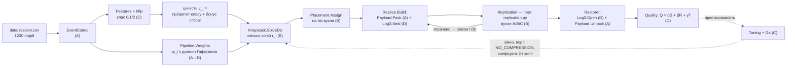
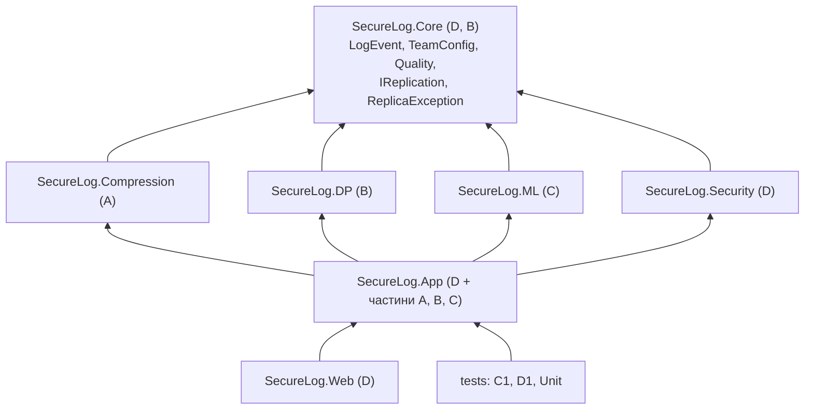

# Як влаштована система і хто за що відповідає

Тут загальна карта: як частини SecureLog пов'язані між собою і що кожна передає іншим. Детальний розбір коду кожної зони — в окремих посібниках:

| Учасник | Зона | Посібник |
|---|---|---|
| A — `sergeymal1` | Compression & Format: записи, канонічний Гаффман, навантаження, файли реплік, звірка з еталонами | [A-sergeymal1-compression.md](A-sergeymal1-compression.md) |
| B — `Danbrave5662` | DP & Replication: рюкзак ДП, порядок реплікації, модель вузлів (порт `replication.py`), ремонт втрачених batch | [B-Danbrave5662-dp-replication.md](B-Danbrave5662-dp-replication.md) |
| C — `uozawo` | ML & GA: ознаки, перцептрон, генетичний алгоритм, налаштування параметрів | [C-uozawo-ml-ga.md](C-uozawo-ml-ga.md) |
| D — `nykytenkovictoria` | Security + Integration: криптографія LOG3, ядро, конвеєр, відновлювач, CLI, звіт, атака, вебконсоль | [D-nykytenkovictoria-security-integration.md](D-nykytenkovictoria-security-integration.md) |

Почни з цього файлу, потім читай посібник своєї зони. Розділи «Де твоя зона в системі» в кожному посібнику показують ті самі зв'язки з боку цієї зони.

## 1. Система в одній картинці

Агент журналу класифікує події, стискає їх і пакує в захищені репліки. Планувальник вирішує, скільки копій кожної події зберегти і на які вузли. Відновлювач збирає журнал з того, що вціліло на вузлах. Наприкінці рахується метрика Q.



## 2. Залежності проєктів

Кожна зона — окремий проєкт рішення. Зони A, B, C і криптографія D знають лише спільне ядро `SecureLog.Core` і одна про одну не знають. Зводить їх разом тільки `SecureLog.App`.



Тому, наприклад, `Knapsack` не знає, що таке Гаффман: він отримує лише масиви ваг і корисностей. А `Huffman` не знає, що його довжини кодів стануть вагами рюкзака. Зв'язує їх `Pipeline` у зоні D.

## 3. Контракти між зонами

Саме ці типи й методи треба вміти пояснити разом із сусідом по зоні: через них дані переходять з однієї частини в іншу.

| Що | Визначено | Хто викликає | Що передається |
|---|---|---|---|
| `LogEvent` (8 полів запису) | Core (D) | усі | одна подія журналу; ідентичність — точні 16 байтів |
| `EventCodec.Encode` / `Decode` / `ReadCsv` | Compression (A) | Pipeline, Replica, ReplicaFile, Attack, тести | події ↔ 16-байтові записи big-endian; `Decode` перевіряє діапазони полів |
| `Huffman.CodeLengths` | Compression (A) | `Pipeline.Weights` (D) | довжини кодів вікна → вага запису `w_i` у бітах для ДП (B) |
| `Payload.Pack` / `Unpack` | Compression (A) | `Replica.Build`/`Open` (D), `ReplicaFile`, `Reference` | записи ↔ відкрите навантаження: таблиця довжин, бітовий потік або NO_COMPRESSION |
| `Log3.Seal` / `Open`, `Crypto`, `KeyRing` | Security (D) | Replica, ReplicaFile, Reference | навантаження ↔ репліка: заголовок 43 Б, AES-256-CTR, HMAC-SHA256 |
| `Features.Extract`, `Mlp.Predict` | ML (C) | `Pipeline.Classify` (D) | ознаки події за 800 мс історії → клас 0/1/2 |
| `Knapsack.SolveDp` / `SolveGreedy` | DP (B) | `Pipeline.Send` (D), звіт, тест C06 | ваги, корисності, бюджет → кількість копій `r_i` кожної події вікна |
| `Placement.Assign` | DP (B) | `Pipeline.Send` | копії → списки подій для batch кожного вузла |
| `IReplication` (`Write`, `Read`, `UsedBytes`, …) | Core (B) | `Pipeline`, вебконсоль | контракт між планувальником і моделлю вузлів; реалізація — `Replication` (B) |
| `Params(Window, MinGain, SecondCopyFactor)` | Core (D) | `Tuning` (C) створює, `Pipeline` використовує | три параметри, які налаштовує ГА |
| `Ga.Run` / `RandomSearch` | ML (C) | `Tuning` (C), `Attack` (D) | загальний ГА з операторами, що передаються ззовні |
| `Quality.Compute` | Core (D) | `Pipeline.Run` | S, R, T, Q одного прогону; пристосованість для ГА |
| `ReplicaException` + `ErrorCode` | Core (B, D) | усі, хто читає репліки | відмова прийняти репліку з кодом `E_SHORT` … `E_CODE` |

## 4. Один повний прогін `run` крок за кроком

Команда `dotnet run -c Release --project src/SecureLog.App -- run normal` проходить через усі чотири зони:

1. **D, [Program.cs](../../src/SecureLog.App/Program.cs)** читає конфіг (`Workspace.Config` → `TeamConfig.Load`), сесію (`Workspace.Session` → `EventCodec.ReadCsv`, A), параметри ГА (`Workspace.BestParams` → `data/ga_params.json`, C) і модель (`data/model.json`, C). Створює `Pipeline` і викликає `RunSim` з відкритим seed `427243`.
2. **B, [Replication.cs](../../src/SecureLog.DP/Replication.cs)**: `RunSim` створює модель вузлів для сценарію з глобальним бюджетом, місткістю й імовірністю відмов кожного вузла з `team_config.json`.
3. **C через D, [Pipeline.cs](../../src/SecureLog.App/Pipeline.cs) `Classify`**: `Features.Extract` рахує 9 ознак кожної події, `Mlp.Predict` дає клас.
4. Далі вікно за вікном (розмір вікна — параметр ГА, зараз 253 записи):
   - **A через D, `Weights`**: одна таблиця Гаффмана на вікно, `w_i` = сума довжин кодів 16 байтів запису;
   - **D**: `v_i = priority(клас) + critical_bonus·[critical]`, корисність `u_i(r)` з кумулятивними коефіцієнтами 1 / 1.55 (або налаштований) / 1.85; бюджет вікна — `5000 · n / 48` бітів, але не більше частки глобального бюджету;
   - **B, `Knapsack.SolveDp`**: скільки копій (0–3) отримує кожна подія;
   - **B, `Placement.Assign`**: на які вузли (копії однієї події — лише на різних вузлах, спершу найнадійніший);
   - **A + D, `Replica.Build`**: `Payload.Pack` стискає batch, `Log3.Seal` шифрує й підписує; один batch на вузол за вікно, не більше 1024 байтів (хвіст обрізається по 10 %);
   - **B, `IReplication.Write`**: модель вирішує, збережено копію, відхилено через бюджет чи втрачено у стані BAD;
   - **B, ремонт**: події з втраченого batch, що ще не мають збереженої копії, переходять у batch наступного вузла того самого вікна.
5. **D, [Replica.cs](../../src/SecureLog.App/Replica.cs) `Restorer`**: для кожної вцілілої копії — `Log3.Open` (перевірка HMAC до розшифрування), `Payload.Unpack` і `EventCodec.Decode` (A); дублікати з різних вузлів зливаються за точними 16 байтами.
6. **D, [Quality.cs](../../src/SecureLog.Core/Quality.cs)**: S = сирий журнал / (сирий + `8 · global_used_bytes`), R = частка відновлених критичних подій, T = 30 / (30 + час), Q = 0.35·S + 0.5·R + 0.15·T.

## 5. Інші шляхи через систему

**Файли реплік (`pack` / `unpack`).** `Program` (D) → `ReplicaFile.ReadRecords` (A, перевіряє записи через `EventCodec.Decode`) → `ReplicaFile.Pack` (A) → `Payload.Pack` (A) + `Log3.Seal` (D). Назад: `ReplicaFile.Unpack` (A) → `Log3.Open` (D) → `Payload.Unpack` + `EventCodec.Decode` (A). Помилку з кодом `E_*` друкує `Program` (D), код виходу 1.

**Звірка з еталонами (`check`).** `Program` (D) → `Reference.Check` (A): кожен `ref_*.bin` відкривається (`Log3.Open`, D), розбирається (`Payload.Unpack`, A) і порівнюється з `.json`; потім наш `Payload.Pack` і `Log3.Seal` з тими самими сіллю й nonce мають зібрати той самий пакет байт у байт. `bad_*.bin` мають дати код з `expected_failures.json`.

**Налаштування (`ga`).** `Tuning.Run` (C) → `Ga.Run` (C) з пристосованістю `Tuning.Fitness` (C), яка запускає повний `Pipeline.RunSim` (усі зони) на 3 сценаріях × 8 seeds і віднімає 1 за кожен прогін, де втрачено більше критичних подій, ніж дозволяє поріг сценарію.

**Атака (`attack`).** `Attack.Demo` (D) шифрує журнал слабким XOR-шифром (`WeakCipher`, D) і відновлює ключ через `Ga.Run` (C) за частотами байтів `train.csv`.

**Навчання (`train`).** `Program.Train` (C): `Features.Extract` → `Mlp.TrainBest` (3 ініціалізації, вибір за macro-F1 на `valid.csv`) → `data/model.json` і `docs/results/confusion.md`.

## 6. Спільні файли: чия яка частина

Кілька файлів у `SecureLog.App` і в тестах містять роботу різних зон. Відповідає за файл його власник, але свою частину кожен має вміти пояснити сам.

| Файл | Власник | Частини інших зон |
|---|---|---|
| [Pipeline.cs](../../src/SecureLog.App/Pipeline.cs) | D | B — облік за `UsedBytes`, ремонт втрачених batch і `RunOptions.Repair`; A — довжини Гаффмана в `Weights`; C — `Classify` використовує модель |
| [Program.cs](../../src/SecureLog.App/Program.cs) | D | C — `Train()`; A — команди `check`, `pack`, `unpack` викликають `Reference` і `ReplicaFile` |
| [Tuning.cs](../../src/SecureLog.App/Tuning.cs) | C | обгортку ГА створено в зоні D; пороги втрат як жорсткі умови — частина C |
| [Report.cs](../../src/SecureLog.App/Report.cs) | D | B — таблиця 2 (копії з ремонтом і без), рядок «без ремонту» в таблиці 3 |
| [Reference.cs](../../src/SecureLog.App/Reference.cs), [ReplicaFile.cs](../../src/SecureLog.App/ReplicaFile.cs) | A | використовують `Log3` і `KeyRing` з зони D |
| [Attack.cs](../../src/SecureLog.App/Attack.cs) | D | C — генетичний алгоритм `Ga.Run` |
| [IReplication.cs](../../src/SecureLog.Core/IReplication.cs), [ReplicaException.cs](../../src/SecureLog.Core/ReplicaException.cs) | B | D — властивість `Detail` |
| [C1Tests.cs](../../tests/SecureLog.Tests.C1/C1Tests.cs) | D | A — кейси 1–5 і 12; B — 6–8; C — 9 |
| [UnitTests.cs](../../tests/SecureLog.Tests.Unit/UnitTests.cs) | спільний | A — `Huffman_*`, `Payload_*`; B — `Knapsack_*`, `Placement_*`, `PyRandom_*`, `Replication_*`; C — `Mlp_LearnsXor`; D — `AesCtr_*`, `Attack_*` |
| [RoundTripTests.cs](../../tests/SecureLog.Tests.Unit/RoundTripTests.cs) | A | C — виправлення тесту обрізання на межі реплік |
| [D1Tests.cs](../../tests/SecureLog.Tests.D1/D1Tests.cs) | B, C | C — D4 (ГА); B — D5 (вплив копій) |

## 7. Хто читає які поля `team_config.json`

Конфіг виданий викладачем і не змінюється; `TeamConfig.Load` (D) читає його за українськими ключами.

| Поле | Де використовується | Зона |
|---|---|---|
| `пароль_сеансу` | `Workspace.Password` → ключі PBKDF2 | D |
| `метрика_Q` (alpha, beta, gamma, t_ref) | `Quality.Compute` | D |
| `replication_window_records`, `replication_budget_bits` | бюджет вікна ДП у `Pipeline.Send` | B, D |
| `max_batch_bytes` | обрізання batch у `Pipeline.Send` | B, D |
| `second_copy_factor`, `third_copy_factor` | корисності `u_i(2)`, `u_i(3)`; межа гена ГА | B, C |
| `сценарії` (бюджет, вузли A/B/C) | `Replication` | B |
| `seed_моделі_реплікації` | типовий seed `run` і вебконсолі | B, D |
| `пріоритети_класів`, `critical_bonus` | цінність `v_i` у `Pipeline.Send` | B, C |
| `пороги_втрати_критичних_подій` | `Tuning.Fitness`, тест C08 | C, B |
| `класифікатор.F1_min` | тест C09 | C |
| `ліміт_часу_повного_прогону_секунд` | тест C12 | D |

Командні параметри, яких у конфігу немає (вікно ознак 800 мс, прихований шар 24, поріг NO_COMPRESSION), мають значення за замовчуванням у [TeamConfig.cs](../../src/SecureLog.Core/TeamConfig.cs).

## 8. Перевірка всього разом

```bash
dotnet build -c Release
dotnet test -c Release                                     # 46 тестів: C1, D1, Unit
dotnet run -c Release --project src/SecureLog.App -- check # 13 еталонних пакетів
dotnet run -c Release --project src/SecureLog.App -- run   # три сценарії: S, R, T, Q
```

Числа експериментів — у [docs/results/tables.md](../results/tables.md), рішення і їхні причини — у [docs/decisions.md](../decisions.md).
